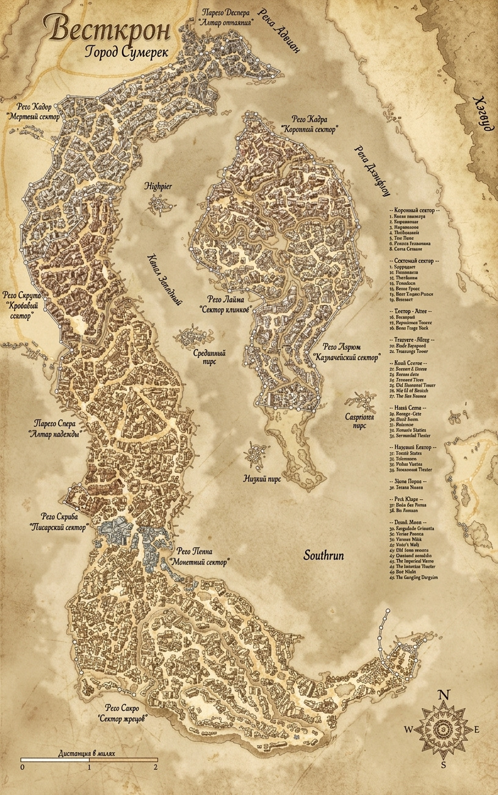

# Глава 1. Тени Весткроуна

::: figure [Карта Весткроуна;width:auto;height:90%]

:::

### Описание главы

Глава может играться как детективное приключение, рассчитанное на одну игровую сессию в рамках PF2e Legacy для группы из
четырёх героев 5-го уровня.

Для отслеживания опыта лучше использовать систему milestone leveling: партия получает уровень после прохождения главы и
нахождения зацепок, ведущих к таверне «Слёзы устрицы».

Глава рассчитана на 4–6 часов реального времени (one-shot или одна-две встречи).

Глава не предполагает, что игроки пройдут все ветки приключения.
Только какую-то одну две частично (если партия решит разъединиться).
Этого должно быть вполне достаточно, чтобы игроки оказались в таверне.

Игроки прибывают в Весткроун и берутся помочь с расследованием одного или нескольких дел: серийные убийства в городе
(жертвы — культисты, контрабандисты, обычные горожане); нелегальный оборот наркотиков; дезертирство.

Глава заканчивается тем, что игроки получают зацепку: все нити расследования (любого из вариантов) ведут в таверну
«Слёзы устрицы», расположенную за городом.

### Кратко для мастера

Приключение происходит в последнюю неделю Гозрана (апреля) 4711 AR.

::: pftab[Стандартная шкала отношений — attitude\_level]

| Название                        | Описание                                                                                                          |
|---------------------------------|-------------------------------------------------------------------------------------------------------------------|
| Враждебный (−2) (Hostile)       | Существо активно противостоит вам, хочет навредить, дерется или пытается саботировать ваши действия               |
| Недружелюбный (−1) (Unfriendly) | Существо избегает вас, испытывает подозрение, не желает помогать и может сообщить о вас властям или выгнать.      |
| Безразличный (0) (Indifferent)  | Существо нейтрально. Оно не помогает бесплатно, но и не вредит; ведет себя вежливо или отстраненно                |
| Дружелюбный (+1) (Friendly)     | Существо симпатизирует вам, охотно болтает, дает советы или оказывает мелкие услуги, не подвергая себя опасности. |
| Полезный (+2) (Helpful)         | Существо готово пойти на серьезный риск ради вас, защитить в бою или выполнить важную просьбу.                    |

Кроме стандартной уровня отношений персонажей (`attitude\_level`), в приключении используется шкала уровней доверия
(`candor\_level`).

Прежде всего она влияет на правдивость ответов персонажа при разговоре и допросах.

::: pftab[Уровни доверия — candor\_level]

| Название                         | Описание                                                                                                                  |
|----------------------------------|---------------------------------------------------------------------------------------------------------------------------|
| Не доверяет (no\_trust)          | Персонаж будет рассказывать только общую информацию, по возможности лгать или отказываться делиться сведениями.           |
| Осторожный (cautious)            | Персонаж будет рассказывать только общую информацию, либо скрытую информацию, но в общих чертах.                          |
| Доверяет (trust)                 | Персонаж будет рассказывать общую и малоизвестную информацию подробно, также готов делиться малыми тайнами.               |
| Полностью доверяет (full\_trust) | Полное раскрытие. Персонаж готов рассказывать всё подробно, делясь как общей и скрытой информацией, так и любыми тайнами. |

:::

В отличие от отношения персонажа (которое может меняться при проверках Дипломатии, Запугивания или других социальных
навыков), уровень доверия к персонажу меняется только при выполнении определённых действий.
Например: при успешном выполнении задания или его провале; при обнаружении определённых улик или зацепок и демонстрации
их персонажу; при узнавании некоторой информации и обозначении персонажу, что игроки её знают.
Т. е. уровень доверия активно меняется только по ходу развития приключения, а не на проверках.

#### Механика проверки слухов

Потратив 10 минут, партия может осмотреться и послушать, о чём говорят вокруг.

Кроме того, игроки могут потратить 10 минут на общение с дружелюбным (friendly) персонажем, чтобы узнать свежие слухи.

Кроме того, игроки могут потратить 1–10 зм, чтобы узнать слухи у любого персонажа, безразличного к ним (indifferent).
Это делает персонажа дружелюбным до конца дня.
Сумма зависит от социального статуса и должности персонажа и оставляется на усмотрение Мастера.

Для проверки слухов игрок кидает d6, d10, d12 или d20 (в зависимости от таблицы в текущем месте или у выбранного
персонажа), после чего узнаёт слух, соответствующий выбранному значению.

## Расписание персонажей (глава 1)

Карта присутствия ключевых NPC и партии по игровому времени (6:00–20:30).
Частично пересекается с главой 2, т.к. игроки могут прибыть в таверну с 18:30 до 20:30

| Время | Художник (d6=6)                                                                                                                  | Моряк (d6=2)                                                                         | Детектив (d6=5)                                                       | Доктор (d6=4)                                                               | Трактирщик (d6=1)                                       | Официантка (d6=3)                                      | Партия игроков                                                                                                                                       |
|-------|----------------------------------------------------------------------------------------------------------------------------------|--------------------------------------------------------------------------------------|-----------------------------------------------------------------------|-----------------------------------------------------------------------------|---------------------------------------------------------|--------------------------------------------------------|------------------------------------------------------------------------------------------------------------------------------------------------------|
| 04:00 | Спит                                                                                                                             | Спит                                                                                 | Спит                                                                  | Спит                                                                        | Просыпается в своей комнате в «Слёзах устрицы»          | Просыпается в своей комнате в «Слёзах устрицы»         | —                                                                                                                                                    |
| 05:00 | Просыпается на мансарде в «Слёзах устрицы», молится Шелин, умывается и собирается к поездке                                      | Просыпается в своей комнате в «Слёзах устрицы», умывается                            | —                                                                     | Просыпается в своей комнате в «Слёзах устрицы», умывается                   | Контролирует приготовление завтрака                     | Помогает с готовкой завтрака                           | —                                                                                                                                                    |
| 05:15 | Завтракает в «Слёзах устрицы» с остальными постояльцами                                                                          | Завтракает в «Слёзах устрицы» с остальными постояльцами                              | —                                                                     | Завтракает в «Слёзах устрицы» с остальными постояльцами                     | Завтракает в «Слёзах устрицы» с остальными постояльцами | Накрывает завтрак для постояльцев                      | —                                                                                                                                                    |
| 05:30 | Выезжает из «Слёз устрицы» в Весткроун по тракту                                                                                 | Готовит ялик с командой к отплытию                                                   | —                                                                     | Завтракает в «Слёзах устрицы» с остальными постояльцами                     | Общается с поварами на кухне                            | Завтракает в «Слёзах устрицы» на кухне                 | —                                                                                                                                                    |
| 06:00 | Пересекает Адивианский мост (Adivian bridge)                                                                                     | Отбывает из «Слёз устрицы» в Весткроун на ялике                                      | —                                                                     | Помогает подготовиться к утренней молитве Дагону                            | Общается с рабочими во дворе                            | Готовится к утренней молитве Дагону                    | —                                                                                                                                                    |
| 06:30 | Прибытие в Весткроун, проходит мост Клинкокрыла (Bladewing Bridge)                                                               | Посередине реки в ялике (плывет в Весткроун)                                         | —                                                                     | Участвует в ритуале поглонения Дагону в Логове культа                       | Общается с рабочими во дворе                            | Проводит ритуал поглонения Дагону в Логове культа      | —                                                                                                                                                    |
| 07:00 | Поиск культиста по городу                                                                                                        | Прибывает в Порт Parego Spera                                                        | Просыпается в своем доме в Весткроуне                                 | Отбывает из «Слёз устрицы» в Весткроун на пароме                            | Общается с рабочими во дворе                            | —                                                      | —                                                                                                                                                    |
| 07:30 | Допрос культиста                                                                                                                 | Встреча с представителями Совета воров                                               | —                                                                     | Посередине реки в лодке (плывет в Весткроун)                                | Общается с рабочими во дворе                            | —                                                      | —                                                                                                                                                    |
| 08:00 | Убийство культиста                                                                                                               | Убийство представителей Совета воров                                                 | Приходит в казармы обычных доттари                                    | Прибытие в Весткроун (в порт Parego Spera)                                  | —                                                       | —                                                      | —                                                                                                                                                    |
| 08:30 | Возвращается к мосту Кликокрыла по город                                                                                         | Прибывает в Порт Rego Aerum                                                          | —                                                                     | Прибывает в Морг                                                            | —                                                       | —                                                      | —                                                                                                                                                    |
| 09:00 | У моста Клинкокрыла (Bladewing Bridge) — зарисовывает входящих                                                                   | Порт Rego Aerum - Встрачает Баржу из Эгориана с грузом контрабанды                   | Общается с Дуротасом Сарией Рокцин в Казармах Common Dottari          | В морге.                                                                    | —                                                       | —                                                      | —                                                                                                                                                    |
| 09:30 | У моста Клинкокрыла (Bladewing Bridge) — зарисовывает входящих                                                                   | Порт Rego Aerum - Контроль разгрузки товара                                          | Идет к месту первого убийства (§C1 ИЛИ §D1 ИЛИ §E1)                   | В морге.                                                                    | —                                                       | —                                                      | —                                                                                                                                                    |
| 10:00 | У моста Клинкокрыла (Bladewing Bridge) — зарисовывает входящих                                                                   | Порт Rego Aerum - Контроль разгрузки товара                                          | Осматривает места убийств (§C1 ИЛИ §D1 ИЛИ §E1)                       | В морге.                                                                    | —                                                       | —                                                      | —                                                                                                                                                    |
| 10:30 | У моста Клинкокрыла (Bladewing Bridge) — зарисовывает входящих                                                                   | Порт Rego Aerum - Контроль погрузки товара на один из трёх яликов                    | Осматривает места убийств (§C1 ИЛИ §D1 ИЛИ §E1)                       | В морге. Принимает тело с места первого убийства                            | —                                                       | —                                                      | —                                                                                                                                                    |
| 11:00 | У моста Клинкокрыла (Bladewing Bridge) — зарисовывает входящих                                                                   | Порт Rego Aerum - Контроль погрузки товара на один из трёх яликов                    | Осматривает места убийств (§C1 ИЛИ §D1 ИЛИ §E1)                       | В морге. Осматривает тело.                                                  | —                                                       | —                                                      | —                                                                                                                                                    |
| 11:30 | У моста Клинкокрыла (Bladewing Bridge) — зарисовывает входящих                                                                   | Порт Rego Aerum - Контроль погрузки товара на один из трёх яликов                    | Идет к месту второго убийства                                         | В морге. Осматривает тело.                                                  | —                                                       | —                                                      | —                                                                                                                                                    |
| 12:00 | У моста Клинкокрыла (Bladewing Bridge) — зарисовывает входящих                                                                   | Переход на ялике к таверне «Слёзы устрицы»                                           | Осматривает места убийств (§D1 ИЛИ §E1 ИЛИ §C1)                       | В морге. Занимается оформлением отчета о вскрытии.                          | Спит в своей комнате (дневной сон)                      | —                                                      | Глава 1 — §A — Прибытие в Весткроун (event_022 — прибытие в город; event_022a — ветровой нагон и «Чёрная Сирена»)                                    |
| 12:30 | У моста Клинкокрыла (Bladewing Bridge) — Встречается с игроками                                                                  | Посередине реки в ялике (плывет в «Слёзы устрицы»)                                   | Осматривает места убийств (§D1 ИЛИ §E1 ИЛИ §C1)                       | В морге. Принимает тело с места второго убийства                            | Спит в своей комнате (дневной сон)                      | —                                                      | Глава 1 — §B1 — Очередь на мосту (event_022b — мост Клинкокрыла, таможня, встреча с Художником)                                                      |
| 12:45 | Идёт через Parego Spera к причалам паромщиков, что—бы переплыть в Parego Regicona и дойти в Тривардум (отдать картину заказчику) | Посередине реки в ялике (плывет в «Слёзы устрицы»)                                   | Осматривает места убийств (§D1 ИЛИ §E1 ИЛИ §C1)                       | В морге. Осматривает тело.                                                  | Спит в своей комнате (дневной сон)                      | —                                                      | Глава 1 — §B2 — Художник ИЛИ §B3 — Таможня                                                                                                           |
| 13:00 | Идёт через Parego Spera к причалам паромщиков, что—бы переплыть в Parego Regicona и дойти в Тривардум (отдать картину заказчику) | Прибывает в таверну «Слёзы устрицы» (причал таверны «Слёзы устрицы»)                 | Идет к месту третьего убийства                                        | В морге. Осматривает тело.                                                  | Спит в своей комнате (дневной сон)                      | —                                                      | Глава 1 — §B3 — Таможня ИЛИ §B2 — Художник                                                                                                           |
| 13:30 | Parego Regicona — Rego Laina — Trivardum - отдает законченную картину заказчику                                                  | Разгрузка и размещение товара на складе контрабандистов в таверне «Слёзы устрицы»    | Осматривает места убийств (§E1 ИЛИ §C1 ИЛИ §D1)                       | В морге. Занимается оформлением отчета о вскрытии.                          | Спит в своей комнате (дневной сон)                      | —                                                      | Глава 1 — §B4 — Rego Scripa, развилка (event_022c — улицы, случайные места убийств (d6), развилка)                                                   |
| 14:00 | Тривардум (Trivardum) - обсуждает портрет с заказчиком                                                                           | Обсуждение поставки с Трактирщиком в его кабинете                                    | Осматривает места убийств (§E1 ИЛИ §C1 ИЛИ §D1)                       | В морге. Принимает тело с места третьего убийства                           | Спит в своей комнате (дневной сон)                      | —                                                      | Глава 1 — §C1 — Убийство культиста ИЛИ ИЛИ §D1 — Убийство вора ИЛИ §E1 — Ритуал культа                                                               |
| 14:30 | Тривардум (Trivardum) - обсуждает портрет с заказчиком                                                                           | Узнаёт о «Черной сирене», Обсуждает с Трактирщиком, что ему нужно пока залечь на дно | Осматривает места убийств (§E1 ИЛИ §C1 ИЛИ §D1)                       | В морге. Осматривает тело.                                                  | Общается с поварами на кухне                            | Подслушивает планы Моряка. Отправляет записку Доктору. | Глава 1 — §C1 — Убийство культиста ИЛИ ИЛИ §D1 — Убийство вора ИЛИ §E1 — Ритуал культа                                                               |
| 15:00 | Тривардум (Trivardum) - закупается художественными товарами                                                                      | Контроль работы грузчиков (Причал таверны «Слёзы устрицы»)                           | Общается с игроками (§C2 — Детектив)                                  | В морге. Осматривает тело.                                                  | Контролирует приготовление обеда                        | Помогает с готовкой обеда.                             | Глава 1 — §C2 — Детектив ИЛИ §D2 — «Чёрная Сирена» ИЛИ §E2 — Налёт воров Совета                                                                      |
| 15:30 | Тривардум (Trivardum) - закупается художественными товарами                                                                      | Контроль работы грузчиков (Склад контрабандистов)                                    | Идёт в Морг                                                           | Получает записку. Отправляется в таверну «Слёзы устрицы»  на пароме.        | Контролирует приготовление обеда                        | Накрывает обед для постояльцев.                        | Глава 1 — §C2 — Детектив ИЛИ §D2 — «Чёрная Сирена» ИЛИ §E2 — Налёт воров Совета                                                                      |
| 16:00 | Обед в «Трикалиста» (Tricalista) — Тривардум (Trivardum)                                                                         | Обедает вместе с остальными постояльцами (главный зал таверны)                       | В морге. Ищет Доктора и отчёты о вскрытии тел                         | Посередине реки в лодке (плывет в «Слёзы устрицы»)                          | Обедает в своем рабочем кабинете                        | Обедает на кухне.                                      | Глава 1 — §C3 — Приёмная Дуротаса (event_023 — встреча с Дуротасом Сарией Рокцин; получение задания) ИЛИ §D3 — Капитан Маретти ИЛИ §E3 — Совет Воров |
| 16:30 | Обед в «Трикалиста» (Tricalista) — Тривардум (Trivardum)                                                                         | Разгрузка заканчивается. Организация переупаковки товара. (Склад контрабандистов)    | Обедает у себя дома                                                   | Прибытие в «Слёзы устрицы»                                                  | —                                                       | —                                                      | Глава 1 — §C4 — Морг (event_024 — отчёты о вскрытии; дорога к таверне) ИЛИ §D4 — Таверна «Трикалиста» ИЛИ §E4 — Опрос торговцев                      |
| 17:00 | Приплывает на пароме в Parego Spera и идёт по улицам в сторону Моста Клинкокрыла (Bladewing Bridge)                              | Следит за переупаковкой товара. (Склад контрабандистов)                              | Отправляется в таверну «Слёзы устрицы» по суше                        | Обсуждают с Официанткой желание Моряка залечь на дно.                       | —                                                       | Обсуждают с Доктором желание Моряка залечь на дно.     | Альтернативное Глава 1 — §F2 — Паром                                                                                                                 |
| 17:30 | Уезжает по тракту (road) в «Слёзы устрицы»                                                                                       | Следит за переупаковкой товара. (Склад контрабандистов)                              | Пересекает Адивианский мост (Adivian bridge)                          | Занимается оформлением отчетов о вскрытии. В своей комнате.                 | —                                                       | —                                                      | Отправляются в «Слёзы устрицы» по тракту ИЛИ §F1 — Место убийства контрабандиста (event_025 — уезжают из города; отказ на воде)                      |
| 18:00 | Пересекает Адивианский мост (Adivian bridge)                                                                                     | Сидит в центральном зале таверны, обсуждает вопросы с поставщиками                   | Прибытие в таверну «Слёзы устрицы»                                    | Занимается оформлением отчетов о вскрытии. В своей комнате.                 | —                                                       | —                                                      | Глава 2 — §A1 - Адивианский мост (Adivian bridge) ИЛИ Глава 1 — §F2 — Паром                                                                          |
| 18:30 | Прибытие в «Слёзы устрицы»                                                                                                       | Сидит в центральном зале таверны, обсуждает вопросы с Трактирщиком                   | Общается с Доктором. (просит отчёты о вскрытии)                       | Общается с Детективом. (рассказывает, что отчёты о вскрытии пока не готовы) | Контролирует приготовление ужина                        | Помогает с приготовлением ужина                        | Глава 2 — §B1 — Прибытие в «Слёзы устрицы»                                                                                                           |
| 18:45 | Поднимается в мансарду переодеться после дороги и убрать зарисовки                                                               | Сидит в центральном зале таверны                                                     | В зале таверны у камина; приветствует партию (event_026)              | Занимается оформлением отчетов о вскрытии. В своей комнате.                 | Контролирует приготовление ужина                        | Помогает с приготовлением ужина                        | Глава 2 — §C1 — Вступление в зал; знакомство с NPC; приветствие Детектива у камина (event_026)                                                       |
| 19:00 | Спускается с мансарды                                                                                                            | Сидит в центральном зале таверны                                                     | Предлагает остаться из-за ливня                                       | Спускается в зале таверны                                                   | Контролирует приготовление ужина                        | Флиртует с Художником (event_027)                      | Альтернативное Глава 1 — §F3 — Ночь в городе (Стая из Нижних Теней, 19:00 и позже)                                                                   |
| 19:15 | Общается с Официанткой                                                                                                           | Сидит в центральном зале таверны                                                     | Арендует комнату, чтобы переждать ливень (event_029)                  | Слушает флирт Официантки с Художником (event_027)                           | —                                                       | Флиртует с Художником (event_027)                      | Альтернативное Глава 1 — §F3 — Ночь в городе (Стая из Нижних Теней, 19:00 и позже)                                                                   |
| 19:30 | Ужинает вместе с остальными постояльцами в «Слёзах устрицы»                                                                      | Ужинает вместе с остальными постояльцами в «Слёзах устрицы»                          | Ужинает вместе с остальными постояльцами в «Слёзах устрицы»           | Конфликт с Трактирщиком                                                     | Конфликт с Доктором                                     | Накрывает ужин для постояльцев                         | Альтернативное отправление в «Слёзы устрицы» ИЛИ Ужинают вместе с остальными постояльцами в «Слёзах устрицы»                                         |
| 19:45 | Ужинает вместе с остальными постояльцами в «Слёзах устрицы»                                                                      | Ужинает вместе с остальными постояльцами в «Слёзах устрицы»                          | Ужинает вместе с остальными постояльцами в «Слёзах устрицы»           | Поднимается в свою комнату                                                  | Предлагает гостям заночевать из-за ливня (event_029)    | —                                                      | Альтернативное отправление в «Слёзы устрицы» ИЛИ Ужинают вместе с остальными постояльцами в «Слёзах устрицы»                                         |
| 20:00 | Заканчивает с ужином, уходит в мансарду                                                                                          | Поднимается в свою комнату                                                           | Непринужденно общается с другими постояльцами в таверне               | Официантка приносит ужин. Ужинают вместе в комнате Доктора.                 | Ужинает в своем рабочем кабинете                        | Приносит ужин в комнату Доктора. Ужинают вместе.       | Альтернативное Глава 2 — §A1 — Адивианский мост (Adivian bridge)                                                                                     |
| 20:30 | Покупает Лист-живодёр у Трактирщика                                                                                              | Ведет бухгалтерию, занимается делами                                                 | Альтернативное приветствие партии игроков или общается с постояльцами | Ужинают вместе с Официанткой в комнате Доктора.                             | Занимается делами таверны                               | Ужинает вместе с Доктором в комнате Доктора.           | Альтернативное Глава 2 — §B1 — Прибытие в «Слёзы устрицы»                                                                                            |

## А. Начало приключения

::: scene-meta
time: 12:00–12:30
weather: Мутная дымка; ветер с залива Жемчужной короны.
location: Галикарнасские холмы, подступы к Весткроуну; вид на город, статую Ародена, порт, залив Жемчужной короны.
purpose: Прибытие в Весткроун; проверка погоды/реки/залива; первые зацепки.
:::

::: checklist
can:

- Зацепка «Потоп» (погода/река)
- Зацепка «Чёрная сирена» (корабль в заливе)

:::

#### При подходе к городу зачитать:

> Вы стоите на гребне Галикарнасских холмов, и перед вами в утренней дымке
> расстилается Весткроун. С высоты город похож на огромного раненого зверя,
> приникшего к дельте реки Адивиан. Когда-то его называли Городом Девяти Звёзд —
> теперь это Город Сумерек. Ветер, словно стеной давящий на грудь, несёт с залива
> Жемчужной короны запахи соли и гниющего дерева.
>
> Самый заметный ориентир — гигантская статуя Ародена. Беломраморный колосс
> высотой в девяносто футов поднимается над крышами южного берега. Даже отсюда
> видно серебряную инкрустацию на его груди — символ крылатого ока. Статуя не
> тронута временем: ни пятна, ни трещины. Она стоит, как и сотни лет назад, лицом
> к реке, словно всё ещё ждёт возвращения мёртвого бога.
>
> Левее, в самом сердце города, остров Парего Регикона — «Плавучий Дворец». Его
> окружает стена с цепными арками, а за ней теснятся дворцы старой знати. Шпили и
> купола ещё хранят остатки былого величия, но краска облупилась, а сады заросли.
> Флюгеры, некогда радостно крутящиеся на крышах, кажется, намертво застыли,
> показывая на север. Некогда здесь заседал Имперский Двор. Теперь это остров
> призраков в человеческом обличье.
>
> Прямо под вами, вдоль южного берега, кипит порт. Сотни мачт, склады, причалы.
> Стаи птиц, беззвучно кружащих над утренним хаосом. Утро — время торговли, и
> Весткроун на несколько часов становится похож на живого. Отсюда уходят корабли
> вниз по реке, к Внутреннему морю. Но чем дальше на север, тем тише становится
> город. Там, за каналами, лежит Парего Доспера — «Алтарь Отчаяния». Руины,
> обгоревшие каркасы домов, пустые глазницы окон. Там не ходят днём. А ночью там
> не ходят вообще.
>
> И вот, когда вы уже готовы тронуться в путь, взгляд цепляется за движение на
> воде. Из залива Жемчужной короны в устье мутного Адивиана входит корабль. Он
> идёт медленно, уверенно, словно не замечая тёмных туч на горизонте. Чёрные
> паруса, как вымпелы ночи, надуты тёплым и упругим ветром с залива. А на каждом
> из них — белая сирена, раскинувшая руки, словно приглашающая в объятия. Корабль
> скользит мимо доков, не сворачивая к торговым причалам, мимо статуи Ародена и
> уходит к внутренним причалам острова. Никто на берегу не машет ему. Никто не
> выходит встречать. Весткроун смотрит на него молча. Добро пожаловать в Город
> Сумерек.

#### GM knows

::: check
Обратить внимание на погоду

[Природа; 15]
critical_success: Погода показывает, что идёт ветровой нагон волны. Через несколько дней в городе произойдёт наводнение.
success: Судя по погоде, скоро возможно наводнение.
failure: Вы не замечаете ничего необычного в погоде.
critical_failure: Отличная погода для Весткроуна.
:::

::: check
Осмотреть реку

[Знание Весткроун; 15]
critical_success: Вы вспоминаете, что Адивиан в это время года регулярно выходит из берегов из-за таяния снегов в горах
Менадор.
success: Вы вспоминаете, что Адивиан регулярно выходит из берегов в это время года.
failure: Вы не замечаете ничего необычного в реке.
:::

::: check
Осмотреть залив Жемчужной короны
[Внимательность, 10]
success: В залив входит корабль с чёрными парусами и белой сиреной, уходит к внутренним причалам; его никто не
встречает.
:::

#### Итоги сцены A

Если игроки успешно прошли проверки, то:

| Проверка | Зацепка       | опыт  |
|----------|---------------|-------|
| Погода   | Потоп         | 10 XP |
| Река     | Потоп         | 10 XP |
| Залив    | Чёрная сирена | 10 XP |