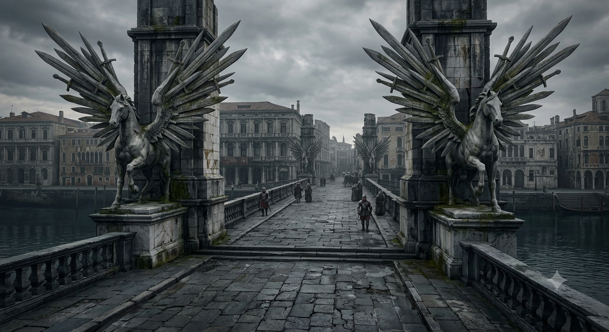

## B. Мост Клинкокрыла (Bladewing Bridge)

::: block
::: figure [Мост Клинкокрыла]

:::
:::

::: scene-meta
time: ~12:30
weather: Пасмурно. Тёплый ветер с залива Жемчужной короны; облака тяжелеют.
location: Мост Клинкокрыла (Bladewing Bridge), канал Канароден.
purpose: Въезд в Весткроун; слухи; знакомство с Художником; проверка канала/опор.
:::

::: checklist
can:

- Зацепка «Потоп» (канал/река)
- Зацепка «Культ Дагона» (опоры/крит. успех)
- Зацепка «Художник»
- Слухи (d10)
- Зацепка «Таверна „Слёзы устрицы“
- Зацепка «Комендантский час
- Зацепка «Чёрная сирена
- Зацепка «Маньяк в городе
- Зацепка «Фальконе — взяточник
  cannot:
- Имя убийцы
- Точная связь с таверной „Слёзы устрицы“
- Полный план расследования
- Личность Художника (аасимар/паладин)
  :::

Мост Клинкокрыла — каменный мост Пегасов, перекинутый через глубокий канал Канароден, самый длинный и наименее
изменённый канал Весткроуна, вдвое глубже каналов внутреннего города.

На мосту — укреплённый пропускной пост и стража.

За мостом — Rego Scripa, часть Parego Spera.

Это главный вход в Весткроун с запада по тракту.

##### Парего Спера

Парего Спера — это всё ещё процветающий район города, где торговля важнее политики. В Спере находится самый длинный
канал в городе, а также два больших моста Пегасов, которые восходят ко временам Ародена.

Спера состоит из трёх подсекторов: Скрипа, Пена и Сачеро.

Канал, или Канароден, — популярное место среди туристов благодаря своей уникальной особенности: вдоль северной стены
высечены изображения двенадцати обликов, в которых Ароден когда-то ходил по Голариону: нищий, вор, рыбак, охотник,
пастух, земледелец, солдат, купец, портной, ремесленник, художник и учёный. Хотя за последние сто лет изображения
Ародена были сильно повреждены, последствия таинственным образом исчезли.

#### Зачитать при подходе к мосту

> Вы подходите к западному въезду в Весткроун.
>
> Перед вами — Мост Клинкокрыла: длинная каменная лента, перекинутая через Канароден.
> Под мостом — тёмная, глубокая вода. Опоры, перила и парапеты украшены крылатыми конями, а вдоль стен канала
> расположены 12 огромных фризов высотой в пятнадцать футов — фигуры, стёртые временем, но всё ещё смотрящие на
> проходящих.

#### Проверки

::: check
Осмотреть канал
[Внимательность, 12]
success: Вода в Канародене мутнее, чем должна быть; вдоль опор — полоса белой пены. Уровень воды выше старых меток на
ладонь.
critical_success: Под водой, у самой поверхности, проходит длинная тёмная тень. Слишком большая для рыбы. Слишком
темная для лодки. Она движется против течения — вверх по каналу, к городу.

[Природа, 15]
success: Рыба ушла из канала. Ни чаек над водой, ни мальков у берега. Вода пустая — как будто что-то её выгнало.

[Знание (Весткроун), 15]
success: вдоль северной стены высечены изображения двенадцати обликов, в которых Ароден когда-то ходил по Голариону:
нищий, вор, рыбак, охотник, пастух, земледелец, солдат, купец, портной, ремесленник, художник и учёный.

:::

::: check
Осмотреть опоры моста
[Внимательность, 15]
success: На дальней опоре, чуть ниже уровня воды, свежие царапины. Глубокие, длинные. Как будто что-то крупное
выбиралось на камень.

:::

#### Итоги

Если игроки успешно прошли проверки, то:

| Проверка     | Зацепка      | опыт  |
|--------------|--------------|-------|
| Канал        | Потоп        | 10 XP |
| Канал — Крит | Культ дагона | 10 XP |
| Река         | Потоп        | 10 XP |
| Опоры        | Культ дагона | 10 XP |

### B1. Очередь на мосту

#### Зачитать при выходе на мост

> На набережной, перед входом на мост кипит обычная дневная толчея. Кто-то смеётся, кто-то спорит, ребёнок плачет,
> лошадь фыркает, колёса скрипят по брусчатке.
> На парапете удобно устроился высокий мужчина, поджав одну ногу; он увлечённо разглядывает толпу. Серебряный
> штифт в его руках ловко скользит по бумаге небольшого альбома.
> Солдат в красной накидке запрыгнул в повозку, подъехавшую к стойке в центре моста. Откинул полог, постучал по ящикам,
> скрывавшимся под ним, крикнул лейтенанту: "Порядок!" — и спрыгнул обратно.
> Лейтенант в чёрном табарде, сидя за столом у стойки, заскрипел пером, отмечая что-то в толстом журнале перед собой.
> По ту сторону моста у кареты отвалилось колесо, и пара солдат в красных накидках помогают поставить его на место.
> «Сколько?!» — крик разрезает убаюкивающий шум толпы. «Да мне дешевле на пароме приплыть!»
> Торговец, чью повозку только что осматривали, швыряет мешочек с золотом лейтенанту на стол. «Чтоб вы подавились,
> разбойники!»

::: check
Осмотреть заставу таможни
[Внимательность, 15]
success: На столе прибита табличка — старая, буквы полустёрты. На ней написано: «Пошлина за въезд в город: пеший — 1 зм;
на осле или муле — 3 зм; конный — 5 зм; телега — 10 зм; карета — 20 зм. Жителям города и пригорода — проезд бесплатный»

[Знание (Челия, Весткроун), 15]
success: Солдаты на посту — это доттари, местная городская стража. В красном табарде с чёрным Глазом Ародена на груди и
щитах — рядовые стражники, в чёрном табарде с красным Глазом Ародена на левом предплечье — лейтенант.
:::

::: check
Осмотреть Художника
[Внимательность, 15]
success: Вы внимательно осмотрели художника, сидящего на мосту. Текст описания — ниже. Результат — зацепка «Художник»
critical_success: Вы замечаете больше подробностей во внешности художника. Текст описания — ниже. Результат — зацепки
«Художник» и «Маньяк в городе»
:::

Если игроки замечают художника, это зацепка для перехода к §B2.
Можно зачитать следующий текст:

> На парапете набережной, перед мостом, сидит высокий, стройный мужчина лет тридцати пяти с почти аристократическими и
> необычайно острыми чертами лица — резкими скулами и высоко очерченным лбом.
> В его осанке и движениях — мягкая, бесшумная кошачья грация; держится он слишком прямо и дерзко легко для обычного
> горожанина.
> Тёмные волосы аккуратно зачёсаны назад.
> Он одет в простую, но качественную тёмную рубаху, кожаный жилет и тёмные штаны; на ногах — мягкие туфли.
> В руках он держит серебряный штифт, на коленях лежит небольшой альбом, заполненный набросками уже более чем
> наполовину.
> На длинных пальцах рук и манжетах рукавов — старые следы краски, которые так и не удалось отмыть.

При критическом успехе можно узнать больше деталей:

> Серые глаза с безумной искрой и обаятельная улыбка — но эта улыбка кажется натянутой фальшивкой, не доходит до глаз.
> Он внимательно изучает лица людей в толпе, проходящей через мост. И делает быстрые наброски каждого лица,
> профессионально подмечая малейшие детали и перенося их на бумагу.
> Стоит ему подумать, что на него никто не смотрит, как лицо мгновенно теряет эмоции и превращается в пустую маску.
> Во всей его фигуре проскальзывает что-то холодное и противоестественное.

##### Серебряный штифт

| Название  | Серебряный штифт                                                                                                               |
|-----------|--------------------------------------------------------------------------------------------------------------------------------|
| Тип       | Инструмент для рисования                                                                                                       |
| Материал  | Серебро                                                                                                                        |
| Описание  | Тонкая палочка из серебра для рисования по грунтованной бумаге. Редкий и дорогой инструмент — признак мастерства или достатка. |
| Стоимость | Дорого — по усмотрению Мастера                                                                                                 |

#### Слухи

Потратив 10 минут игроки могут услышать следующие слухи (кидаем d10 и результат смотрится по таблице):

::: rumors [d10, Слухи на мосту Клинкокрыла]
rumor: 1 | «По ночам по городу ходят тени. А утром — находят растерзанных ими жителей.» | пьяный матрос | Комендантский
час
rumor: 2 | «Утром в порт пришёл корабль с чёрными парусами и белой сиреной на них. Их никто не встречал.» | торговец |
Чёрная сирена
rumor: 3 | «В порту люди пропадают. Стража не ищет.» | женщина с корзиной | Маньяк в городе
rumor: 4 | «Художник на мосту. Странный. Смотрит как на натуру.» | мальчишка | Художник
rumor: 5 | «За городом таверна есть. Слёзы устрицы. Вино дешёвое, комнаты чистые.» | крестьянин | Таверна «Слёзы
устрицы»
rumor: 6 | «Река поднимется. Я чувствую. Вода уже не та.» | старик | Культ Дагона
rumor: 7 | «Лейтенант берёт в десять раз. Но если знать слово — пропустит.» | наёмник | Фальконе — взяточник
rumor: 8 | «В канале что-то живёт. Рыбаки обходят.» | портовый грузчик | Культ Дагона
rumor: 9 | «Сектанты в городе. Как раньше.» | старуха | Культ Дагона
rumor: 10 | «Трупы находят. Странные. Стража молчит.» | стражник в очереди | Маньяк в городе
:::

Если игроки задерживаются на мосту больше, чем на 10 минут, они привлекут внимание Художника.
Зачитать:
> Мужчина элегантно встает с парапета и движется к вам. Кажется, что он не идёт, а скользит по брусчатке набережной,
> словно перетекая из одного места в другое.
> "Доброго вам дня, путешественники. Разрешите представиться — Лучиано Аврелиан. Вольный художник. У вас такой
> уникальный типаж! Вы не возражаете, если я вас зарисую?"

После этого переход к сцене §B2 — Художник.

#### Итоги сцены B1:

Общие итоги и дальнейшие действия:

- Игроки могут получить зацепки для дальнейшего сюжета;
- Если игроки начали диалог с Художником (сами или по его инициативе) — можно перейти к §B2 Художник;
- Если игроки приняли решение пройти по мосту в город — можно перейти к §B3 Таможня
- Если игроки решат не переходить по мосту — они могут обойти город и найти лодку. Это займет 6 часов времени и будет
  стоить 5 зм за человека. На лодке — можно перейти к §D1 Порт

Логика распределения опыта по подсказкам — опыт не дается за те подсказки, которые применимы в текущей сцене.

| Зацепка                 | опыт  |
|-------------------------|-------|
| Комендантский час       | 10 XP |
| Чёрная сирена           | 10 XP |
| Маньяк в городе         | 10 XP |
| Художник                | 0 XP  |
| Таверна «Слёзы устрицы» | 10 XP |
| Культ Дагона            | 10 XP |
| Фальконе — взяточник    | 0 XP  |
