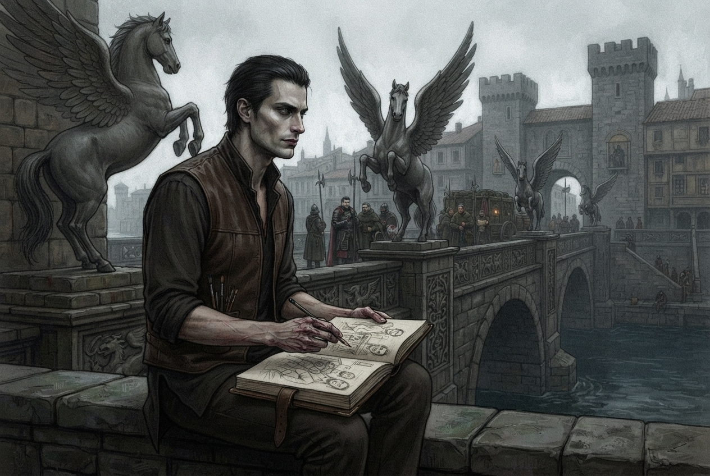

### B2. Художник

::: scene-meta
time: ~12:45
weather: Пасмурно.
location: Набережная перед Мостом Клинкокрыла, Парего Спе́ра.
purpose: Знакомство с Художником; заказ «Поиск реликвии»; сведения о районах.
:::

::: checklist
can:
- Знакомство с Художником (Лучиано)
- Заказ «Поиск реликвии»
- Зацепка «Тривардум»
- Зацепка «Теневые твари»
- Зацепка «Сумеречный рынок»
- Зацепка „Трикалиста“
- Сведения о районах Весткроуна
- Изменение отношения/доверия Художника
cannot:
- Имя убийцы
- Что он — серийный убийца / паладин-агент
- Что он принимает Лист-живодёр
- Точная связь с культом Дагона как своей целью
- Где он ночует
:::

На набережной перед мостом, на парапете, сидит человек, который смотрит на толпу так, словно перед ним не пропускной
пункт, а полотно. Это **Лучиано Аврелиан** — «Художник» (d6=6).

Сцена знакомства:

- Лучиано подойдет сам, если игроки проведут более 10 минут перед мостом (например, осматривая мост или слушая слухи);
- Лучиано подойдет сам, если игроки застрянут на таможенном осмотре или сведут его к открытому конфликту;
- Лучиано подойдет сам, если игроки прошли таможню и не познакомились ещё с ним;
- Игроки могут подойти к Лучиано, после того как заметят его на мосту, но до того, как пройдут таможню.

По ходу разговора `attitude_level` (уровень отношения) и `candor_level` (уровень откровенности) может изменяться, как
указано в диалогах.

Изначально, Лучиано относится к игрокам дружелюбно (`attitude` = friendly), и его уровень откровенности `candor_level` =
easy → по умолчанию **«Осторожный»**.

#### Описание NPC

##### Идентификация

- **Имя:** Лучиано Аврелиан.
- **Прозвище:** «Маэстро».
- **Роль:** «вольный художник»
- **Раса:** аасимар.
- **Мировоззрение:** Хаотично-добрый (CG).

##### Внешность и манера держаться

**Высокий, стройный** — чуть выше среднего; **кошачья грация**, длинные руки и пальцы (намёк на аасимское
происхождение). **Красивое, почти аристократическое лицо**; тёмные волосы, аккуратно зачёсанные назад. **Серые глаза с
безумной искрой**; **улыбка — обаятельная, но не доходит до глаз**; стоит ему подумать, что на него никто не смотрит,
как лицо мгновенно теряет эмоции и превращается в **пустую маску**. Черты лица — необычные: чуть более острые скулы
и лоб, чем у обычного человека.

Простая, но качественная тёмная рубаха, кожаный жилет, тёмные штаны. Обувь мягкая, бесшумная.

Длинные пальцы и кисти рук, а также манжеты рубашки — испачканы в краске. В длинных пальцах — **Серебряный штифт**
(рисует/делает заметки).

**Поведение и шлейф восприятия:** **держится слишком прямо и дерзко легко** для обычного горожанина. Движется
**бесшумно**, легче, чем человек. В тени становится чуть **прозрачнее/невесомее**, но в ярком свете — обычный.
**Запах:** масляная краска, льняное масло, резкие травы и **еле уловимый, противоестественный холод** (намёк на
аасимское происхождение). Говорит **мягко, чуть звеняще**, с металлическим оттенком; в напряжении — металл слышнее.

#### Начальная реплика

Если партия подходит к Лучиано самостоятельно:
> Мужчина элегантно встает с парапета и поворачивается к вам. Кажется, что он не двигается, а будто перетекает
> из одной позы в другую, не останавливаясь ни на мгновение.
> «Доброго дня» — Он делает реверанс, поклоняется, размахивая невидимой шляпой. — «Разрешите представиться — Лучиано
> Аврелиан. Вольный художник. Чем обязан?»

#### Дальнейший диалог

1. Лучиано хочет сделать наброски персонажей в своем альбоме, но боится, что персонажи — с предрассудками и не
   разрешат ему.
   Если игроки соглашаются — `candor_level` растёт к «Доверяет» (dc medium).
   Если игроки не соглашаются — отношения не изменяются.
2. Если игроки отказались от наброска сейчас, то Лучиано говорит, что возможно они передумают, и он с радостью тогда их
   нарисует. И говорит, что днем его обычно можно найти в Тривардуме у лавок с художественными товарами или у торговцев
   предметами искусства. Конечно же, он их зовет попозировать не за просто так, а за определенное вознаграждение.
   Если игроки соглашаются — `candor_level` растёт к «Доверяет» (dc medium) + зацепка "Тривардум".
   Если игроки не соглашаются — отношения не изменяются.
3. Лучиано хочет получше познакомиться с персонажами.
   Если игроки соглашаются — `candor_level` растёт к «Доверяет» (dc medium).
   Если игроки не соглашаются — отношения не изменяются.
4. Если игроки отказались рассказывать о себе, то Лучиано предлагает угостить их выпивкой в таверне Трикалиста. Он будет
   там ближе к вечеру.
5. Если игроки согласились рассказать о себе, Лучиано предлагает им помочь в его поисках реликвии.
   Независимо от согласия, игроки получают зацепку "Реликвия".
6. Лучиано согласится ответить ещё на 5 вопросов игроков, после чего сошлётся на время и уйдет в сторону города,
   буквально растворившись на улицах за считанные секунды.

#### Что Лучиано знает и может рассказать

**Что важно помнить:**

- Лучиано никогда не врёт прямо. Он умалчивает или рассказывает полуправду. Это его стиль.
- Он обаятелен, но неприятно обаятелен — как красивая картина, на которую если долго смотреть — начинает тошнить.
- Он не настаивает. Если игроки отказываются — он не давит. Просто подождет, пока они сами придут.
- Его улыбка не доходит до глаз. Он улыбается только губами. Ключевая деталь.
- В моменты «пустой маски» лицо теряет эмоции на секунду. Происходит, когда он слышит что-то важное (культ, Мендев,
  реликвия).
- Запах: масляная краска, льняное масло, резкие травы и противоестественный холод. Холод — намёк. Игроки не поймут
  сразу, но запомнят.
- Жесты: слишком плавные, слишком правильные. Как будто он контролирует каждое движение, чтобы не выдать себя.

Общедоступную информацию — можно рассказать напрямую из лора приключения.

::: answers
Общедоступная информация

**Q:** Что это за город?
friendly: Может сказать, что это Весткроун, и рассказать краткую историю города.

**Q:** Кто здесь главный?
friendly: Может кратко рассказать о лорде-мэре, доттари, адских рыцарях и правящих семьях.

**Q:** Кто такие доттари?
friendly: Подробно расскажет о доттари, дуксотаре, четырех дуротаси, охране мостов и патрулях на улицах

**Q:** Кто такой Чезаре Фальконе?
friendly: Лейтенант на таможенном посту.
medium: Взяточник и казнокрад. За лишнюю монету — родную дочь продаст.

**Q:** Почему Чезаре так легко согласился пропустить группу?
friendly: Он хороший знакомый Лучиано.
medium: Немного золота каждый день — и любой доттари будет с тобой всегда согласен.

**Q:** Почему введен комендантский час? Кто такие ночные твари?
friendly: Кратко расскажет о недавних событиях, связанных с Илнериком (Ilnerik).

**Q:** Кто такие Адские рыцари? Что за Орден дыбы?
friendly: Может кратко рассказать историю появления Адских рыцарей и Ордена дыбы. Обратит внимание, что они выполняют в
том числе задачи по поиску инакомыслия и демонических культов.

**Q:** Что интересного есть в городе?
friendly: Расскажет про Тривардум и про доки.
medium: Дополнительно расскажет про Сумеречный рынок.

:::

::: answers
Ответы на вопросы о себе

**Q:** Кто ты?
friendly: Представляется: «Лучиано Аврелиан, вольный художник».

**Q:** Откуда ты?
friendly: С севера, из Мендева.

**Q:** Почему ты здесь?
friendly: Ищет вдохновение для своих работ.
medium: Рассказывает, что ищет украденную "семейную" реликвию, не сильно раскрывая подробности.

**Q:** Ты художник?
friendly: Да.
medium: Большую часть времени — да.

**Q:** Почему ты на мосту?
friendly: Много интересных типажей и ситуаций — получаются отличные зарисовки для картин.
medium: Ищет людей, которые могли бы знать, где находится реликвия.

**Q:** Ты один?
friendly: Один, и уже давно.
medium: Здесь, в городе, у него нет друзей, но есть хорошие знакомые.

**Q:** Ты опасен?
friendly: В этом городе нельзя быть беззащитным.
medium: Может постоять за себя.

**Q:** Где его можно найти?
friendly: Утром — здесь, на мосту. Днем — в **Тривардуме** у лавок с художественными товарами / у торговцев предметами
искусства. Вечером — в таверне **Трикалиста**.
medium: Ночует он за городом, но не говорит где.
:::

::: answers
Ответы на вопросы о реликвии (умалчивание, не прямая ложь — «семейная реликвия», не «реликвия ордена»)

**Q:** Что за реликвия?
friendly: Старая вещь: реликварий, ковчег. Внутри — мумифицированный череп святого. Успокаивает: давно мёртв, в отличие
от живых не кусается.

**Q:** Откуда она у тебя?
friendly: Не у него. Была у храма, где он вырос; украдена. Воры, потом перекупщики — след теряется. Он идёт по следу уже
давно.

**Q:** Почему она важна?
friendly: Это память о тех, кто был до него и верил во что-то настоящее. Когда память теряется — теряется всё.

**Q:** Зачем тебе она?
friendly: Вернуть туда, где ей место. Он не коллекционер — курьер, просто курьер с кистями.

**Q:** Кто украл?
friendly: Сначала воры, потом культисты — Культ Дагона. Выкупили у воров и спрятали где-то. Где именно — пока не знает.

**Q:** Почему ты не обратишься к страже?
friendly: Доттари пьют и не могут найти ночного маньяка. Это — его личное дело; не хочет, чтобы его топтали сапогами.

**Q:** Что ты сделаешь, когда найдёшь?
friendly: Вернёт туда, где ей место. Возможно — покарает тех, кто украл. Но это уже не их забота: их — найти, его —
решить, что с ней делать.

**Q:** Почему мы? Почему не местные?
friendly: Местные боятся — знают, что бывает с теми, кто задаёт вопросы. Вы — ещё нет. «Это комплимент».

**Q:** Почему не открывать?
friendly: Это святое, а святое не для чужих глаз. Просит просто принести, закрытым, и всё. (На секунду «пустая маска»,
улыбка не доходит до глаз.)

**Q:** Ты связан с культом?
friendly: Нет — он охотится на них. «Но это не ваше дело, пока не ваше». Извиняется: «Я говорю лишнее». (Голос с
металлическим оттенком.)

:::

::: answers
Предложение работы («Поиск артефакта храма» — ложная личность в действии, умалчивание)

**Q:** Что за реликвия?
friendly: Старая, семейная вещь: реликварий, ковчег. Внутри — череп святого. Успокаивает: давно мёртв, не кусается.

**Q:** Почему мы?
friendly: Потому что они — не местные. Местные боятся, знают, что бывает с теми, кто задаёт вопросы; они — ещё нет. «Это
комплимент».

:::

::: answers
Реакция на отказ или согласие (заказ)

**Q:** Отказ
friendly: Не настаивает. Говорит, что если передумают — он будет в таверне «Слёзы устрицы» за городом, у реки; дорога
туда одна, не заблудиться.

**Q:** Согласие
friendly: «Хорошо». Деньги — по факту, не раньше. Просит: если найдут — не открывать, просто принести ему. Это — личное.

:::

::: answers
Уровень «Доверяет» (`dc medium`, тон `trust`) — открытый, но сдержанный; не полное раскрытие

**Q:** Реликвия
friendly: Та же «семейная реликвия» и «храм, где я вырос», но мягче — без военного отрыва и без «пустой маски».

**Q:** Заказ
friendly: Деньги — по факту, не раньше. Если найдут — не открывать, просто принести. Это — личное.

**Q:** Почему мы?
friendly: Потому что они — не местные; местные боятся и знают, что бывает с задающими вопросы.

**Q:** Куда идти
friendly: Если передумают — он будет в таверне «Слёзы устрицы» за городом, у реки.

:::

**Триггеры смены тона (обязательны для обоих уровней):**

- Упоминание культа Дагона → лицо на секунду «пустеет», голос с металлом.
- Упоминание «Мендева» или «Язвы» → становится тише, говорит отрывисто, как военный.
- Упоминание реликвии в лоб → улыбка возвращается, но **позже, чем нужно**.

**Что он НЕ расскажет ни на «Осторожном», ни на «Доверяет» (только «Полностью доверяет»):**

- Что он — **паладин / тайный агент ордена** (военный жаргон Мендева: «Свет не дрогнет. Долг превыше всего. Мы — щит»).
- Что он — **серийный убийца**, получает удовольствие и не считает себя злодеем.
- Что **тайно принимает Лист-живодёр** (Flayleaf) и его зависимость.
- Точную связь с **культом Дагона** как с собственной целью (только намёк «Я охочусь на них»).

#### Итоги сцены B2

Знакомство с Художником даёт партии:

- Знакомство с Лучиано (Зацепка **«Художник»** — сработала);
- Возможный заказ «Поиск реликвии храма»;
- Возможный заказ «Попозировать для художника»;
- Зацепки «Теневые твари», «Тривардум», «Сумеречный рынок», «Трикалиста»;
- Сведения о районах Весткроуна;
- Отношение/доверие Художника может измениться.

Если не используется milestone leveling, то партия за сцену получает:

| Действие                      | XP |
|-------------------------------|----|
| Познакомились с Художником    | 10 |
| Взяли заказ «Поиск артефакта» | 20 |
| Узнали сведения о лоре        | 10 |
