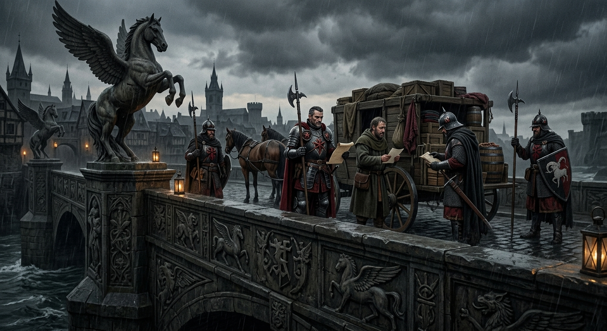
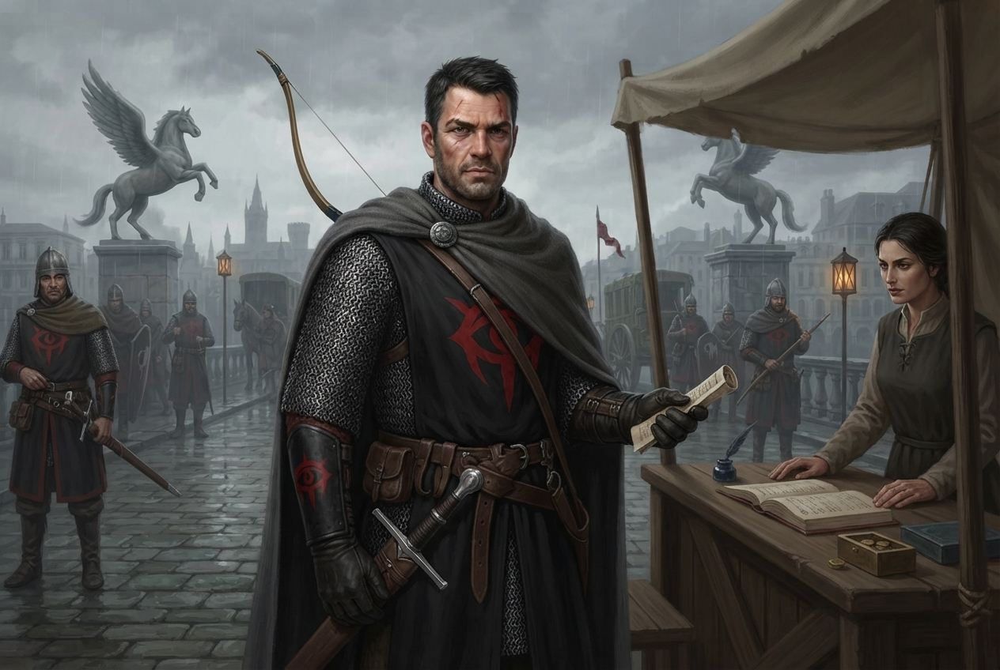
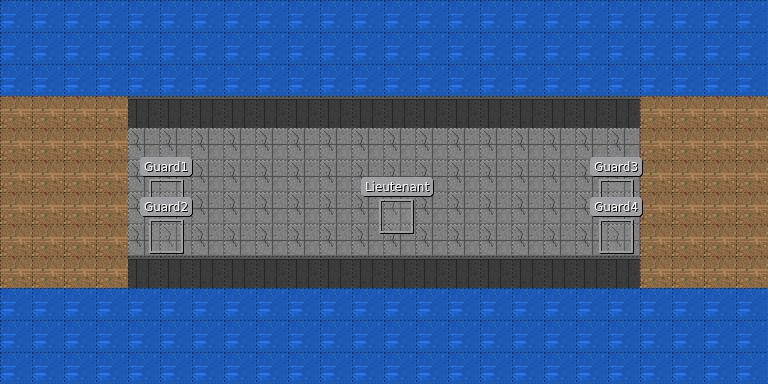

### B3. Таможня

::: scene-meta
time: ~13:00
weather: Пасмурно. Облака темнеют, ветер нагоняет воду с залива.
location: Мост Клинкокрыла, таможенный пост (доттари).
purpose: Въезд в город; пошлина/взятка; знакомство с Фальконе; боевая проверка.
:::

::: checklist
can:

- Зацепка «Фальконе — взяточник»
- Зацепка «Чёрная сирена»
- Зацепка «Комендантский час»
- Зацепка „Слёзы устрицы“ (указание Фальконе)
- Боевой энкаунтер: таможенная проверка
- Упоминание Дуксотара → бесплатный проход
  cannot:
- Имя убийцы
- Точная связь с таверной „Слёзы устрицы“
- Личность Художника
  :::

::: figure [Таможня;width:100%;height:auto]

:::

На мосту стоит отряд доттари и проверяет въезжающих в город.

#### Как выглядит сцена

Мост перегорожен шлагбаумом и деревянными баррикадами. Рядом — навес от дождя, под которым располагается стойка.
На стойке — журнал, чернильница, сургучная печать, деревянный ящик для монет.
У стойки — очередь из пяти-шести человек:
торговцы с телегами, крестьянин с курами, женщина с корзиной, двое наёмников в потёртых доспехах.

За стойкой сидит лейтенант, заполняющий бумаги. Медленно. Вдумчиво.
Каждого проходящего он вписывает в большой журнал — имя, цель визита, срок пребывания.
Он практически не смотрит на людей — только в бумаги.
Иногда поднимает взгляд, оценивает — и снова опускает.

Рядом — четыре стражника: двое у шлагбаума с копьями, двое чуть дальше с арбалетами. Они скучают.

За мостом видны чистые, строгие здания Rego Scripa — Сектора Писцов.

#### Лейтенант Чезаре Фальконе

##### Идентификация

- **Имя:** Чезаре Фальконе.
- **Прозвище:** «Лейтенант» (никто не зовёт его по имени — только по званию).
- **Роль:** Лейтенант доттари, начальник таможенного поста на Мосту Клинкокрыла. **В прошлом — патрульный.**
- **Раса:** человек.
- **Мировоззрение:** Законопослушно-нейтральное (LN), склоняется к LE.
- **Статус:** контекстный NPC.

##### Описание

Фальконе служит в доттари **двадцать лет**. Он начинал **патрульным** — ходил по улицам ночью, гонял теневых тварей,
ловил воров. **Шрам** — от той поры. Потом **получил ранение** (не смертельное, но достаточное, чтобы не стоять в
ночном патруле), и его **перевели на таможню**. С тех пор он **сидит за стойкой** и **считает монеты**.

Он **не бюрократ по призванию**. Он **солдат, которого поставили на скучную работу**. Он **скучает**. Он **пьёт**
(немного, на службе). Он **берёт взятки** — не потому что жадный, а потому что **двадцать лет службы, а платят
копейки**.

##### Внешний вид и черты лица

**Жилистый, подтянутый** — не толстый, не худой. **Спина прямая** — привычка двадцати лет. **Шрам** через левую
бровь — старый, заживший. **Короткие тёмные волосы** без седины. **Без усов**. **Без шлема** — шлем лежит рядом на
стойке. **Без украшений** — челийская сдержанность.

##### Одежда и детали

- **Кольчуга (Chainmail hauberk) под чёрным табардом** — он всё ещё носит её. Привычка.
- **Красный «Глаз Ародена» на чёрном поле** — на **левом предплечье** (инвертированный знак, отличие офицера).
- **Тёмно-серый плащ** — перекинут через спинку стула.
- **Длинный меч искусной работы (Masterwork longsword)** — на поясе. Он **умеет** им пользоваться. Просто **не хочет**.
- **Композитный длинный лук (Composite longbow)** — прислонён к стойке. Он **стреляет** из него, когда кто-то пытается
  сбежать через мост.
- **Журнал, чернильница, сургучная печать, деревянный ящик для монет** — на стойке.

##### Поведение и шлейф восприятия

Фальконе **не встаёт** со своего места. Это **не лень** — это **привычка**. Он сидит **прямо**, как на плацу. Он **готов
встать** в любой момент. Он **не расслаблен** — он **скучает**.

Пахнет **чернилами, бумагой и лёгким запахом вина** (он пьёт, но не напивается на службе).

#### Что зачитать игрокам при первом входе

> За стойкой сидит мужчина лет сорока — **жилистый, подтянутый**, с прямой спиной человека, который двадцать лет носил
> доспех. **Короткие тёмные волосы**, **шрам** через левую бровь — старый, заживший. **Без шлема** — шлем лежит рядом
> на стойке, начищенный до блеска.
> На нём хауберк (длинная кольчужная рубаха, закрывающая тело до колен) под чёрным табардом (накидкой с короткими
> рукавами); на **левом предплечье** — красный «Глаз Ародена» на чёрном поле.
> **Тёмно-серый плащ** перекинут через спинку стула. **Мастерски изготовленный длинный меч** — на поясе.
> **Композитный лук** — прислонён к стойке.
>
> При вашем приближении, он дописывает что-то в журнал, не обращая внимания.
> Потом — поднимает взгляд. Серые глаза, внимательные, **без улыбки**.
>
> «Следующие. Имя, цель визита, срок пребывания». Пауза. «По одному».
>
> Лейтенант доттари останавливает партию у стола писца.
>
> «Пошлина за въезд — пятьдесят золотых. С каждого. Или валите туда, откуда пришли.».

#### Механика пошлины

- Официальная пошлина: указана на табличке. Обычно это 5 зм (считаем, что игроки — конные)
- Лейтенант требует 50 зм за каждого — **в десять раз больше** официальной пошлины. Он не скрывает
  это и не стесняется. Это чистое вымогательство — сумма ощутимая для 5-го уровня, но не комическая.
- Социальный конфликт: партия выбирает — заплатить (50 зм × 4), торговаться/обманывать (Обаяние/Обман), запугивать
  (Запугивание) или напасть на заставу.

##### Способы разрешения

Таможня пропускает бесплатно граждан города и людей, работающих на городские власти.

- Если игроки согласились помочь Дуксотару в расследовании — у них будет бумага об этом.
- Если игроки являются жителями Весткроуна — у них будут бумаги, подтверждающие место жительства.
- Если игроки владеют недвижимостью в Весткроуне — у них будут бумаги, подтверждающие право владения недвижемостью.
- Если у игроков есть **Бумаги о сотрудничестве** от Дуротаса Сарии Рокцин (Common Dottari) — Фальконе пропустит их
  **бесплатно**, но **запишет имена**.

::: check
Способы прохода через таможню:
[Заплатить полностью, 50 зм]
success: игроки без проблем проходят таможню.

[Торговаться (Дипломатия), 20]
critical_success: Лейтенант согласен пропустить игроков по ценам с таблички.
success: Лейтенант согласен снизить цену до 20 зм за каждого.

[Запугивание, 20]
critical_success: Лейтенант согласен пропустить игроков по ценам с таблички.
success: Лейтенант согласен снизить цену до 5 зм за каждого, но портится отношение (Отношение Доттари -1).
failure: Цена не изменилась, но отношение — испортилось (Отношение Доттари -1).
critical_failure: Цена не изменилась, но отношение — испортилось (Отношение Доттари -2).

[Дать взятку (Обман), 18]
critical_success: Лейтенант согласен пропустить игроков по ценам с таблички.
success: Лейтенант согласен Неофициально пропустить игроков по 10 зм за каждого.

[Упоминание Дуксотара (Знание "Челия"/Знание "Весткроун"), 15]
success: Лейтенант согласен пропустить игроков по 10 зм за каждого.

[Предъявить документы (Дипломатия), 10]
success: Лейтенант согласен пропустить игроков бесплатно, если у них есть документы.
failure: Лейтенант всё равно будет вымогать взятку за проход (по 10 зм с каждого).
critical_failure: Лейтенант всё равно будет вымогать взятку за проход (по 50 зм с каждого).
:::

Если опустить отношение к доттари ниже -1 (hostile — враждебный), то стража нападёт на игроков.
Либо, игроки могут самостоятельно напасть на заставу.

#### Боевая сцена: Таможенная проверка

Если договориться не получилось, игроки могут попробовать напасть на заставу.

::: figure[Карта Моста Клинкокрыла]

:::

##### Противник: доттари на заставе

Если договориться не удалось, то на заставу можно напасть.

На заставе находится урезанный отряд доттари:

| Роль            | Статблок в бестиарии     | Количество | Расположение                                          |
|-----------------|--------------------------|------------|-------------------------------------------------------|
| Чезаре Фальконе | Лейтенант доттари        | 1          | по центру моста у стола с бумагами                    |
| Мечник          | Стражник-мечник доттари  | 2          | на западном краю моста — следят за очередью на проход |
| Стрелок         | Стражник-стрелок доттари | 2          | на восточном краю моста — прикрывают                  |

::: encounter [Чезаре Фальконе]
**Способности:**

- **Бюрократическая власть (Bureaucratic Authority)** `[two-actions]` (concentrate, linguistic, mental) —
  **Требование:** существо в пределах 30 футов, которое лейтенант может видеть и слышать. **Эффект:** лейтенант требует
  у существа документы и **задерживает** его на **1 час**, если у него есть **любое формальное основание** (отсутствие
  документов, подозрительное поведение, несоответствие в показаниях). Это **не бой** — это **законная задержка**.
  Существо может оспорить задержку через **Дипломатию (СЛ 20)** или **Запугивание (СЛ 22)**; при провале оно обязано
  оставаться на посту. Лейтенант не может использовать эту способность на одном и том же существе чаще одного раза в
  сутки.
- **Взгляд оценщика (Appraiser's Eye)** `[one-action]` (concentrate) — лейтенант оценивает платёжеспособность существа в
  пределах 30 футов. Проверка **Проницательности** против **СЛ 20**. При успехе лейтенант узнаёт, может ли
  существо заплатить **50 зм** без труда, с трудом или не может вовсе. При критическом успехе он также узнаёт примерную
  сумму наличных (в пределах порядка величины).
- **Связи (Connections)** `[free-action]` (concentrate) — **Частота:** 1/день. Лейтенант наводит справку об одном
  существе, которое проходило через его пост. Он узнаёт, **кто** это был, **когда** проходил и **с чем** (краткое
  описание груза). Если существо не проходило через пост лейтенанта, способность не даёт результата.
- **Осторожность (Caution)** — лейтенант **не вступает в бой первым**. Если начинается драка, он **отступает** за спины
  стражников и **зовёт подкрепление**. Это не трусость, а прагматизм: он сохраняет себя как командную единицу.
- **Печать и журнал (Seal and Ledger)** `[one-action]` (concentrate, manipulate) — **Требование:** лейтенант имеет
  доступ к постовому журналу. **Эффект:** он может **подделать** или **изъять** запись в журнале. Проверка **Обмана**
  против **СЛ 22**. При успехе запись изменена или удалена; при провале остаются следы вмешательства, которые можно
  заметить при проверке **Общества (СЛ 20)**.
  :::

**Тактика боя:**

- Двое стражников с мечами — встают между лейтенантом и игроками, поднимая щиты, стрелки — отходят назад.
- Лейтенант **не вступает в бой первым**: он **отступает** за спины стражников и **отдаёт приказы** («Приказ»:
  союзники получают +1 к следующей атаке). Если нужно — **стреляет** из композитного длинного лука (composite longbow).
- Один из стрелков **бежит за подкреплением** в городские кварталы. Через **3 раунда** он приведёт двух
  стражников-копейщиков, которые помогали горожанам рядом с мостом.
- **Тактика Фальконе:** он **не тратит** действия на атаку, пока стражники держат линию. Он **ждёт**, пока игроки
  потратят ресурсы, и **только тогда** вступает в бой — с длинным мечом искусной работы (Masterwork longsword), если его
  достали, или композитным длинным луком (composite longbow), если держат дистанцию. Если стражники падают — он
  **отступает** к палатке и **зовёт подкрепление** голосом.

Доттари — это городская стража, а не отряд головорезов. Их основная задача — задержать, обезвредить и доставить
нарушителей на суд для проведения законного следствия и вынесения приговора.

Механически: в ближнем бою для добивания (когда очевидно, что после успешного удара HP персонажа опустится до 0)
доттари стараются использовать дубинки и нанести несмертельный урон. Если персонаж игрока опускается до 0 HP от такой
атаки — он без сознания и стабилен, а не умирает. После боя его приводят в чувство, обыскивают и отправляют под арест.

Исключение — если игроки **уже** убили более 1 стражника или лейтенанта. Но и тогда их будут стараться задержать, но не
так активно.

##### После первого раунда боя

После первого раунда боя, если игроки ещё не убили ни одного доттари (но, возможно, довели его HP до 0 и страж без
сознания), Лучиано попытается остановить бой.

Если игроки уже познакомились с Лучиано:

> "Господа, ни к чему это всё!" — обволакивающий, проникающий в самое нутро голос неожиданно разносится над мостом.
> К вам подходит Лучиано, художник, с которым вы только что познакомились.
> "Фальконе!" — он машет рукой в воздухе. — "Пропусти моих друзей."
> Лейтенант убирает меч в ножны. "Ну раз это ваши друзья — пусть проходят. Но записаться всё равно надо."

Если игроки ещё не познакомились с Лучиано:

> К вам подходит элегантный мужчина, которого вы видели на набережной ранее.
> Кажется, что он не идёт, а скользит по брусчатке моста, словно перетекая из одного места в другое.
> "Фальконе, ни к чему это всё" — он машет рукой в воздухе. — "Пропусти моих друзей."
> Лейтенант убирает меч в ножны. "Ну раз это ваши друзья — пусть проходят. Но записаться всё равно надо."
> "Доброго вам дня, путешественники." — Мужчина уже оборачивается к партии. — "Разрешите представиться — Лучиано
> Аврелиан. Вольный художник. У вас такой уникальный типаж! Вы не возражаете, если мы отойдём отсюда и поговорим?"

После этого — переходим к B2 — Художник.

#### Вопросы к Фальконе

Если партия получила возможность пройти в город (заплатив или договорившись о проходе), Фальконе может ответить на
несколько (3-5) вопросов. После чего — будет обязан предупредить о Теневых тварях и Комендантском часе и, сославшись на
работу, закончит диалог.

Если партия победила в бою, и Фальконе остался жив и захвачен — партия может его допросить (3-5 вопросов), после чего
подойдет подкрепление доттари (ещё два таких же отряда по 1 лейтенанту и 6 солдат-доттари).

::: answers
Вопросы к лейтенанту Фальконе

Ответы Фальконе подаются через косвенную речь: вместо прямой цитаты сообщается, что именно он сказал (или отказался
сказать). Каждый более высокий уровень доверия повторяет содержание предыдущего и добавляет к нему новые детали.

**Q:** «Кто вы?»
indifferent: Сообщает, что он — лейтенант Чезаре Фальконе, доттари, таможенный пост на Мосту Клинкокрыла.

**Q:** «Что это за город?»
hostile: Отказывается отвечать.
unfriendly: Называет город — Весткроун — и не даёт больше ничего.
indifferent: Добавляет, что это Город Сумерек, бывшая столица Челии, а сейчас — порт.
friendly: Говорит то же и с паузой подчёркивает, что город — ещё и кладбище для тех, кто не умеет считать.
helpful: Уточняет, что когда-то это был Город Девяти Звёзд, а теперь — Город Сумерек.

**Q:** «Почему город в упадке?»
unfriendly: Называет причину — Дом Трун — и не даёт больше ничего.
indifferent: Говорит, что Дом Трун перенёс столицу в Эгориан, богатство ушло, а осталось — всё, что видно вокруг.
friendly: Говорит то же и с паузой подчёркивает, что осталось лишь то, что игроки видят.
helpful: Раскладывает причину по порядку: город потерял бога, потом статус, потом деньги. Пауза. Теперь здесь только
тени — в прямом смысле.

**Q:** «Почему в городе введён комендантский час?»
unfriendly: Обозначает его как приказ и не объясняет.
indifferent: Говорит, что из-за теневых тварей после заката, по приказу лорд-мэра, время — восемнадцать ноль-ноль.
friendly: Говорит то же и добавляет, что твари после заката выходят на охоту. С паузой советует: он в город ночью не
ходит, и не советует и игрокам.
helpful: Говорит то же. Тише. Признаётся, что сам был в патруле и шрам остался с той поры, не любит об этом вспоминать.
Просит не ходить ночью.

**Q:** «Что будет, если останемся ночью на улице?»
unfriendly: Отмахивается: «Это ваши проблемы».
indifferent: Говорит, что тогда он их больше не увидит.
friendly: Говорит то же с паузой и добавляет, что твари не оставляют тел — только тени.
helpful: Говорит то же. Тише. Просит не выходить ночью — не как совет, а как просьба.

**Q:** «Где мы можем переночевать?»
unfriendly: Отмахивается — это не его дело.
indifferent: Говорит, что в городе — таверны, а за городом — «Слёзы устрицы», таверна Гаэтано, у реки.
friendly: Говорит то же с паузой и добавляет, что туда доттари не ходят, но и твари пока не заходят.
helpful: Говорит то же. Тише. Называет это хорошим местом, но сам он туда не езжу уже год — и не спрашивайте, почему.

**Q:** «Кто здесь главный?»
unfriendly: Называет лорд-мэра и не даёт больше ничего.
indifferent: Говорит, что формально — лорд-мэр Абериан Арванкси, а реально — Совет Воров и доттари.
friendly: Говорит то же и с усмешкой добавляет, что в Весткроуне никто не главный — это и есть проблема.
helpful: Говорит то же с паузой. Тише. Предостерегает, что доттари — не единая стража, а четыре банды с одним
названием.

**Q:** «Кто такие доттари?»
unfriendly: Обозначает их как городскую стражу.
indifferent: Говорит, что это городская стража, а начальник — дуксотар Илтус Мартис, племянник лорд-мэра.
friendly: Говорит то же, называя себя лейтенантом. С паузой добавляет, что Дуксотар — молодой, пьёт, но не злой, просто
слабый.
helpful: Говорит то же с паузой. Тише. Уточняет, что Дуксотар не командует, а подписывает бумаги, остальное — их зоны;
доттари — не единая стража, а четыре банды с одним названием.

**Q:** «Кто такой Дуксотар?»
 unfriendly: Обозначает его как начальника стражи.
 indifferent: Говорит, что это Илтус Мартис, племянник лорд-мэра, молодой, пьёт.
 friendly: Говорит то же с паузой и добавляет, что он не злой, просто слабый — если игроки что-то умеют, пусть идут к
 нему, он ищет помощи.
 helpful: Говорит то же. Тише. Добавляет, что он не злой и боится — боится, что маньяк доберётся до него; из-за этого и
 нанял Детектива. Говорит, что наймёт и игроков, если они придут.

**Q:** «Что ты знаешь о Художнике (Аврелиане)?»
 unfriendly: Отказывается — отвали, он ни о ком не знает.
 indifferent: Говорит, что Аврелиан иногда появляется здесь, и больше ничего не знает.
 friendly: Говорит, что Аврелиан частенько ходит через мост, появился месяца шесть назад и заявил, что вольный
 художник. Тише. Говорит, что тот странный, но платит хорошо.
 helpful: Говорит, что Аврелиан приехал месяца шесть назад, поселился где-то за городом и заявил, что вольный
 художник. Тише. Уточняет, что тот странный — смотрит на людей как на материал для своих работ, но не буянит и платит
 хорошо.

**Q:** «Серьезно, я хочу помочь с серией убийств — к кому идти?»
 unfriendly: Это не твоё дело.
 indifferent: Иди к Дуротасу Сарии Рокцин. Она командует Common Dottari.
 friendly: «Помочь? — Фальконе поднимает взгляд от журнала. — В городе и так тяжело: комендантский час, теневые
 твари, а тут ещё и не то маньяки, не то криминальные разборки. Трупы находят — странные. Стража молчит. Я — не
 следователь. Я — таможенник. Но если хочешь помочь — иди к Дуротасу Сарии Рокцин. Она командует Common Dottari.
 Скажи, что от меня. Она — единственная, кто ещё не продался.»
 helpful: Говорит то же с паузой. Тише. Может добавить один-два слуха: «Говорят, маньяк режет культистов. Или
 культисты режут друг друга. Не разберёшь.» / «Говорят, в порту люди пропадают. Стража не ищет.» / «Говорят, за
 городом таверна есть. „Слёзы устрицы“. Вино дешёвое, комнаты чистые. Но я бы не советовал.»

**Q:** «Почему таможенный пункт усилен?»
 unfriendly: Отказывается.
 indifferent: Говорит, что усилен, и не даёт больше ничего.
 friendly: «Почему усилен? — Фальконе хмыкает. — Потому что в городе серия убийств. Жестоких. Расчленёнка. Стража
 не справляется. А мы стоим на входе — и проверяем всех.»
 helpful: Говорит то же с паузой. Тише. «Может, убийца — не местный. Может, он уже здесь. Может, он пройдёт через
 этот мост. И я его не увижу.»

:::

#### Подводка к §C3 (Приёмная Дуротаса)

Если игроки спрашивают о серии убийств или предлагают помощь (см. вопросы выше), Фальконе направляет их к **Дуротасу
Сарии Рокцин** (Common Dottari) в §C3.

**Реакция Фальконе на «Бумаги о сотрудничестве» от Дуротаса Сарии Рокцин:** если игроки предъявляют на таможне **Бумаги
о сотрудничестве** от Сарии, Фальконе хмыкает:

> «А, Сария. Ну, проходите. Но если что — я вас записал. И если вы найдёте маньяка — скажите мне. Я хочу
> посмотреть на него.»

(Отношение доттари +1.)

#### Итоги сцены B3:

Если не используется milestone leveling, то партия за сцену получает:

| Решение                                              | XP                                |
|------------------------------------------------------|-----------------------------------|
| Заплатили 50 зм                                      | 10 (Trivial — просто откупились)  |
| Прошли по протекции Художника                        | 10 (Trivial — просто откупились)  |
| Торговались / запугали / обманули                    | 30 (Low — было испытание)         |
| Прошли по документам / бесплатно                     | 40 (Moderate — чистое решение)    |
| Прошли через бой и победили                          | 100 (Moderate — полный энкаунтер) |
| Прошли через бой, но с потерями (арест, отступление) | 40 (Low — частичный успех)        |
| Прошли через бой, но бой остановил Художник          | 30 (Low — было испытание)         |

Если партия проиграла бой:

- Их разоружают, обыскивают, приводят в чувство и отправляют под арест в Крепость Дотари (Keep Dotar) или на ближайший
  пост.
- Фальконе лично допрашивает их (3–5 вопросов), после чего направляет их к Дуротасу Сарии Рокцин (Common Dottari).
  _(переходим к "§C3 Приёмная Дуротаса".)_
- Отношение доттари при аресте падает до unfriendly (−1) или hostile (−2), но не ниже — их не пытают и не казнят. Это
  стража, а не инквизиция.

Также партия может получить дополнительный опыт за каждую найденную зацепку.
Логика распределения опыта по подсказкам — опыт не дается за те подсказки, которые применимы в текущей сцене.

| Зацепка                 | опыт  |
|-------------------------|-------|
| Комендантский час       | 10 XP |
| Чёрная сирена           | 10 XP |
| Маньяк в городе         | 10 XP |
| Художник                | 0 XP  |
| Таверна «Слёзы устрицы» | 10 XP |
| Культ Дагона            | 10 XP |
| Фальконе — взяточник    | 0 XP  |

Общие итоги и дальнейшие действия:

- Игроки получают возможность войти в город;
- Игроки могут узнать о комендантском часе и теневых тварях;
- Игроки могут узнать о структуре города;
- Игроки могут получить изменить отношение доттари (как уменьшить, так и увеличить);
- Игроки познакомились с лейтенантом Фальконе;
