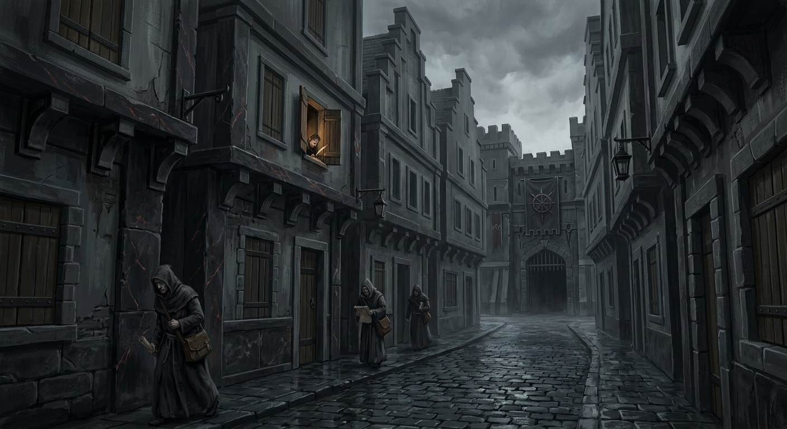

### B4. Rego Scripa — вход в город

::: scene-meta
time: ~14:00–14:30
weather: Пасмурно. Тёмные тучи, сырость; воздух тяжелеет перед дождём.
location: Улицы Весткроуна / развилка A/B/C, Парего Спе́ра.
purpose: Развилка: A — расследование, B — контрабанда, C — дезертир; слухи; допрос прохожего.
:::

::: checklist
can:

- Выбор ветки A/B/C
- Зацепки для выбранной ветки
- Слухи
- Зацепка „Слёзы устрицы“
- Зацепка „Маньяк в городе“
  cannot:
- Имя убийцы
- Точная связь с таверной „Слёзы устрицы“
- Полный план расследования.
  :::

::: figure [Rego Scripa — Сектор Писцов;width:100%;height:auto]

:::

Вы проходите по мосту Клинкокрыла и выходите в **Rego Scripa** — «Сектор Писцов», часть **Parego Spera** — «Алтарь
Надежды».
Это чистые, строгие здания бюрократии: канцелярии, архивы, конторы доттари и правящих семей.
Воздух пахнет чернилами, воском и сухим камнем. Улицы ровные, тихие, пустые — дневная толчея моста здесь
сменяется молчанием канцелярий.

#### Описание сцены (для чтения игрокам)

> Мост остаётся позади. За спиной — гомон толпы, скрип колёс, окрики стражников и запах речной воды. Впереди — тишина.
> Вы входите в Rego Scripa — «Сектор Писцов».
> Улицы ровные, мощёные тёмным базальтом. Здания — высокие, с крутыми ступенчатыми фасадами и острыми углами, без
> единого изгиба. Чёрный аркадский мрамор с красными прожилками ловит слабы свет от солнца и кажется тёплым на ощупь,
> но стоит коснуться, и понимаешь: камень ледяной.
> В воздухе пахнет чернилами, воском и сухим пергаментом. Где-то за открытым окном методично, как метроном, скрипит
> перо.
> Из приоткрытой двери тянет запахом старой бумаги и кожей переплётов.
> Писцы — бледные, сутулые, в тёмных мантиях — скользят вдоль стен, не поднимая глаз.
> Никто не разговаривает. Никто не смотрит в глаза.
> Над крышами, в отдалении, поднимается Тараник-Хаус — мрачный особняк с шипованным колесом над воротами. Оттуда не
> доносится ни звука. Даже вороны облетают его стороной.
> Вы делаете шаг вперёд. Каблуки стучат по камню — и звук уходит в пустоту, не встречая ни эха, ни отклика.
> Rego Scripa — не приветствует гостей. Она их терпит.

#### Если игроки прошли таможню мирно и ещё не получили информации о теневых тварях или комендантском часе

Если партия уже познакомилась с Лучиано и прошла таможню **без драки и без ареста** (заплатила,
торговалась, дала взятку, прошла по документам или по протекции Лучиано) — перед выходом с моста
Фальконе догоняет их и напоминает про комендантский час и теневых тварей.

> «Постойте!..» — Фальконе окрикивает игроков. «Вы, кажется, впервые в Весткроуне. Я обязан предупредить.» — Он
> останавливается, переводит взгляд. «В городе всё ещё действует комендантский час. После заката по улицам гуляют
> теневые твари, мы их ещё не всех переловили, так что — постарайтесь не оказываться на улице в темноте. А лучше —
> найдите себе надёжный дом, где можно переночевать и не выходите вообще на улицу.» — Он смотрит на вас, потом в сторону
> моста, и что-то решает. «...Добро пожаловать в Весткроун!»

::: note
Фальконе предупреждает по своей инициативе — это не проверка и не социальное испытание, просто
«закрытый» диалог с доттари.
:::

#### Если игроки прошли таможню мирно и не познакомились с Лучиано Аврелианом

Если партия **не** познакомилась с Лучиано до этого (прошла таможню по документам, через бой или
после задержки на мосту) — он **догоняет их** здесь, в Rego Scripa.

> «Господа!.. Простите великодушно!..» — вы замечаете бегущего за вами художника, которого видели ранее на другом
> берегу, на мосту. «Доброго... дня... вам! Фух... хорошо... успел догнать.» — Он останавливается, переводит дыхание.
> «Меня зовут Лучиано Аврелиан, местный художник. Не могли бы вы уделить мне буквально 5 минут вашего бесспорно
> драгоценного времени.»

После этой сценки — переход к **§B2 Художник**.

#### Проверки

При входе в район:

::: check
Осмотреться в Rego Scripa
[Внимательность, 15]
success: Вы замечаете, что все окна первого этажа закрыты ставнями — даже днём. На втором этаже одно окно приоткрыто, и
оттуда доносится мерный скрип пера.
critical_success: Вы замечаете, что за вами наблюдают. Из-за занавески на втором этаже одного из зданий мелькает бледное
лицо — и тут же исчезает. Кто-то следит за улицей.

[Знание (Весткроун), 15]
success: Rego Scripa — бывший бюрократический сектор Челии. Здесь же находится Тараник-Хаус — гарнизон Адских Рыцарей
Ордена Дыбы. Лучше не привлекать их внимания.
critical_success: Вы вспоминаете, что каждые три месяца Орден Дыбы устраивает «костры ясности» — сжигает устаревшие
версии истории Челии. Один такой костёр был на прошлой неделе. Воздух до сих пор пахнет гарью, если принюхаться.

[Общество, 12]
success: Вы понимаете: писцы и клерки боятся смотреть вам в глаза. Они не хотят быть замеченными. Не вами — кем-то
другим.

[Проницательность, 15]
success: Тишина в Rego Scripa — неестественная. Это не спокойствие, а затаённость. Люди здесь говорят шёпотом даже друг
с другом.

[Природа / Выживание, 12]
success: Вы замечаете: ни одной собаки, ни одной кошки. Даже голубей нет. Животные ушли из этого района.

[Религия, 15]
success: На одном из зданий — стёртый символ Ародена, замазанный чёрной краской. Кто-то пытался его уничтожить, но не до
конца. Символ Асмодея рядом — свежий, аккуратный.
:::

#### Допросить прохожего

::: check
Допросить прохожего
[Запугивание / Дипломатия, 18]
success: Прохожий соглашается ответить на 1 общий вопрос о городе или поделиться 1 слухом
failure: Прохожий шепчет "Я ничего не знаю" и старается убежать.
:::

Партия может захотеть допросить кого-то из прохожих — бледного писца или клерка из Сектора Писцов.
Такой прохожий пуглив, молчалив и осторожен: он **не доверяет** (candor = no_trust), и его
откровенность растёт лишь при успешных проверках Дипломатии / Запугивания.

Потратив 10 минут на разговоры, игроки узнают соответствующий слух:

::: rumors [d8, Слухи, которые может рассказать прохожий]
rumor: 1 | «В Тараник-Хаус опять жгли книги. Говорят, костёр горел всю ночь. И так каждые три месяца.» | | Орден
Дыбы. Лор.
rumor: 2 | «Художник из Тривардума разыскивает старые реликварии. Платит хорошо. Слишком хорошо.» | | Художник
rumor: 3 | «В порту пропал грузчик. Второй за неделю. Доттари не ищут.» | | Маньяк в городе
rumor: 4 | «Ночью в Секторе Писцов видели тень. Доттари молчат. Все молчат.» | | Теневые твари
rumor: 5 | «Дуксотар снова пьёт. Говорят, маньяк его до смерти пугает.» | | Маньяк в городе / Дуксотар
rumor: 6 | «Говорят, за Адивианским мостом есть таверна. Если не хочешь посторонних взглядов — в ней можно снять
комнату.» | | Таверна «Слёзы устрицы»
rumor: 7 | «Совет Воров снова шевелится. Говорят, старик Дровендж сдаёт позиции.» | | Совет Воров
rumor: 8 | «Лорд-мэр снова не выходит из особняка. Говорят, он боится.» | | Лорд-мэр. ЛЛор

:::

#### Куда дальше: маршруты в город

От Rego Scripa партия может двигаться по нескольким направлениям — все они уже известны из зацепок,
полученных в **B1 / B2 / B3**:

- **Сумеречный рынок (Dusk Market).** Место торговли незаконными товарами; зацепка «Сумеречный рынок» — из
  диалога с Художником (§B2) и слухов на мосту (§B1).
- **Тривардум.** Ряд лавок с художественными товарами и предметами искусства, где Художник бывает
  днём; зацепка «Тривардум» — из §B2.
- **Порт.** Причалы, склады, доки; сюда уходят корабли. Сюда можно попасть и на лодке (за 6 часов и
  5 зм), если не идти мостом; зацепка «Порт» — из §B1 и слухов.

#### Итоги сцены B4

После Rego Scripa партия получает:

- Зацепки: «Орден Дыбы», «Совет Воров», «Теневые твари», «Маньяк в городе», «Художник», Таверна «Слёзы устрицы»
- Знакомство с Художником (если не было раньше) — переход к §B2.
- Выбор дальнейшего маршрута:
  — Тривардум — на юг, торговый район. (§C1)
  — Порт — на восток, к докам. (§D1)
  — Сумеречный рынок — на север, в руины Рего Кадер. (§E1)
  — Паром / ночь — если игроки задерживаются до заката. (§F1)
- **Места серии убийств** (отдельные сцены по веткам): §D1 (убитый вор), §E1 (ритуал культа), §F1 (убитый контрабандист).

Если игроки успешно прошли проверки, то они могут получить опыт (если не используется milestone):

| Действие                                   | XP |
|--------------------------------------------|----|
| Заметили Тараник-Хаус / Адских Рыцарей     | 10 |
| Получили зацепку о таверне «Слёзы устрицы» | 10 |
| Получили знания об Ордене Дыбы             | 10 | 
| Получили зацепку о Маньяке                 | 10 | 
| Получили зацепку о Совете Воров            | 10 | 
