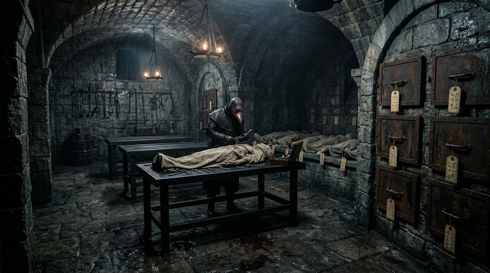

### C4. Морг

::: scene-meta
time: ~16:30
weather: Пасмурно. Первыми каплями дождя; где-то далеко идёт гроза.
location: Морг города, Весткроун.
purpose: Осмотр тел жертв; символы культа; ключ к развязке (Доктор в таверне).
:::

::: checklist
can:

- [Улики: следы крови (blood_traces)]
- [Символы культа на телах (совпадают с cult_lair)]
- [Мутации жертв (перепонки, чешуя, «рыбьи» глаза)]
- [Критическая зацепка: «Доктор в таверне» („Слёзы устрицы“)]
- [Узнали про потоп / чары Дагона]
- [Зацепка «Контрабанда» (тело контрабандиста с накладной на партию)]
- [Дорога к таверне]
  cannot:
- [Имя убийцы]
- [Культ в таверне]
- [Точная связь с таверной „Слёзы устрицы“ как логово]
- [Полный план расследования]
  :::

::: figure [Морг;width:100%;height:auto]

:::

Вы идёте в **Морг** города. Здесь хранятся невостребованные тела жертв серии смертей. Дождь усиливается, где-то далеко
идёт гроза.

#### NPC: Тобиа Бандини — Ассистент Доктора

##### Идентификация

- **Имя:** Тобиа Бандини.
- **Роль:** ассистент Доктора (Элио Вентури); **context_npc**.
- **Раса:** полурослик (Halfling).
- **Мировоззрение:** Нейтрально-добрый (NG).
- **Статус:** context_npc.

#### Механика доступа

- **При взятии заказа «Поиск маньяка»** ассистент **направляет игроков к Дуротасу Сарии** и **отказывается пускать в
  морг без задания** (бумаги от Дуротаса или Детектива).
- **С заданием** — игроки осматривают тела:
  — **Культист** → мутации на теле (перепонки, чешуя).
  — **Вор** → профессиональный разрез на горле.
  — **Горожанин** → ритуальные символы.
  — **Контрабандист** → остатки Лист-живодёра на губах **и обрывок накладной на партию, идущую по реке через порт**
  (доказывает контрабандную линию).
- Ассистент сообщает: **Доктор забрал отчёты о вскрытии** (autopsy_reports) и поработает с ними дома — снял комнату в
  **таверне за городом** (doctor_room).
- Игрокам **объясняют дорогу** к таверне.

## Часть 1: Осмотр тел

> Холодное, светлое помещение. Железная стойка, ящики с телами, лампы. Пахнет формалином и металлом.
>
> На стенах — карточки с датами и именами. Часть пустых. На телах — символы, которые вы уже видели на улицах.

Эту часть можно дать, даже если партия не хочет разговаривать с Тобиа. Осмотр не требует разговора — достаточно бумаги
от Дуротаса или Детектива.

::: check
Осмотреть тела
[Медицина, 15]
success: Вы замечаете символы культа на телах жертв серии (записаны Доктором) — они совпадают с символами в cult_lair.
critical_success: Вы находите мутации (перепонки, чешуя, «рыбьи» глаза) — порча от магии Дагона.
failure: Просто трупы; символов не заметно.

[Внимательность, 12]
success: Вы находите следы крови (blood_traces) и следы профессиональной резки.
:::

::: note[Улика места (морг):]

Среди тел серии — **контрабандист**, доставленный городской стражей. На губах и руках — остатки **Лист-живодёра**, а при
теле — **обрывок накладной на партию товара, идущую по реке через порт**.

- **Связь с расследованием:** указывает на **контрабанду** как действующую сеть (а не только «жертва пробовал наркотик»).
  Доказывает, что у серии есть жертва из контрабандного оборота.
- **Источник иной, чем в §D1/§E4:** здесь — тело в морге, а не место убийства (D) или рынок (E). Не дублирует.
  :::

## Часть 2: Разговор с Тобиа

> В морге вас встречает молодой человек лет двадцати пяти, в белом фартуке. Усталое, но живое лицо. Он явно привык к
> трупам, но не потерял любопытства.
>
> — Вы к Доктору? Его нет. Уехал. Забрал все бумаги.

Разговор по шкалам **attitude / candor** (hostile → helpful). Тон: нервозность, страх Доктора, по-делу.

::: answers
Тобиа Бандини — Ассистент Доктора

**Q:** Пусти нас к телам в морге!
hostile: «Без бумаги — ни пяди. Уходите.»
unfriendly: «Никак не могу. Доктор запретил пускать без предписания.»
indifferent: «Без заказа от Дуротаса или Детектива — не имею права. Есть бумага — смотрите.»
friendly: «Проходите. Руками ничего не трогайте. Тела изрезаны ровно, как по линейке.»
helpful: «Проходите, тсс. Срезы идеальные, хирургическая чистота. Разбойник так не накрошит — тут работал эстет.»

**Q:** Где отчёты о вскрытии?
hostile: «Нету у меня ничего! Всё забрали! Уйдите!»
unfriendly: «Нету их в морге. Доктор все бумаги забрал.»
indifferent: «Отчётов тут нет. Доктор Элио забрал все записи с собой.»
friendly: «Доктор Элио все бумаги к себе утащил. Он последние дни сам не свой.»
helpful: «Он забрал отчёты и никому не показывает! Даже мне! Сложил все папки в саквояж и уехал.»

**Q:** Где нам найти Доктора Элио?
hostile: «Не знаю. Он мне не отчитывается. Уходите.»
unfriendly: «В загородной таверне. По делам уехал.»
indifferent: «Снимает комнату за городом, в таверне… „Слёзы устрицы“. Поехал с бумагами.»
friendly: «Он в „Слёзах устрицы“, за Адивианским мостом. Комната на втором этаже. Из-за ливня застрял.»
helpful: «В „Слёзах устрицы“! Он взял с собой не только отчёты, но и опасные алхимические составы из лаборатории.»

**Q:** Что странного ты заметил в поведении Доктора?
hostile: «Ничего. Доктор как доктор.»
unfriendly: «Нервный. Переутомился от трупов.»
indifferent: «Стал часто запираться. И с девчонкой из таверны шептался.»
friendly: «Всё про агонию и остывание тел в воде расспрашивал. И официантка из „Слёз устрицы“ к нему тайком приходила.»
helpful: «Я видел, как он шептался с Официанткой про ритуалы и воду. И утащил отчёты именно по трупам с мутациями.»

**Q:** Что ты знаешь о Корине Марроне (Моряке)?
hostile: «Никаких моряков не знаю!»
unfriendly: «Моряки к нам в морг только в виде трупов.»
indifferent: «Доктор говорил о каком-то моряке. Он его боялся.»
friendly: «Доктор сказал — он опасен. Он угрожал Доктору.»
helpful: «Доктор сказал — он убийца. Он убил жену Трактирщика и угрожал Доктору. Но Доктор его боится.»

**Q:** Ты заметил что-то странное в воде или погоде?
hostile: «Дождь как дождь! Что вам надо?!»
unfriendly: «В подвале морга сыро. Вот и всё.»
indifferent: «Вода в сточных канавах ведёт себя странно… как будто натягивается вверх, а не стекает.»
friendly: «Я анализировал воду из реки: в ней магический осадок, плотность растёт. Это не паводок — это чары!»
helpful: «Это чары Дагона! Я сказал Доктору, а он рявкнул: „Не лезь не в своё дело, Тобиа!“ Точно вам говорю!»
:::

::: note

*Критическая зацепка (нельзя потерять):*

Тобиа говорит: «Доктор в таверне „Слёзы устрицы“ за городом. Снял комнату на втором этаже.»

Если партия провалила все проверки — Тобиа **всё равно** это скажет. Это не проверка. Это сюжетный мост в главу 2.
:::

#### Реакция Тобиа на «Бумаги о сотрудничестве» от Дуротаса

Если игроки предъявляют **Бумаги о сотрудничестве** от Дуротаса Сарии Рокцин (Common Dottari), Тобиа берёт документ,
читает и пропускает их:

> «Бумага от Дуротаса? — Тобиа берёт документ, читает. — Хорошо. Проходите. Руками ничего не трогать. Тела
> изрезаны ровно, как по линейке.»

**Последствия:**

- Отношение Common Dottari +1.
- Отношение Тобиа растёт до friendly.
- Игроки получают доступ к телам (см. «Механика доступа» выше).

#### Итоги сцены C4

- **Часть 1 (осмотр тел):** улики `blood_traces` (следы крови), **символы культа на телах** (совпадают с cult_lair),
  мутации жертв.
- **Зацепка «Контрабанда»:** среди тел — **контрабандист** с остатками Лист-живодёра и обрывком накладной на партию,
  идущую по реке через порт (доказывает контрабандную линию из ветки C).
- **Часть 2 (разговор с Тобиа):** сведения о Докторе, о Моряке, о чарах Дагона в воде.
- **Критическая зацепка (нельзя потерять):** «Доктор в таверне „Слёзы устрицы“» — Тобиа скажет это **всё равно** при
  любых провалах проверок; это сюжетный мост, а не проверка.
- **Главный хук главы 1:** все нити расследования ведут в таверну **«Слёзы устрицы»** за городом.
- 17:00 — начинается дождь; где-то далеко идёт гроза (эскалация к ливню).
- **Переход к Глава 2** — §F2 (Паром / отказ на воде) → §F3 (Ночь в городе), ~17:30.

Если не используется milestone leveling, то партия за сцену получает:

| Действие                       | XP |
|--------------------------------|----|
| Осмотрели тела                 | 20 |
| Нашли символы культа           | 20 |
| Узнали про Доктора (в таверне) | 10 |
| Узнали про потоп / чары Дагона | 10 |
