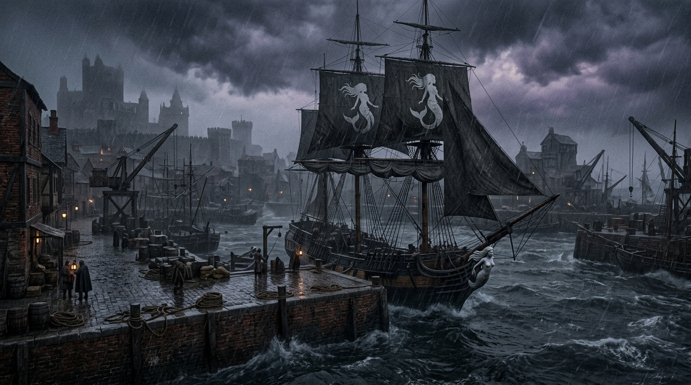
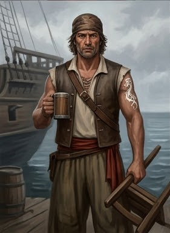
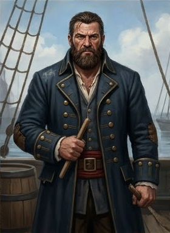
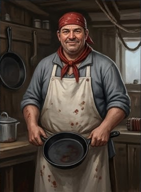

## D. Игроки идут в порт (D1 → D2 → D3)

**Время:** ~14:30–17:00.

На 14:30 развилке (§B4 / §C1) игроки выбирают ветку **D — Дезертир**: вместо расследования серии (ветка C) они
спускаются к **порту** Весткроуна, у устья реки Адивиан, в заливе Жемчужной короны. Здесь — дело о **дезертире**: моряк
Корин Марроне («Кайрэн») украл судовую казну и сбежал с корабля «Чёрная Сирена». Итог главы 1 — все нити (в т.ч.
ветки D) ведут в таверну «Слёзы устрицы» за городом.

Общий тайминг (эскалация погоды): D1 ~14:30–15:30 → D2 ~15:30 → D3 ~16:30 → 17:00 дождь → глава 2.

---

### D1. Порт — «Чёрная Сирена» (Драка с матросами)

::: scene-meta
time: ~14:30–15:30
weather: Пасмурно. К 17:00 — дождь.
location: Порт Весткроуна, доки, устье реки Адивиан, Залив Жемчужной короны.
purpose: Боевой энкаунтер «Чёрная Сирена»; знакомство с Капитаном; след дезертира.
:::

::: checklist
can:

- Зацепка «Чёрная Сирена» (знак/тату)
- Зацепка «Капитан» (Алессандро Маретти)
- Зацепка «Корин Марроне / Кайрэн»
- Упоминание «Солёный Алессандро»
- Тайна: драка — проверка навыков, а не нападение
  cannot:
- Имя убийцы
- Что Моряк в таверне
- Культ в таверне
- Серия убийств в городе
  :::

::: figure [Порт;width:100%;height:auto]

:::

Вы спускаетесь к **порту** Весткроуна — в устье реки Адивиан, в заливе Жемчужной короны. Порт обрабатывает около
половины всей внешней торговли Челии: кирпичные причалы, швартованные корабли, лодки, якоря, толпа грузчиков и матросов.
Вдалеке — титанический Арсенал со скелетом строящегося флагманского корабля «Доминатор». Пахнет солью, дёгтем, рыбой и
водой. Громкие голоса, стук молотка, скрип канатов. На входе в гавань — большая песчаная отмель Рифардона; капитанам
приходится огибать Утёсы Жемчужной короны.

#### Зачитать при первом входе

> Кирпичные причалы, швартованные корабли, лодки, якоря, толпа грузчиков и матросов. Вдалеке — титанический Арсенал со
> скелетом строящегося флагманского корабля «Доминатор». Пахнет солью, дёгтем, рыбой и водой. Громкие голоса, стук
> молотка, скрип канатов. Порт обрабатывает около половины всей внешней торговли Челии.
>
> Из залива в устье Адивиана входит корабль с чёрными парусами и белой сиреной на каждом из них. Никто на берегу не
> машет ему. Никто не выходит встречать.

#### Наблюдения

- **Корабль «Чёрная Сирена»** — большой парусник, стоящий в порту; чёрные паруса, белая сирена.
- **Матросы и абордажники** — закалённые в штормах; задевают игроков.
- **Знак/тату «Чёрной Сирены»** — на одном из моряков (критическая зацепка).

#### Зацепка перед дракой

::: note *Зацепка перед дракой:*

Когда партия входит в порт, один из матросов «Чёрной Сирены» — с татуировкой сирены на предплечье — бросает в сторону
партии фразу: «Эй, вы. Не местные. Ищете кого-то конкретного? Или просто гуляете?»

Если партия отвечает грубо — драка начинается сразу. Если партия отвечает уклончиво — матрос подходит ближе и
провоцирует: «Слышал, вы про дезертира спрашивали. Может, вам стоит поговорить с боцманом?»

*Цель:* дать игрокам шанс понять, что это не случайные хулиганы, а люди, которые *знают* о дезертире.
:::

#### Драка с матросами «Чёрной Сирены» (боевой энкаунтер)

Порт / у причалов. Закалённые в штормах моряки и абордажники под предводительством боцмана задевают игроков — не ради
убийства, а ради **«проверки»**. Это «кабацкая» драка: без обнажения стального оружия, на импровизированном оружии
(кружки, стулья, бутылки). **Бюджет XP: 120 XP (Severe, партия 4×5 уровня).**

::: pftab[Уровень сцены]

| Боец                     | Уровень | XP               | Количество |
|--------------------------|---------|------------------|------------|
| Абордажник-матрос        | 3       | 30 × 2 = **60**  | 2          |
| Запевала-корабельный кок | 2       | **20**           | 1          |
| Портовый Боцман          | 4       | **40**           | 1          |
| **Итого**                |         | **120** (Severe) |            |

:::

::: note

**Особенность:** «кабацкая» драка — без стального оружия. Задача — **обезоружить** и привести к Капитану, а не
убить. Запевала поддерживает «Ритмом кабацкой песни», боцман командует «Приказом „Чёрной Сирены“», абордажники
используют «Захват/Бросок в драке». Если побеждают моряки — игроков ведут силой; если побеждают игроки (более
половины моряков с 0 HP / без сознания) — Капитан сам останавливает сражение.

:::

#### Атмосфера

> Порт пахнет солью, дёгтем и рыбьей чешуёй. Под ногами — мокрые доски, скользкие от воды и масла. Вокруг — ящики,
> бочки, канаты. Грузчики расходятся в стороны, кто-то свистит, кто-то ставит ставку.
>
> Матрос с татуировкой сирены на предплечье усмехается и кивает своим. Трое поднимаются с ящиков. Один — с чугунной
> сковородой. Другой — с бутылкой. Третий — просто с кулаками.
>
> — Ну что, — говорит он, — проверим, из чего вы сделаны.

::: note *Правила драки:*

- Стальное оружие не обнажается. Только импровизированное: кружки, бутылки, стулья, сковорода.
- Цель моряков — не убить, а проверить и привести к капитану.
- Цель партии — выжить и понять, что это не случайные хулиганы.

*Если партия обнажает сталь* — моряки не отступают, но бой становится смертельным. Боцман кричит: «Эй! Без стали! Мы
не убийцы!» — но если партия продолжает, моряки отвечают тем же.
:::

##### Статблок: Абордажник-матрос (Siren Deckhand) — Creature 3

::: pftab[Абордажник-матрос]

| Параметр      | Значение                                                            |
|---------------|---------------------------------------------------------------------|
| Мировоззрение | CN                                                                  |
| Восприятие    | +7                                                                  |
| Языки         | Общий                                                               |
| AC            | 18                                                                  |
| HP            | 35                                                                  |
| Скорость      | 25 футов                                                            |
| Спасброски    | Стойкость +8, Реакция +7, Воля +6                                   |
| Ближний бой   | Импровизированное оружие +9 [Несмертельное, Стычка], 1d6+3 дробящий |

:::

- **Драчун (Barroom Brawler):** не получает -2 за импровизированное оружие.
- **Захват в драке (Brawling Grapple):** Атлетика против Стойкости → «Захвачен».
- **Бросок в драке (Barroom Slam):** 1d8+3 дробящий + «Сбит с ног».

> «Это всё? Я думал, вы крепче.»

##### Статблок: Портовый Боцман (Siren's Boatswain) — Creature 4

::: pftab[Портовый Боцман]

| Параметр      | Значение                                                                       |
|---------------|--------------------------------------------------------------------------------|
| Мировоззрение | N                                                                              |
| Восприятие    | +10                                                                            |
| Языки         | Общий                                                                          |
| AC            | 20                                                                             |
| HP            | 68                                                                             |
| Скорость      | 25 футов                                                                       |
| Спасброски    | Стойкость +12, Реакция +9, Воля +10                                            |
| Ближний бой   | Тяжёлый корабельный нагель +12 [Несмертельное, Обезоруживание], 2d6+6 дробящий |

:::

- **Приказ «Чёрной Сирены» (Siren's Command):** союзники в 30 футов +1 к атакам и Атлетике.
- **Толчок и сбивание (Bull Rush & Tackling) — 2 действия:** +2 к Толчку/Сбиванию; 2d6+4 + «Захвачен».

> «Держи линию! Не дай им окружить!»

##### Статблок: Запевала-корабельный кок (Shanty Cook) — Creature 2

::: pftab[Запевала-корабельный кок]

| Параметр      | Значение                                                                       |
|---------------|--------------------------------------------------------------------------------|
| Мировоззрение | N                                                                              |
| Восприятие    | +7                                                                             |
| Языки         | Общий                                                                          |
| AC            | 17                                                                             |
| HP            | 34                                                                             |
| Скорость      | 25 футов                                                                       |
| Спасброски    | Стойкость +8, Реакция +7, Воля +9                                              |
| Ближний бой   | Тяжёлая чугунная сковорода +8 [Несмертельное, Смертельный d10], 1d6+3 дробящий |

:::

- **Ритм кабацкой песни (Shanty Rhythms):** союзники +1 к спасброскам против страха/«Оглушён»; противники в 30 футов
  проходят Волю СЛ 18, иначе «Очарован 1».

> «Эй, парни! Песню! „Сирена, сирена, веди нас домой!“»

##### Тактика моряков

- **Раунд 1:** Запевала включает «Ритм кабацкой песни». Боцман отдаёт «Приказ» и делает «Толчок».
- **Раунд 2:** Абордажники активно используют окружение, «Захват в драке» и «Бросок в драке».

##### Действия порта (выберите подходящее)

Мастер сам решает, когда что использовать — таблица не случайная.

::: pftab[Действия порта (выберите подходящее)]

| Эффект           | Когда использовать                                                |
|------------------|-------------------------------------------------------------------|
| Скользкие доски  | Если бой идёт у воды; Акробатика СЛ 18, иначе «Сбит с ног».       |
| Бутылочный дождь | Если в драке участвует толпа; Реакция СЛ 18, иначе 1d6 дробящего. |
| Толпа            | Если бой затянулся; Стойкость СЛ 18, иначе «Замедлен 1».          |

:::

**Цель победы:** если побеждают моряки — игроков ведут силой. Если побеждают игроки (более половины моряков с 0 HP /
без сознания) — Капитан сам останавливает сражение.

##### GM knows

- **Тайна:** «Драка с матросами» — не нападение, а **проверка навыков**; Капитан хочет нанять игроков.
- **Критическая зацепка:** знак/тату «Чёрной Сирены» — не терять из-за одного провала.
- **При победе игроков:** Капитан предлагает поговорить в таверне «Булькающая гаргулья».

#### Итоги сцены D1

- Боевой энкаунтер (120 XP, Severe): «кабацкая» драка без стального оружия — цель обезоружить, не убить.
- **Критическая зацепка:** татуировка «Чёрной Сирены» — ведёт к **Капитану**.
- Упоминание капитана / «Солёный Алессандро» / дезертира **Корина Марроне (Кайрэн)**.

#### Что дальше

- **Переход к §D2 Капитан Алессандро Маретти** (по зацепке / по уговору Капитана).
- Если побеждают моряки — игроков ведут силой к Капитану; если побеждают игроки — Капитан сам останавливает сражение и
  предлагает поговорить в таверне «Булькающая гаргулья».

Если не используется milestone leveling, то партия за сцену получает:

| Действие                      | XP |
|-------------------------------|----|
| Победили/продрались в драке   | 10 |
| Заметили знак «Чёрной Сирены» | 20 |
| Узнали о Капитане             | 10 |
| Узнали о дезертире            | 10 |
