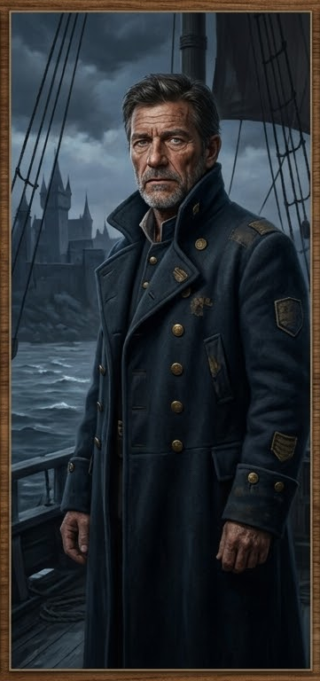

### D3. Капитан Алессандро Маретти («Солёный Алессандро»)

::: scene-meta
time: ~16:00
weather: Пасмурно. Облака сгустились, ветер нагоняет воду с залива.
location: Порт / таверна «Булькающая гаргулья», Весткроун.
purpose: Задание «Поиск дезертира»; награда; след у Адивианского моста.
:::

::: checklist
can:

- Задание «Поиск дезертира»
- Награда (казна/десятая часть)
- Знание: «Кайрэн — вор и дезертир»
- Зацепка «Слёзы устрицы» (след теряется у моста)
- Указание на таверны «Булькающая гаргулья» / «Трикалиста»
- Знание: платит Совету
  cannot:
- Что Моряк в таверне
- Культ в таверне
- Серия убийств в городе
- Детектив
  :::

Встреча — в порту (port) либо в таверне «Булькающая гаргулья». Капитан **нанимает** игроков на
поиск дезертира Корина Марроне («Кайрэн»), укравшего судовую казну корабля «Чёрная Сирена».

#### Зачитать при первой встрече

> Капитан ждёт вас в порту — не в таверне, не в каюте. Он стоит у причала, спиной к воде, лицом к вам. Ветер треплет
> полы его камзола. За спиной — «Чёрная Сирена»: чёрные паруса, белая сирена на каждом.
>
> Он не протягивает руку. Не улыбается. Просто смотрит — оценивающе, как человек, который привык командовать.
>
> — Значит, вы те, кто устроил драку на причале, — говорит он. — Хорошо. Мне нужны люди, которые умеют драться. И
> которые умеют *не* убивать.

#### Идентификация

- **Имя:** Алессандро Маретти.
- **Прозвище:** «Солёный Алессандро».
- **Роль:** Капитан корабля «Чёрная Сирена» (La Sirena Nera); **main_npc**.
- **Раса:** человек.
- **Мировоззрение:** Законопослушно-нейтральное (LN).
- **Статус:** main_npc.

::: note
Капитан — **не жертва серии** (can_be_murder_victim: false). Он **не знает** о Моряке в таверне, о культе в таверне и о
серийных убийствах в городе. Он знает только о дезертирстве и краже казны своего матроса.
:::

#### NPC: Капитан Алессандро Маретти

##### GM knows

- **Тайна:** «Драка с матросами» была **проверкой навыков**, а не нападением — Капитан хотел нанять игроков.
- **Связь:** Доктор Элио Вентури — бывший сослуживец Капитана (судовый врач на «Чёрной Сирене»); он **не знает** о
  краже казны.
- **Награда:** золото или возвращённая казна; Капитан хочет найти Моряка **живым** («хочу задать ему один вопрос:
  „Зачем?“»).
- **Совет Воров:** Капитан платит Совету, чтобы его не трогали; он знает Вассиндио Дровендж.

#### Задание: «Поиск дезертира»

Капитан **нанимает** игроков на поиск Корина Марроне (Кайрэн): моряк украл судовую казну (золото команды) и сбежал с
«Чёрной Сирены» полгода назад.

- **Приём заказа** → отношение Капитана растёт; игроки получают задание.
- **Знание:** «Кайрэн — вор и дезертир»; Капитан чувствовал, что Моряк в Весткроуне.

::: note

**Награда Капитана:**

- Казну вернёшь — четверть.
- Моряка приведёшь — десятую часть.
- И то, и другое — половину.
- Моряк мёртвый — половина от десятой части.
- Моряк живой — полная десятая часть.

**Капитан хочет Моряка живым.** «Я хочу задать ему один вопрос: „Зачем?“»
:::

#### Вопросы к Капитану

Ответы по шкалам **attitude** (hostile / unfriendly / indifferent / friendly / helpful). Стиль: суровая, вкрадчивая
морская лаконичность; «Дальше» — его манера завершать фразу.

::: answers
Капитан Алессандро Маретти

**Q:** Что за дело?
hostile: «Не твоё дело. Уйди.»
unfriendly: «Дезертир. Мой.»
indifferent: «Один человек с моего корабля. Дезертировал. Украл казну.»
friendly: «Украл судовую казну. Я ищу его. И заплачу тому, кто найдёт.»
helpful: «Корин Марроне — Кайрэн. Украл казну и ушёл. Мне нужен он живым.»

**Q:** Кто такой Корин Марроне?
hostile: «Не твоё дело.»
unfriendly: «Мой моряк. Дезертир.»
indifferent: «Матрос «Чёрной Сирены». Украл казну.»
friendly: «Хороший моряк, жадный. Украл казну и ушёл полгода назад.»
helpful: «Кайрэн — пять лет служил, воровал казну и сбежал. Ищу его полгода.»

**Q:** Почему он дезертировал?
hostile: «Не знаю.»
unfriendly: «Украл. Ушёл.»
indifferent: «Украл казну. Ушёл.»
friendly: «Жадность. Но почему именно тогда — не знаю.»
helpful: «Не знаю. Он умный — значит, у него был план. Быть может, его кто-то ждал.»

**Q:** Что он украл?
hostile: «Не твоё дело.»
unfriendly: «Казну.»
indifferent: «Судовую казну. Золото команды.»
friendly: «Казну команды. Не моё — общее. Предательство.»
helpful: «Казну — долю каждого матроса. Я могу простить бегство, но не воровство у команды.»

**Q:** Где он может быть?
hostile: «Не знаю.»
unfriendly: «В городе. Дальше.»
indifferent: «В городе. Мои люди видели его, но где — не знаю.»
friendly: «У порта, потом у моста — и след теряется.»
helpful: «Видали у порта, потом у Адивианского моста — и больше нет. Мост закрыт. Он в ловушке.»

**Q:** Почему вы не ищете его сами?
hostile: «Не твоё дело.»
unfriendly: «Я — капитан. Я не бегаю.»
indifferent: «Я не бегаю по улицам. Мои люди не справляются.»
friendly: «Он знает город, я — нет. Поэтому нанимаю тебя.»
helpful: «Меня знают, а тебя — нет. Ты — мой глаз и мой нож.»

**Q:** Вы заплатите? Сколько?
hostile: «Не твоё дело.»
unfriendly: «Заплачу.»
indifferent: «Казну — четверть. Его — десятую часть.»
friendly: «И то и другое — половину. Плачу честно.»
helpful: «Но мне нужен он живым. Мёртвым — половина от десятой. Живым — полная десятая.»

**Q:** Что такое «Чёрная Сирена»?
hostile: «Мой корабль.»
unfriendly: «Мой корабль.»
indifferent: «Мой флагман. Быстрый. Хожу на нём двадцать лет.»
friendly: «Чёрные паруса, белая сирена. Ты видел его в заливе — это я.»
helpful: «Чёрные паруса, белая сирена. Я пришёл за Корином — я чувствовал, что он здесь.»

**Q:** Вы платите Совету?
hostile: «Не твоё дело.»
unfriendly: «Плачу.»
indifferent: «Плачу. Все платят. Это порт.»
friendly: «Но если ты ищешь Корина — не говори Совету, они его предупредят.»
helpful: «Он всегда умел платить и пользоваться людьми. Я не знал — теперь знаю.»

**Q:** Что вы знаете о таверне «Булькающая гаргулья»?
hostile: «Таверна.»
unfriendly: «Таверна. Порт.»
indifferent: «Хорошее место. Я там останавливаюсь. Там можно поговорить.»
friendly: «Там не любят чужаков. Но со мной — можно.»
helpful: «Начни там. Моряки знают — моряки всегда знают.»

**Q:** Что вы знаете о «Трикалисте»?
hostile: «Таверна.»
unfriendly: «Таверна.»
indifferent: «Там пьют докеры и моряки. Много чего можно узнать.»
friendly: «Но осторожно — там много глаз, Совет слушает.»
helpful: «Спроси там, но не говори, что ты от меня. Скажи, что ты сам по себе.»
:::

#### Итоги сцены D3

- Задание **«Поиск дезертира»** (приём заказа); отношение Капитана растёт.
- Награда: золото или возвращённая казна; Капитан хочет Моряка **живым**.
- **Зацепка:** «Кайрэн — вор и дезертир»; след теряется у Адивианского моста.
- Указание на **таверны** «Булькающая гаргулья» / «Трикалиста» (дальнейший допрос).
- Переход к **§D4 Таверна „Трикалиста“** (дальнейший допрос моряков/докеров).

#### Что дальше

- **Переход к §D4 Таверна „Трикалиста“** (дальнейший допрос моряков/докеров).
- **Переход к §F2** (отказ на воде — если партия решила ехать на «Чёрной Сирене»).
- Если игнор — Капитан сам нанимает других; игроки остаются без задания, но без врага.

Если не используется milestone leveling, то партия за сцену получает:

| Действие                        | XP |
|---------------------------------|----|
| Приняли заказ «Поиск дезертира» | 20 |
| Узнали о «Чёрной Сирене»        | 10 |
| Узнали про Совет Воров          | 10 |
| Узнали про таверны              | 10 |
