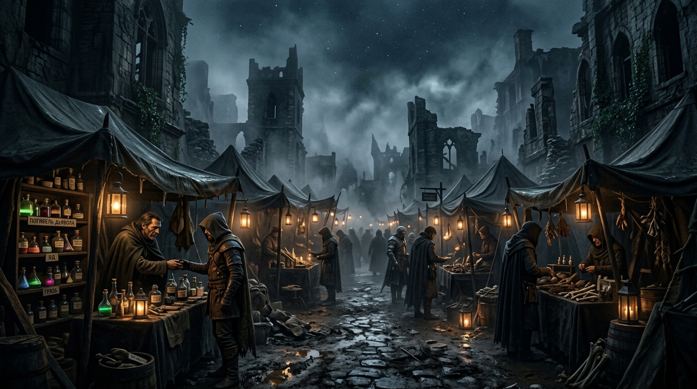

## E. Сумеречный рынок (E1 → E2 → E3 → E4)

**Время:** ~14:00–17:00.

Ветка **E — Сумеречный рынок** ведёт игроков на **блуждающий чёрный рынок** в руинах северной части города (Парего
Доспера, Рего Кадер — «Мертвый Сектор»). Путь начинается с места проведения ритуала, затем — налёт воров Совета, Совет
Воров и опрос торговцев. Отсюда партия выходит на **контрабанду** (ветка B / smugglers), на **Совет Воров** и на след
**«Погибели Дьявола»**, который ведёт в таверну «Слёзы устрицы».

Ветка доступна из развилки **§B4** (маршрут «Сумеречный рынок — на север, в руины Рего Кадер») и из зацепок о
запрещённых товарах (из §B2 Художник, из слухов на мосту §B1).

Общий тайминг (эскалация погоды): E1 ~14:00 → E2 ~15:00 → E3 ~16:00 → E4 ~16:30 → 17:00 дождь → глава 2.

---

### E1. Место проведения ритуала (по пути на Сумеречный рынок)

::: scene-meta
time: ~14:00
weather: Пасмурно. Небо чернеет, ветер крепчает; воздух сыр и тяжёлый.
location: Тёмный переулок / руины Рего Кадер, «Мертвый Сектор», Парего Доспера.
purpose: Место проведения ритуала Дагона; улика (кольцо культистов); зацепка «Маньяк в городе»; выход к Сумеречному
рынку.
:::

::: checklist
can:

- Улика места ритуала (кольцо культистов; следы перепончатых лап; выжженный отпечаток тела)
- Зацепка «Культ Дагона / Официантка и Доктор»
  cannot:
- Имя убийцы
- Зацепка «Маньяк в городе» (ритуал ≠ серийное убийство; только предполагает)
- Точная связь с таверной «Слёзы устрицы»
- Культ в таверне
- Полный план расследования
  :::

::: figure [Сумеречный рынок;width:100%;height:auto]

:::

По пути на Сумеречный рынок, в руинах Рего Кадер, партия натыкается на место, где недавно был убит человек. На стенах —
влажные потёки, на земле — круг, вычерченный солью.

#### Зачитать при первом входе

> За проломом в стене начинается узкий двор, давно отрезанный от улицы обвалившимися арками. Между камнями проросла
> жёсткая трава, но в центре двора земля голая, будто её выжгли.
>
> На стене проступает влажный знак: глаз, заключённый в круг, а вокруг него — линии, похожие то ли на руны, то ли на
> тонкие щупальца. Вода стекает по рисунку и собирается у основания стены в чёрную лужицу.
>
> На земле вычерчен круг. Его граница неровная: соль смешана с чем-то тёмным, густым, и местами следы пальцев уходят
> в грязь. В центре остался силуэт человеческого тела — не тело, а выжженный отпечаток, с тёмными краями и мелкими
> трещинами в камне.
>
> Вокруг стоят огарки чёрных свечей. Воск вытянулся по земле длинными наростами, напоминающими щупальца. Ветер
> здесь почти не ощущается, однако пламя одной уцелевшей свечи дрожит и наклоняется к центру круга.
>
> Из водостока доносится тихое бульканье.
>
> У самого стока видны следы босых ног. Они уходят в темноту, и в нескольких отпечатках между пальцами тянутся тонкие
> перемычки кожи.

#### Истина для мастера

> **Только для мастера.** Не зачитывать игрокам.

**Что произошло.** Здесь недавно проводили ритуал культа Дагона. Пространство использовали для обряда: важны границы
круга, символ, свечи, следы жидкости и положение жертвы. Даже если ритуал был жестоким, его цель не сводится к
демонстрации тела ради зрителя.

**Что сцена должна сообщить игрокам:**

- Это место проведения ритуала культа Дагона, а не случайная сцена убийства.
- Здесь есть культовые предметы (кольцо культистов) и следы участников.
- Ритуальная разметка — отдельный почерк, отличный от серии «Маньяка».

**Что пока не следует раскрывать:**

- Имя убийцы.
- Точную связь с таверной «Слёзы устрицы».
- Культ в таверне.
- Полный план расследования.

#### Описать игрокам

> За проломом в стене начинается узкий двор, давно отрезанный от улицы обвалившимися арками. Между камнями проросла
> жёсткая трава, но в центре двора земля голая, будто её выжгли.
>
> На стене проступает влажный знак: глаз, заключённый в круг, а вокруг него — линии, похожие то ли на руны, то ли на
> тонкие щупальца. Вода стекает по рисунку и собирается у основания стены в чёрную лужицу.
>
> На земле вычерчен круг. Его граница неровная: соль смешана с чем-то тёмным, густым, и местами следы пальцев уходят
> в грязь. В центре остался силуэт человеческого тела — не тело, а выжженный отпечаток, с тёмными краями и мелкими
> трещинами в камне.
>
> Вокруг стоят огарки чёрных свечей. Воск вытянулся по земле длинными наростами, напоминающими щупальца. Ветер здесь
> почти не ощущается, однако пламя одной уцелевшей свечи дрожит и наклоняется к центру круга.
>
> Из водостока доносится тихое бульканье. У самого стока видны следы босых ног. Они уходят в темноту, и в нескольких
> отпечатках между пальцами тянутся тонкие перемычки кожи.

#### Слой A. Видно без проверки

- На стене — влажный знак: глаз в круге, обведённый линиями-рунами/щупальцами.
- На земле — вычерченный круг солью с тёмными следами пальцев.
- В центре круга — выжженный отпечаток человеческого тела.
- Огарки чёрных свечей; воск вытянулся наростами, похожими на щупальца.

#### Слой B. При целенаправленном осмотре

- Следы босых ног с перемычками кожи (перепонки), уходящие к ливневому стоку.
- Золотое кольцо (Кольцо культистов) с гравировкой на древнем языке (Акло).
- Тихое бульканье из водостока.

Бросок не нужен, чтобы заметить круг, знак или кольцо: достаточно осмотреть место. Критический успех (или удачная
проверка) даёт **уточнение** — например, узнавание символа Дагона или связь повреждении с ритуалом, — но не
единственный способ получить обязательную улику.

#### Слой C. Проверки навыков

::: check
Осмотреть место ритуала
[Внимательность, 10]
success: Вы находите следы перепончатых лап, ведущие к стоку ливневой канализации, и золотое кольцо с гравировкой.
critical_success: Вы замечаете: граница круга неровная, соль смешана с тёмной густой жидкостью; пламя уцелевшей свечи
наклоняется к центру круга.
failure: Вы видите лишь выжженный круг и потёки; ничего не бросается в глаза.

[Медицина, 12]
success: Вы понимаете: отпечаток в центре круга — это не тело, а выжженный силуэт; здесь важно пространство вокруг
жертвы, а не сама жертва.
critical_success: Вы замечаете: повреждение в центре круга не обязательно соответствует способу смерти — ритуал мог
происходить до или после убийства.

[Религия, 12]
success: Вы узнаёте символ Дагона (глаз осьминога в золотом диске, обведённый рунами) и ритуальную разметку круга.
critical_success: Вы понимаете: это обряд, а не преступление ради зрителя; здесь важны границы круга и место жертвы.
:::

> Сложность (СЛ) приведена ориентировочно; сверьте уровень группы (4 героя 5-го уровня) и выберите стандартную или
> подходящую по контексту сложность в PF2e Legacy.

#### Улика: кольцо культистов

::: note *Улика места:*

Золотое кольцо (Кольцо культистов) с гравировкой на древнем языке (Акло), обнаруженное в ходе осмотра.

- **Связь с расследованием:** указывает на **культ Дагона / Официантку и Доктора**.
- **Зацепка «Маньяк в городе» (только предполагает):** ритуальная разметка *не обязательно* означает серийное убийство;
  культ и маньяк — разные почерки.
  :::

#### Карточки улик

- **E1-01. Кольцо культистов (сильная).** Источник: место ритуала. Факт: золотое кольцо с гравировкой на древнем языке
  (Акло). Допустимый вывод: участники ритуала — культисты Дагона; связь с Официанткой и Доктором. Следующий шаг:
  расспросить о культе, сопоставить с другими культовыми предметами. Ограничение: не доказывает серийное убийство.
- **E1-02. Символ Дагона + ритуальный круг (основная).** Источник: стена/земля. Факт: влажный знак (глаз в круге) и
  вычерченный солью круг. Допустимый вывод: здесь проводили обряд культа Дагона. Следующий шаг: проверить культовую
  связь, §E3/§C3. Ограничение: не устанавливает личность убийцы.
- **E1-03. Следы перепончатых ног (дополнительная).** Источник: земля/сток. Факт: босые ноги с перемычками кожи,
  уходящие к ливневому стоку. Допустимый вывод: один из участников не человек. Следующий шаг: сопоставить с
  свидетельствами о культистах и другими телами. Ограничение: не доказает причастность конкретного убийцы.
- **E1-04. Выжженный контур тела (перекрёстная).** Источник: центр круга. Факт: выжженный отпечаток тела. Допустимый
  вывод: могут перепутать с композициями Художника. Следующий шаг: при внимательном осмотре — заметное различие (см.
  «Что мастер знает»). Ограничение: не доказывает серийное убийство.

#### Что мастер знает

> **Только для мастера.** Не зачитывать игрокам.

**Почерк:** это не постановка ради зрителя. Пространство использовали для обряда: важны границы круга, символ, свечи,
следы жидкости и положение жертвы.

**Улики и их сила:**

- **Знак Дагона + ритуальный круг (основная):** вырезанный/влажный символ и вычерченный круг.
- **Следы перепончатых ног (дополнительная):** босые ноги с перемычками кожи, уходящие к ливневому стоку.
- **Золотое кольцо с гравировкой на Акло (сильная):** оставлено или потеряно участником ритуала; доступно при
  целенаправленном осмотре, критический успех уточняет.
- **Выжженный контур тела (перекрёстная зацепка):** могут перепутать с композициями Художника, но при внимательном
  осмотре заметно различие — здесь геометрию задаёт ритуальная разметка, а не расположение останков.
- **Форензический признак:** повреждение в центре круга не обязательно соответствует способу убийства — ритуал мог
  происходить до или после смерти.

**Главное различие с Художником.** Художник оформляет жертву как произведение; культ организует пространство вокруг
ритуала. Внешне оба могут выглядеть театрально, но композиция подчинена разным правилам. Это предвестие логова культа
(`cult_lair`), а не его уменьшенная копия — не раскрывайте здесь все секреты подвала.

#### Как сцена связывается с остальным

- **Кольцо / символ Дагона →** линия культа Дагона, Официантка и Доктор (§C3/§E3).
- **Следы перепончатых ног →** сопоставить с культистами и другими телами.
- **Зацепка «Маньяк в городе» →** только предполагает (ритуал ≠ серийное убийство); стража *может* отвести к
  Дуротасу Сарии, но это не факт.

Это потенциальные переходы, а не предписанный маршрут.

> Знакомство с Детективом — отдельная сцена (§C2). Отсюда — развилка: к **§D1** (убитый вор, по пути в порт) или к
> **§F1** (убитый контрабандист, если партия задержалась в городе до заката), а затем — в **§E2** (Налёт воров Совета).

#### Итоги сцены E1

После E1 игрокам необязательно знать, кто убийца, но у них должны появиться содержательные версии и возможность
действовать дальше.

| Вопрос               | Что уже можно обоснованно предположить                |
|----------------------|-------------------------------------------------------|
| Что здесь произошло? | Проведение ритуала культа Дагона                      |
| Кто причастен?       | Культисты Дагона (Официантка / Доктор)                |
| Это серия Художника? | Нет: ритуал ≠ серийное убийство (только предполагает) |
| Кто убийца?          | Пока неизвестно                                       |
| Куда идти дальше?    | Линия культа Дагона / §E2 Налёт воров Совета          |

- Улика места ритуала: **кольцо культистов** (плюс следы перепончатых лап, выжженный отпечаток тела; символ Дагона
  узнаётся проверкой).
- Зацепка **«Культ Дагона / Официантка и Доктор»** (доказывает).
- Зацепка **«Маньяк в городе»** — только *предполагает*: ритуал не обязательно серийное убийство.
- Переход к **§E2 «Налёт воров Совета»** (боевой энкаунтер; по пути к рынку).

Если не используется milestone leveling, то партия за сцену получает:

| Действие                | XP |
|-------------------------|----|
| Заметили место ритуала  | 10 |
| Получили улику места    | 20 |
| Узнали о серии убийств  | 10 |
| Узнали про культ Дагона | 10 |
