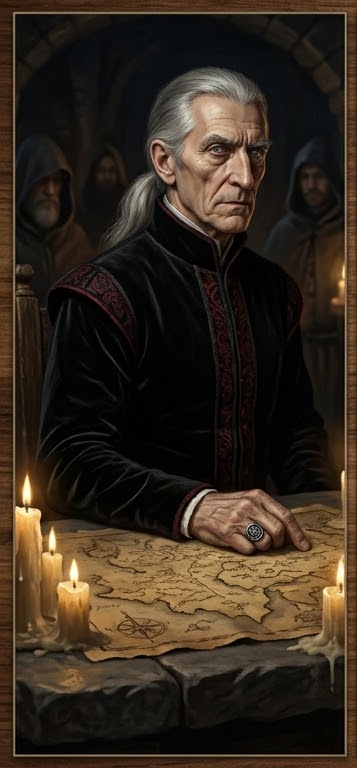

### E2. Совет Воров — Вассиндио Дровендж

::: scene-meta
time: ~16:00–17:00
weather: Пасмурно. Облака сгустились, ветер крепчает; скоро дождь.
location: Тайный подвал Совета Воров (Council of Thieves), Парего Доспера.
purpose: Встреча с патриархом Совета; заказ «Поиск контрабандиста»; зацепка о контрабанде/реликвии.
:::

::: checklist
can:

- Встреча с Вассиндио Дровендж (патриарх Совета)
- Зацепка «Совет Воров» (реальная власть города)
- Зацепка «Контрабанда Погибели Дьявола»
- Зацепка «Погибель Дьявола идёт из „Слёз устрицы“»
- Заказ «Поиск контрабандиста» (Корин Марроне)
- Указание на реликвию (намёк)
  cannot:
- Имя убийцы
- Культ в таверне
- Полный план расследования
  :::

::: figure [Совет Воров;width:100%;height:auto]

:::

> Совет Воров — легендарная теневая преступная организация Весткроуна и фактическая реальная власть города, скрытая за
> видимой городской властью (Дуксотар, Мэр). Большинство горожан считает Совет лишь старой сказкой или мифом — и это их
> устраивает. Встречи — в тёмных переулках, подземных подвалах и тёмных уголках города, вдали от глаз. Атмосфера тайны,
> шантажа, власти. Пахнет дымом, тёмным деревом, вином; слышен шёпот и далёкие голоса.

#### Как игроки попадают сюда (продолжение §E1)

Эта сцена проистекает из сцены **§E1 «Налёт воров Совета»**:

- **Если игроки победили:** оставшиеся воры отступают, а главарь бросает: «Ладно. Вы прошли проверку. Совет захочет с
  вами поговорить. Приходите на Сумеречный рынок и попросите Вассиндио.» — игроки **приходят сами** (по приглашению).
- **Если игроки проиграли:** «Вы приходите в себя в тёмном подвале. Руки связаны, оружие лежит на столе в стороне. Перед
  вами — старик с длинными седыми волосами и пронзительным взглядом. Он не улыбается. — „Итак. Давайте начнём
  сначала.“» — игроков **приводят силой**.

::: note
Мастеру: исход §E1 (победа/проигрыш) меняет только ТОН встречи, не её суть. При проигрыше Вассиндио холоден и
непримирим (candor старт — hostile/unfriendly); при победе — вежлив и сдержан (candor старт — indifferent).
:::

#### Что зачитать при встрече

> В тёмном подвале, за столом, сидит старик с длинными седыми волосами и пронзительным взглядом. Он одет в тёмные,
> дорогие, но неброские одежды. Вокруг него — несколько фигур в капюшонах. На столе — карта города, свечи, вино. Он
> говорит тихо, но каждое слово звучит как приказ. От него веет властью, тайной и холодом.

#### NPC: Вассиндио Дровендж — Патриарх Совета Воров

- **Имя:** Вассиндио Дровендж.
- **Прозвище:** «Патриарх».
- **Роль:** глава Совета Воров (council_of_thieves), дом Дровендж.
- **Раса:** человек.
- **Мировоззрение:** Законопослушно-злое (LE).
- **Класс:** вор (Mastermind), уровень 10.
- **Статус:** контекстный NPC (к 4710 AR его власть ослабевает; внутри Совета зреет революция).

##### GM knows

- **Тайна:** Совет — реальная власть города, скрытая за видимой властью (Дуксотар/Мэр); тайное общество, а не обычная
  воровская гильдия.
- **Критическая зацепка:** «Совет Воров» — ключ к пониманию, почему контрабанда Корина Марроне/Трактирщика не замечена
  (идёт само, минуя Совет, в общак не вносят). Не терять из-за одного провала.
- **Реакция при раскрытии тайны:** Совет угрожает, шантажирует, подкупает — **не нападает открыто** (тайная
  организация).
- **История:** Совет возник ~4285 AR; после соглашения с королевой Корадинной (4469 AR) перешёл к «беловоротничковой»
  преступности (шантаж, ростовщичество, контрабанда, заказные убийства). В Весткроуне нет других воровских гильдий —
  только Совет.

#### Диалог: допрос Вассиндио Дровендж

> По 5 уровням откровенности (`candor_level`, стартовое `unfriendly`, при проигрыше §E1 — `hostile`). Ответы ниже
> повторяют содержание предыдущего и добавляют детали.

::: answers
Вассиндио Дровендж — Патриарх Совета Воров

**Q:** Что Совету известно о серии убийств в городе?
hostile: «Вы ошиблись дверью. И эта ошибка станет последней. Уберите их из моего кабинета.»
unfriendly: «Вы дерзки, приходя с вопросами. Ржут и режут не наших людей — но это мешает торговле. Говорите дело, пока
я вежлив.»
indifferent: «Убийца режет мусор — воров, проституток, портовую пьянь. Нам это не вредило бы, если бы доттари не
ночевали на каждом углу. Найдите этого живописца — и Совет оценит услугу.»
friendly: «Жертвы не случайны. Все они гуляли на „Празднике Гнева“ около семи месяцев назад в „Слёзах устрицы“. Кто-то
методично вычищает тех гостей. Ищите зацепку там.»
helpful: «Один из убитых нёс наш товар — ящик „Погибели Дьявола“. Убийца не тронул золото, но забрал жизни ради
пыток. Это не воровская разборка. Это работа идейного безумца.»

**Q:** Что вы знаете о Корине Марроне (Моряке) и Гаэтано (Трактирщике)?
hostile: «Те, кто произносит имена должников без золота в руках, долго не живут.»
unfriendly: «Гаэтано и беглый матрос Марроне забыли, кто держит тень над Весткроуном. Они крысят товар.»
indifferent: «Они торгуют „Листом-живодёром“ и „Погибелью Дьявола“ в своей загородной таверне, минуя кассу Совета.
Думают, за мостом наша рука их не достанет.»
friendly: «Марроне сбежал с корабля с казной, а Гаэтано даёт ему приют. Если вы заставите их выплатить долг Совету —
вы получите нашу полную поддержку.»
helpful: «Марроне не просто крысит. Он шантажирует половину порта и ищет покупателей на крупную партию товара.
Приведите его к нам или заберите украденное — и теневой Весткроун ваш.»

**Q:** Вы знаете про реликвию, украденную из Мендева?
hostile: «Совет не отчитывается перед бродягами о своих приобретениях.»
unfriendly: «Старый ковчег? Мы наводили на него людей, но дело давно закрыто. Проходите мимо.»
indifferent: «Наши ребята перехватили ковчег с черепом в Мендеве. Но Совет не держит святынь. Мы сбыли её тому, кто
заплатил больше.»
friendly: «Реликвию перекупили фанатики Дагона. Спрятали в своём подполье. Трактирщик Гаэтано делает вид, что не
знает, что у него под полом, но его дочка увязла в этом по уши.»
helpful: «Реликвия всё ещё под алтарём в подвале „Слёз устрицы“. Культисты выкупили её через Марроне. Убийца в городе
ищет именно её, но ищет не там — он пыточным железом выбивает правду из гостей праздника.»

**Q:** Что Совет хочет от партии?
hostile: *(Молча указывает на дверь.)*
unfriendly: «Чтобы вы не путались под ногами и закрыли дело с маньяком.»
indifferent: «Найдите Марроне. Верните долг Совета или ящик с товаром. Взамен стража и воры не будут вам мешать.»
friendly: «Остановите резню в городе и найдите Марроне. Мы дадим вам проход через все портовые посты и прикроем перед
доттари.»
helpful: «Станьте нашими глазами за мостом. Найдите реликвию, прижмите Марроне и Гаэтано. Взамен Совет станет вашим
должником. А долги мы отдаём всегда.»

**Q:** Что за дело?
hostile: «Уйди. Я занят.»
unfriendly: «Контрабанда. Дальше не спрашивай.»
indifferent: «Один человек. Контрабандист. Он не платит Совету. Я ищу его. Или его товар. Или и то и другое.»
friendly: «Один контрабандист. Он возит товар через наш порт. Он не платит в общак. Это — неуважение. Я ищу его. Или
его товар. Или и то и другое. Я заплачу тому, кто найдёт.»
helpful: «Один контрабандист. Он возит „Погибель Дьявола“ и прочую дрянь через наш порт. Он не платит в общак. Это —
неуважение. Совет не любит неуважения. Я заплачу золотом. Или верну украденное — если найдёшь. Но мне нужен он.
Живым. Я хочу задать ему пару вопросов.»

**Q:** Кто такой контрабандист?
hostile: «Не твоё дело.»
unfriendly: «Моряк. Дальше.»
indifferent: «Моряк. Он возит товар. Он не платит. Я не знаю его имени. Мои люди — знают. Но они — молчат. Пока.»
friendly: «Моряк. Он возит товар из порта в таверну за городом. Он не платит Совету. Он где-то в порту. Или в
таверне. Я ищу его.»
helpful: «Моряк. Корин Марроне. „Ржавый“. Он возит товар из порта в „Слёзы устрицы“. Он не платит Совету. Я знаю его
имя. Я знаю, где он. Но я хочу, чтобы его нашли вы. Вы — не Совет. Вы — никто. Пока.»

**Q:** Что он возит?
hostile: «Не твоё дело.»
unfriendly: «Товар. Дальше.»
indifferent: «Товар. „Погибель Дьявола“. Пеш. Лист-живодёр. Грязь. Всё — запрещённое. Всё — дорогое. Всё — не через
Совет.»
friendly: «„Погибель Дьявола“. Пеш. Лист-живодёр. Грязь. Всё — запрещённое. Он возит это в „Слёзы устрицы“.
Трактирщик — его партнёр. Но Трактирщик платит Совету. А Моряк — нет. Это — неуважение.»
helpful: «„Погибель Дьявола“. Пеш. Лист-живодёр. Грязь. И ещё что-то странное. Мои люди видели ящики с символами.
Мокрые. Это — не просто наркотики. Это — что-то для культа Дагона. Я хочу знать. Поэтому я нанимаю вас.»

**Q:** Вы заплатите? Сколько?
hostile: «Не твоё дело.»
unfriendly: «Заплачу. Дальше.»
indifferent: «Заплачу. Золотом. Товар — четверть. Его — десятую часть.»
friendly: «Товар — четверть. Его — десятую часть. Если найдёшь и то и другое — половину. Но мне нужен он. Живым.
Мёртвым — половина от десятой.»
helpful: «Товар — четверть. Его — десятую часть. Если найдёшь и то и другое — половину. Но мне нужен он. Живым. Я
хочу задать ему вопрос. „Почему?“ И: „Для кого?“»

**Q:** Что такое Совет Воров?
hostile: «Уйди.»
unfriendly: «Совет. Дальше не спрашивай.»
indifferent: «Тайное общество. Мы контролируем порт, контрабанду, шантаж. Мы — не банда. Мы — структура. Мы — власть.
Но не видимая. Видимая власть — Дуксотар. Он подписывает. Мы решаем.»
friendly: «Восемь домов. Восемь голосов. Один патриарх. Я — патриарх. Я — не король. Я — первый среди равных. Но
равных — нет. Есть те, кто слушает. И те, кто боится.»
helpful: «…Ты — не боишься. Это хорошо. Пока. Но если ты найдёшь Моряка — может, ты станешь кем-то. Может. Я не
обещаю.»

:::

#### Итоги сцены E2

- **Встреча с Советом Воров** (реальная власть города, скрытая за Дуксотаром/Мэром).
- **Зацепка «Совет Воров»** — ключ к пониманию, почему контрабанда не замечена.
- **Заказ «Поиск контрабандиста»** (Корин Марроне / „Ржавый“); награда — золото, проход через портовые посты,
  прикрытие перед доттари.
- **Зацепка «Погибель Дьявола идёт из „Слёз устрицы“»**; намёк на реликвию (под алтарём в подвале таверны).
- **Главный хук главы 1:** все нити (в т.ч. ветки A/B/C/D/E/F) ведут в таверну **«Слёзы устрицы»** за городом.
- Переход к **§E3 Опрос торговцев** (если игроки хотят ещё информации) или к §F (вечер в городе) — если задерживаются.

Если не используется milestone leveling, то партия за сцену получает:

| Действие                            | XP |
|-------------------------------------|----|
| Поговорили с Вассиндио              | 10 |
| Взяли заказ «Поиск контрабандиста»  | 20 |
| Узнали про «Погибель Дьявола»       | 20 |
| Узнали, что товар из «Слёз устрицы» | 20 |
| Узнали про реликвию (намёк)         | 10 |
