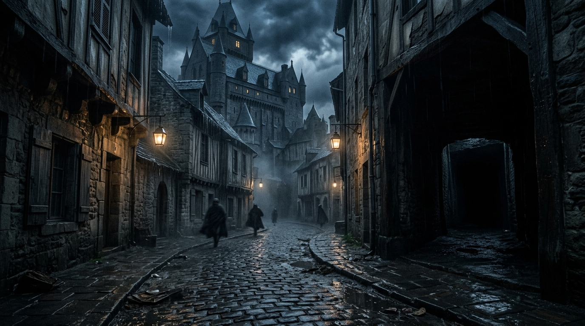

## F. Вечер в городе (F1 → F2 → F3)

**Время:** ~17:30–20:30.

На 17:30 развилке (§D4 / §C4) игроки **не уезжают** из города и остаются на улицах после заката. Ветка **F — Паром /
Ночь**: сначала — место убийства контрабандиста, затем — отказ на воде (паром/лодка), затем — **ночь в городе** (боевой
энкаунтер со стаями теней). Итог ветки: Художник (Лучиано Аврелиан) буквально за ручку отводит игроков в таверну
«Слёзы устрицы» за городом.

Общий тайминг (эскалация погоды): F1 ~17:30 → F2 ~18:00 → F3 ~19:00 → 20:30 таверна (конец главы 1 / начало главы 2).

---

### F1. Место убийства контрабандиста (задержались после заката)

::: scene-meta
time: ~17:30
weather: Пасмурно. Небо чернеет, ветер крепчает; скоро закат, первые капли дождя.
location: Улица у подступов к порту Весткроуна, «Город Сумерек» (Парего Спе́ра).
purpose: Место убийства контрабандиста; улика «Лист-живодёр»; зацепка «Маньяк в городе»; выход к порту.
:::

::: checklist
can:

- Улика места убийства контрабандиста (остатки «Лист-живодёра»; ящик «Погибели Дьявола»)
- Зацепка «Маньяк в городе»
- Зацепка «Контрабанда / Совет Воров»
- Перекрёстная зацепка с §B2 (Художник)
  cannot:
- Имя убийцы
- Точная связь с таверной «Слёзы устрицы»
- Культ в таверне
- Полный план расследования
  :::

::: figure [Улицы Весткроуна;width:100%;height:auto]

:::

Игроки задержались в городе после заката (17:30) — дождь усиливается, и на улицах становится опасно. По пути к порту,
у подступов к докам, они натыкаются на ещё одно место серии.

#### Зачитать при первом входе

> Вы задержались в городе после заката. Дождь усиливается, и на улицах становится опасно. За поворотом — перевёрнутая
> бочка, а рядом — тело. На губах жертвы — следы жидкости, а рядом с телом — разбитый ящик с оттиском «Погибель
> Дьявола».

#### Наблюдения

- **Перевёрнутая бочка / разбитый ящик** — оттиск «Погибель Дьявола».
- **Следы жидкости на губах** — жертва пробовала контрабанду.
- **Запах порта** — дёготь, рыба, соль; скоро и доки.

#### Осмотреть место убийства

::: check
Осмотреть место убийства
[Внимательность, 10]
success: Вы находите остатки «Лист-живодёра» (контрабанда) на губах и руках жертвы.
critical_success: На критическом успехе вы замечаете: ящик с оттиском «Погибель Дьявола» — товар, запрещённый в Челии.
failure: Вы видите лишь тело у бочки; ничего не бросается в глаза.

[Общество, 12]
success: Вы понимаете: местная стража знает о серии, но молчит и не ищет.
:::

#### Улика: «Лист-живодёр»

::: note *Улика места:*

Остатки «Лист-живодёра» (контрабанда) на губах и руках жертвы, а рядом — разбитый ящик с оттиском «Погибель Дьявола».

- **Связь с расследованием:** указывает на **контрабанду / Совет Воров**.
- **Зацепка «Маньяк в городе»:** тело + контрабанда → серийное убийство; стража отправляет к Дуксотару.
:::

> Знакомство с Детективом — отдельная сцена (§C2). Отсюда — развилка: к **§D1** (убитый вор, по пути в порт) или к
> **§E1** (ритуал культа, по пути на Сумеречный рынок), а затем — в **§F2** (отказ на воде).

#### Итоги сцены F1

- Улика места убийства контрабандиста: **остатки «Лист-живодёра»** (и, при критическом успехе — ящик «Погибели
  Дьявола»).
- Зацепка **«Маньяк в городе»** → стража отправляет к Дуксотару.
- Зацепка **«Контрабанда / Совет Воров»**.
- Переход к **§F2 Паром / Аренда лодки** (отказ на воде; если игроки остаются в городе после темноты, 18:00).

Если не используется milestone leveling, то партия за сцену получает:

| Действие                    | XP |
|-----------------------------|----|
| Заметили место убийства     | 10 |
| Получили улику места        | 20 |
| Узнали о серии убийств      | 10 |
| Узнали про контрабанду      | 10 |
