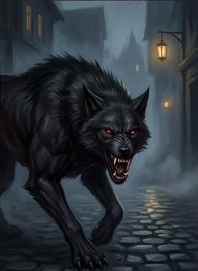

### F3. Ночь в городе (Стая из Нижних Теней)

::: scene-meta
time: 19:00 и позже
weather: Ночь, туман; ливень.
location: Тёмный переулок/пустырь, Парего Спе́ра, или окраина у реки Адивиан.
purpose: Боевой энкаунтер «Стая из Нижних Теней»; Художник отводит игроков в таверну.
:::

::: checklist
can:

- Боевой энкаунтер (11 тварей, Extreme+/TPK)
- Спасение Художником (если встречал днём)
- Зацепка: потоп / твари
- Уход в „Слёзы устрицы“
  cannot:
- Имя убийцы
- Точная связь с таверной „Слёзы устрицы“
- Культ в таверне
- Полный план расследования

:::

**Условие:** игроки не покинули город до заката (17:30) и остались на улицах после темноты (19:00). Сцена нужна, чтобы
заставить игроков отправиться в таверну (Художник буквально за ручку отводит игроков туда).

#### Атмосфера

Тёмный переулок или пустырь в Парего Спе́ра (южный, «жилой» Весткроун), либо окраина у реки Адивиан. Ночь, туман,
единственный источник света — далёкий фонарь или луна, скрытая облаками.

Сначала — тишина. Потом — низкий, вибрирующий вой, от которого стынет кровь. Из темноты проступают силуэты: огромные
псы с шерстью, которая пьёт свет, и бесплотные фигуры, чьи касания оставляют холод в костях.

#### Зачитать при нападении

> Низкий вой разрывает тишину ночи, и в темноте проступают силуэты:
> — огромные псы, чья шерсть пьёт свет;
> — бесплотные фигуры теней, чьи касания оставляют холод в костях.
> Пахнет гарью и морозом.
>
> **Лучиано** (если встречал игроков днём) присоединится к партии после первого хода, ворча: «Предупреждали же не
> ходить в темноте».

#### Сцена: Стая из Нижних Теней (боевой энкаунтер)

Это не просто звери — это осколки проклятия Илнерика, движимые голодом и злобой. Они охотятся стаей: **Shadow Mastiff**
окружают и сбивают с ног, **Shadow** атакуют сквозь плоть, высасывая жизнь.

**Уровень опасности для партии 4×5:** **Extreme+ (TPK).** Без вмешательства Лучиано партия почти гарантированно
погибает в первые 2–3 раунда.

##### Состав энкаунтера

::: pftab[Уровень сцены]

| Боец                 | Уровень | Количество |
|----------------------|---------|------------|
| Shadow Mastiff       | 6       | 4          |
| Shadow Mastiff Alpha | 8       | 1          |
| Shadow               | 3       | 6          |
| **Итого**            |         | **11**     |

:::

##### Статблоки тварей

Статблоки бойцов — **Shadow Mastiff**, **Shadow Mastiff Alpha** и **Shadow** — см. в **Бестиарии** (раздел
«Теневые твари»).

##### Тактика стаи

- **Раунд 1 (шок и страх):** Alpha и два mastiff используют **Ужасающий вой**. Партия 5 уровня имеет Волю примерно
  +8–+12; при СЛ 22–26 большинство проваливает. «Испуган 3» = -3 ко всем проверкам и КБ, «Бежит 1» = тратить действия
  на бегство. Shadows используют **Скольжение в тенях (Slink in Shadows)** и подходят вплотную.
- **Раунд 2 (окружение):** Mastiff используют **Теневое слияние**, становятся невидимыми и атакуют с «Застигнута
  врасплох». **Стайная тактика** даёт +2 к атакам. Каждая атака сбивает с ног.

#### Что дальше (после боя)

- **С Лучиано** → стая отступает; Художник буквально за ручку отводит игроков в **таверну «Слёзы устрицы»**.
- **Без Лучиано** → TPK в первые 2–3 раунда (без вмешательства Мастера).
- **Главный хук:** ночная сцена — не тупик, а путь к таверне; она гонит игроков к свету «Слёз устрицы».

#### Итоги сцены F2

- Боевой энкаунтер (11 тварей, **Extreme+ / TPK**); без Лучиано — почти гарантированный TPK.
- **С Лучиано** — стая отступает; он отводит игроков в таверну «Слёзы устрицы».
- **Главный хук главы 1:** все нити (в т.ч. ветки A/B/C/D/E/F) ведут в таверну **«Слёзы устрицы»** за городом.
- 20:30 — игроки в таверне; конец главы 1 / начало главы 2.

Если не используется milestone leveling, то партия за сцену получает:

| Действие                 | XP |
|--------------------------|----|
| Выжили в ночной сцене    | 20 |
| Спасены Художником       | 10 |
| Ушли в „Слёзы устрицы“   | 10 |
| Узнали про потоп / твари | 10 |
