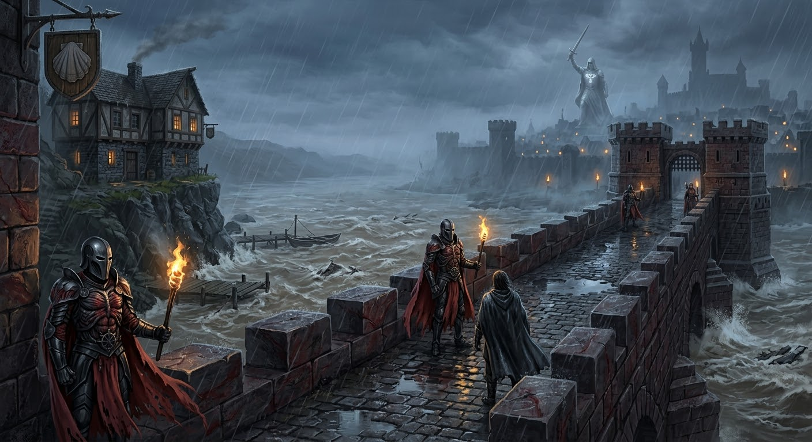
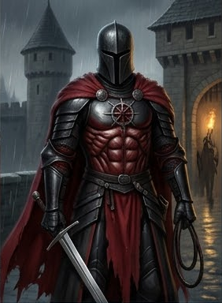

### A1. Адивианский мост

::: scene-meta
time: 18:00
weather: Ливень; ветровой нагон с залива; вода под мостом мутнеет и прибывает.
location: Адивианский мост (adivian_bridge) — тракт над рекой Адивиан, в миле к западу-северо-западу от Весткроуна.
Вводная локация главы 2.
purpose: Прибытие к таверне; изоляция (мост закрывают до утра); первые зацепки: странная вода, гарнизон Адских рыцарей,
пристань с яликом.
:::

::: checklist
can:

- Мост закрывают до утра → изоляция таверны (давление)
- Зацепка: в башне не хватает одного рыцаря
- Зацепка: знание об Ордене Дыбы (Order of the Rack)
- Зацепка: странная вода — потоп / чары Дагона
- Указание на пристань и ялик внизу (путь спасения)
  cannot:
- Имя убийцы
- Точная связь таверны с делом, приведшим партию
- Любое доказательство вины

:::

::: figure [Адивианский мост;width:100%;height:auto]

:::

#### При выезде на мост зачитать:

> Вы переезжаете через Адивианский мост (Adivian Bridge) — каменный мост через реку Адивиан (Adivian River), в миле к
> западу-северо-западу от Весткроуна. Мост построен в **челийском стиле (Chelish-made)**: тяжёлые каменные арки,
> массивные опоры, тёмный камень — чёрный с красными прожилками, резкие ступенчатые и квадратные фасады. Никаких
> изящных арок или кружевных узоров — только массивные блоки, скобы и шипы.
>
> На обоих концах моста — приземистые сторожевые башни (gatehouses) с зубчатыми стенами; их патрулируют **Адские
> рыцари (Hellknights)** Ордена Дыбы (Order of the Rack) — регион Весткроуна. Рыцари одеты в характерный
> чёрный доспех Ордена: нагрудник и наплечники отлиты в виде стилизованных человеческих мышц («обнажённая
> мускулатура»); на головах — гладкие безликие шлемы с узкой смотровой щелью; за спиной — багровые плащи с неровными
> краями, словно содранная кожа; на наплечниках и перчатках — геометрические шипы, а на нагруднике вырезан символ
> Ордена — **колесо с шипами**. Оружие — длинные мечи и кнуты; у кого-то в руках факелы, пламя которых шипит на дожде.
>
> Дождь льёт как из ведра, река под мостом мутнеет и прибывает; на поверхности — пена и брызги, и всё это рождает
> ощущение приближающегося потопа.
>
> Вы останавливаетесь посередине моста, и вдали, сквозь струи дождя, замечаете двухэтажное здание, стоящее прямо на
> обрыве над мутнеющей водой. Под зданием — **пристань (quay)**, у которой пришвартован ялик с убранным парусом.

#### Сцена: стража закрывает мост до утра

::: figure [Адский рыцарь Ордена Дыбы;width:auto;height:55%]

:::

> Уже сходя с моста, вы слышите окрик рыцарей:
>
> «Учтите: мост закрывается до утра — пока дождь не прекратится. Постарайтесь найти ночлег там, куда бы вы ни шли.
> Доброй вам дороги.»
>
> Вы вспоминаете: это был единственный сухопутный путь в город. Теперь вы не сможете вернуться, пока дождь не
> закончится.

#### Как это работает

- **Закрытие моста.** Стража сообщает, что мост закрывают **до утра** (пока не прекратится дождь); переправа по воде
  тоже закрыта (см. главу 1, §F2). Таверна отрезана от города — **изоляция**.
- **Последствие.** Партия не может уехать или вернуться в город до утра. Единственный выход при потопе — **ялик** на
  пристани (G). Дальше — переход к двору таверны (B, 18:30).
- **Давление.** Чем дольше партия внутри, тем яснее: мост и вода отрежут таверну окончательно, а к рассвету река выйдет
  из берегов (07:15).

#### GM knows

::: check
Наблюдать за стражей
[Внимательность, 12]
success: Вы замечаете, что рыцари в башнях следят за переезжающими. Одного рыцаря на посту нет — зацепка: кто-то из
стражи куда-то ушёл.
critical_success: Вы замечаете, что отсутствие рыцаря на посту — не случайность: по распорядку он должен быть здесь.
Что-то увели его с поста.
failure: Рыцари стоят на своих местах неподвижно; вам не до них.
:::

::: check
Узнать Орден Дыбы
[История, 15]

[Религия, 15]
success: Орден Дыбы (Order of the Rack) создан в 4573 AR в ответ на «Белую Чуму» (White Plague) — серию убийств культа
Сифкеш («Путь Благодати»). Орден охотится на демонических культистов, в том числе на культ Дагона (в Челии это
запрещённая ересь).
failure: Вы не вспоминаете подробностей об Ордене Дыбы.
:::

::: check
Осмотреть воду
[Религия, 15]

[Природа, 15]
success: Вода ведёт себя странно — тянется вверх и неестественно тиха. Это не обычный паводок.
critical_success: Это не паводок — это чары. Вода поднимается по чьей-то воле (зацепка «Потоп / чары Дагона»).
failure: Вы видите лишь тёмную мутную воду.
:::

#### Наблюдения

- Мост охраняет гарнизон **Адских рыцарей (Hellknights)** — **Ордена Дыбы (Order of the Rack)**; база — Цитадель Ривад (citadel_rivad).
- У таверны внизу есть **пристань** с причаленным яликом (потенциальный путь спасения при потопе).
- **Адивианский мост** — единственный сухопутный путь из таверны в город. Его закрытие отрезает таверну.
- Вода прибывает и ведёт себя неестественно — предвестие потопа.

#### Входы и выходы

- **Вход:** с тракта/города (road, city_streets, bladewing_bridge).
- **Выход → B (двор таверны)** — 18:30, к таверне.
- **Выход → G (пристань/причал)** — набережная, путь к ялику.

#### Итоги сцены A1

Если не используется milestone leveling, партия получает:

| Действие                              | XP |
|---------------------------------------|----|
| Проехали через Адивианский мост       | 10 |
| Узнали, что мост закрывают до утра    | 10 |
| Заметили, что вода ведёт себя странно | 10 |
| Вспомнили об Ордене Дыбы              | 10 |

#### Переход

- Основной путь — **B. Двор таверны (18:30)**, затем **C1. Общий зал**.
- Альтернатива — сначала спуститься на **G. Пристань** (осмотреть ялик), затем во двор.
