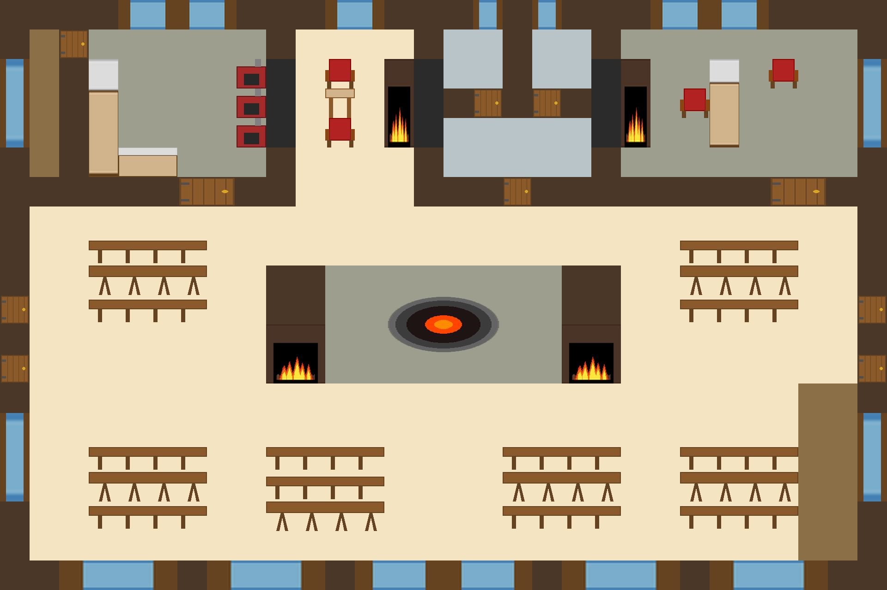

## C. Первый этаж (глава 2) — обзор локации

**Каркас локации.** Сердце таверны: общий зал (C1), кухня (C2) и кабинет Трактирщика (C3). Здесь начинается знакомство
с NPC и разыгрываются ключевые вечерние события (`event_026`–`event_029`). Хранилища (кладовая, ледник, винный погреб)
— уровнем ниже, в подвале (локация F).

**Карта:** `maps/floor_1.tmx` (исходник Tiled); рендер — `maps/floor_1.png`.

::: figure [Карта первого этажа таверны;width:100%;height:auto]

:::

**Кто здесь и когда (глава 2):**

| Время       | Кто                                 | Что делает                       |
|-------------|-------------------------------------|----------------------------------|
| 18:30       | Моряк, Детектив, Доктор             | в зале (C1)                      |
| 18:45       | Детектив                            | у камина (C1, `event_026`)       |
| 19:00–19:15 | Детектив, Официантка                | зал (флирт, `event_027`)         |
| 19:30       | Доктор, Трактирщик, Официантка      | конфликт на кухне (C2, `event_028`) |
| 20:30       | Трактирщик, Художник (сделка)       | кабинет (C3)                     |
| 21:00–21:30 | Трактирщик, Моряк                   | кабинет (C3)                     |

**Сцены локации:**

| Сцена | Название            | Файл                     |
|-------|---------------------|--------------------------|
| C1    | Общий зал           | `31-2-C1-tavern_hall.md` |
| C2    | Кухня               | `32-2-C2-kitchen.md`     |
| C3    | Кабинет Трактирщика | `33-2-C3-office.md`      |

**Входы и выходы:** C1 — узел: C1↔C2, C1↔C3, C1↔B1 (двор), C1↔D1 (вверх), C2↔F2 (кладовая, вниз).

> **Основные сцены** главы — C1 (знакомство, `event_026`–`event_029`), C2 (конфликт `event_028`), C3 (сделки).
