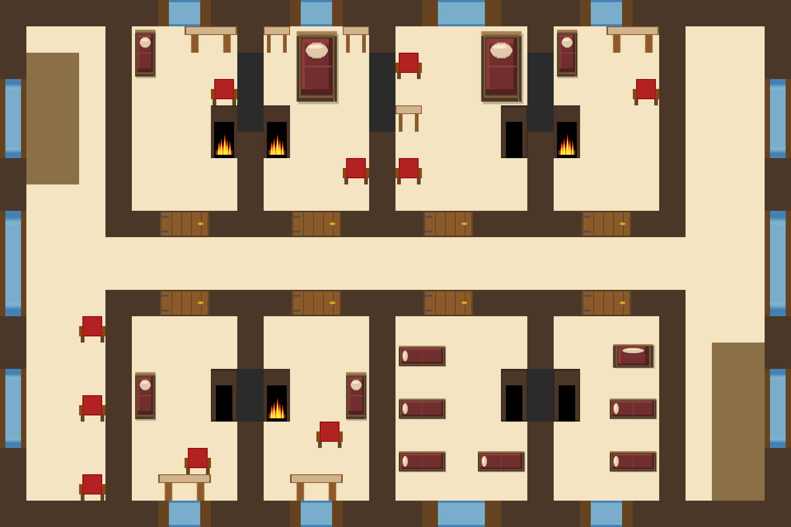

## D. Второй этаж (глава 2) — обзор локации

**Каркас локации.** Жилые комнаты вокруг фойе/коридора (D1): комнаты Официантки, Моряка, Доктора, Детектива,
Трактирщика и три пустые гостевые. Здесь живут тайны постояльцев; обыск комнат — источник вещественных находок.
К 22:00–23:00 большинство NPC расходятся по комнатам и ложатся.

**Карта:** `maps/floor_2.tmx` (исходник Tiled); рендер — `maps/floor_2.png`.

::: figure [Карта второго этажа таверны;width:100%;height:auto]

:::

**Кто здесь и когда (глава 2):**

| Комната | Кто        | Время                                                                       |
|---------|------------|-----------------------------------------------------------------------------|
| D2      | Официантка | 22:00 (дневник), 23:00 уходит в подвал                                       |
| D3      | Моряк      | 20:00–22:00 (бухгалтерия), 22:30 ко сну, 23:00 спит                          |
| D4      | Доктор     | 19:45, 20:00–20:30 (ужин с Официанткой), 21:00 (с Детективом), 22:00 отчёты  |
| D5      | Детектив   | 19:15 аренда, 21:00 уборка, 21:30 ко сну, 22:00 спит                         |
| D6      | Трактирщик | 22:30 ко сну, 23:00 спит                                                     |
| D7–D9   | —          | 21:30 Официантка готовит комнату для игроков                                 |

**Сцены локации:**

| Сцена | Название            | Файл                            |
|-------|---------------------|---------------------------------|
| D1    | Фойе / коридор      | `35-2-D1-foyer.md`              |
| D2    | Комната Официантки  | `36-2-D2-waitress_room.md`      |
| D3    | Комната Моряка      | `37-2-D3-sailor_room.md`        |
| D4    | Комната Доктора     | `38-2-D4-doctor_room.md`        |
| D5    | Комната Детектива   | `39-2-D5-detective_room.md`     |
| D6    | Комната Трактирщика | `40-2-D6-tavern_keeper_room.md` |
| D7    | Гостевая комната 1  | `41-2-D7-guest_room_1.md`       |
| D8    | Гостевая комната 2  | `42-2-D8-guest_room_2.md`       |
| D9    | Гостевая комната 3  | `43-2-D9-guest_room_3.md`       |

**Входы и выходы:** D1 — узел; D1↔C1 (вниз), D1↔E1 (мансарда, вверх), D1↔D2–D9.

> **Примечание:** комната Художника — на мансарде (E2), отдельно от второго этажа (см. локацию E).
