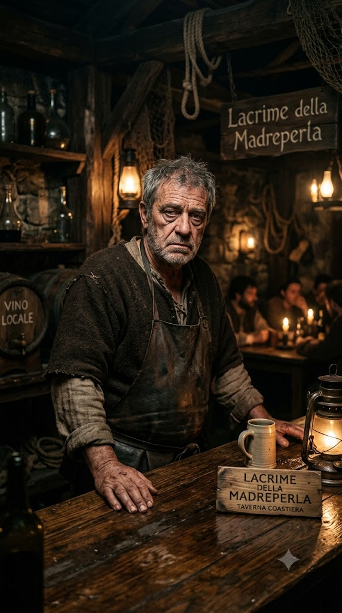

## Трактирщик — Гаэтано Вельди (d6=1)

::: figure [Портрет Гаэтано Вельди;width:90%;height:auto]

:::

### Идентификация

- **Имя:** Гаэтано Вельди.
- **Прозвище:** «Старый Гаэтано».
- **Роль:** Трактирщик; владелец «Слёз устрицы»; main_npc; **может быть жертвой убийства** (`can_be_murder_victim = true`).
- **Раса:** человек.
- **Мировоззрение:** Нейтральное (N).
- **Возраст:** ~55 лет.

### Описание

Обветренное лицо в глубоких морщинах; седые волосы, коротко стриженные; глаза — серые, усталые, с постоянной тенью.
Взгляд тяжёлый, как будто он всё время что-то вспоминает.

Крепкое, но уже не молодое сложение — плечи чуть ссутулены, руки в мозолях от многолетней работы. Носит простую
тёмную одежду: льняную рубаху с закатанными рукавами, кожаный жилет, тяжёлый фартук; на поясе — связка ключей; на левой
руке — обручальное кольцо, которое он никогда не снимает.

**Приметы:** шрам на левой ладони — старый, от ножа (след контрабандного прошлого); всегда держит ключи при себе, даже
ночью; когда смотрит на портрет жены — на секунду замирает. Запах: пыль, бумага, чернила, лёгкий запах спирта.
Ночью, когда думает, что его не видят, сидит у портрета и разговаривает с ним шёпотом.

### Речь

Суровый, ворчливый, настороженный — речь владельца таверны. Темп медленный, с паузами; взвешенно, как будто всё
обдумывает. Голос низкий, приглушённый; в friendly — почти шёпот, как разговор с портретом. Лексика: «тайник», «счёт»,
«ключи», «дочь». Синтаксис: короткие фразы, замирает на полуфразе. Клички: «Не спрашивай», «Моего дела». Жесты: держит
связку ключей, смотрит на портрет.

- **hostile:** холодно врёт, резко обрывает, не смотрит.
- **unfriendly:** бурчит, отводит глаза, цедит через зубы.
- **indifferent:** тише, злее, взвешенно; прищуривается.
- **friendly:** глухо, как разговор с портретом, впервые смотрит в глаза.

### Предыстория

Много лет назад Гаэтано сам занимался контрабандой. После встречи с будущей женой (Изабеллой) он решает завязать,
уезжает подальше от моря, женится и открывает таверну «Слёзы устрицы» (`event_013`). Портрет жены он ставит на видном
месте в основном зале — в память о ней (`event_014`).

Несколько лет назад в таверне появляется Моряк. Он узнаёт Гаэтано и предлагает вести общие дела; Гаэтано отказывается.
Тогда Моряк изнасиловал и убил его жену и пригрозил сделать то же с дочерью, если Гаэтано не согласится (`event_004`).
С тех пор через таверну идёт трафик нелегальной торговли, а Гаэтано работает с Моряком из страха за дочь.

### Профессия

Владелец таверны «Слёзы устрицы» — официально. Тайно — получатель и продавец контрабандных товаров, которые поставляет
Моряк по реке Адивиан: «Погибель Дьявола» (Devil's Bane), пеш (Pesh), лист-живодёр (Flayleaf), грязь (Grit) — набор
инструментов культа Дагона. Продаёт их неофициально, в том числе **Художнику** (лист-живодёр). Тайник для товара —
в кабинете трактирщика (`tavern_keeper_office`, см. `event_005`).

### Скрывает

- **[small]** Контрабандный промысел: продаёт запрещённые товары (Devil's Bane, Pesh, Flayleaf, Grit). Официантка лишь
  подозревает об этом, но не знает точно (`known_by: sailor`).
- **[big]** Моряк изнасиловал и убил его жену. Моряк узнал Гаэтано, предложил вести общие дела; Гаэтано отказал — тогда
  Моряк убил жену и пригрозил дочерью. С тех пор Гаэтано работает с ним из страха (`known_by: sailor, tavern_keeper`).
- **[small]** Подозревает, что Официантка связана с культом, но не знает о её положении в культе (не знает, что она —
  верховная жрица), и не распространяет это подозрение (`known_by: tavern_keeper`).

### Чего боится

- **Моряк** — убил его жену и держит его через дочь; если Гаэтано откажется от контрабанды, Моряк убьёт дочь так же, как
  жену.
- **Совет Воров** (`council_of_thieves`) — фактическая власть города; Гаэтано и Моряк торгуют сами, минуя Совет, и не
  вносят в общак. Совет может привлечь их к ответу за нелегальную контрабанду (вне системы = вне защиты).
- **Доттари** — городской страже могут раскрыть контрабанду.

### Отношения

- **Виттория Вельди (Официантка, d6=3)** — дочь; отцовская любовь (devoted). Работает в таверне. Гаэтано подозревает,
  что она связана с культом, но не знает подробностей.
- **Изабелла Вельди (Мёртвая жена)** — погибшая жена; портрет висит на видном месте в зале в память о ней (devoted).
- **Корин Марроне (Моряк, d6=2)** — кровная месть и одновременно деловой партнёр по контрабанде (despised / associated).
  Гаэтано работает с ним из страха за дочь.
- **Элио Вентури (Врач, d6=4)** — лично неприятен; подозревает, что Врач сдаст контрабандный бизнес властям (avoided).
  Ложное подозрение: Элио не контрабандист.
- **Лучиано Аврелиан (Художник, d6=6)** — продаёт ему лист-живодёр неофициально; знает о его зависимости от листа.
  Художник снял мансарду в долгосрочную аренду именно ради доступа к листу. Гаэтано **не знает** о Художнике как об
  убийце.

### Ключевое знание

- **Знает точно:** Моряк изнасиловал и убил его жену; Моряк угрожал убить дочь, если он не согласится вести общие дела;
  много лет назад он сам занимался контрабандой, а после встречи с женой завязал; портрет жены стоит в зале в память о
  ней; Моряк — его деловой партнёр по контрабанде; он и Моряк торгуют мимо Совета Воров; Официантка работает у него в
  таверне; знает о зависимости Художника от листа-живодёра.
- **Подозревает:** Официантка как-то связана с культом в таверне; Врач связан с контрабандистами (Врач знает Моряка).
- **Не знает:** деталей культа (не знает, что Официантка — верховная жрица); о молитве Официантки Дагону, вызвавшей
  потоп; о серийных убийствах в городе; о Художнике как о серийном убийце.

### Ложные убеждения

- **Моряк — единственный, кто точно знает о его контрабанде** (на деле Официантка подозревает об этом отце, работая в
  той же таверне; confidence: medium).
- **Врач связан с контрабандистами** (на деле Элио не контрабандист — он лишь знает Моряка как бывшего сослуживца;
  confidence: low).

### Повседневное расписание

- **Ночь** — в кабинете (`tavern_keeper_office`): закрывает таверну, проверяет счёт и переписку; тайно хранит
  контрабанду в тайнике кабинета.
- **Утро** — во дворе (`tavern_yard`): рубит дрова у дровницы (woodpile), затем открывает таверну.
- **День** — в зале (`tavern_hall`): обслуживает зал, наблюдает за гостями.
- **Вечер** — в зале: обслуживает вечерний зал, следит за гостями (конфликт с Врачом из-за Официантки, `event_028`,
  19:15–19:30); тайно продаёт Художнику лист-живодёр (~19:00–19:45).
- **Полночь** — в кабинете: тайно получает контрабанду от Моряка (`event_005`).

### Скрытое

- Кинжал трактирщика (`tavernkeeper_dagger`).
- Дневник трактирщика (`tavernkeeper_diary`).
- Письмо Моряка с угрозой (`sailor_threat_letter`).
- Тайник трактирщика (`tavernkeeper_hiding`).
- Флакон яда (`potion_poison`).
- Долговая расписка (`debt_note`).

### [PF2e stat-block]

| Параметр          | Значение                                                                                          |
|-------------------|---------------------------------------------------------------------------------------------------|
| **Уровень**       | 5                                                                                                 |
| **Мировоззрение** | N                                                                                                 |
| **Раса**          | Человек                                                                                           |
| **Класс**         | Вор (Rogue)                                                                                       |
| **Роль**          | Melee support / bodyguard                                                                         |
| **Восприятие**    | +13 (moderate)                                                                                    |
| **Языки**         | Общий, Варисийский                                                                                |
| **Навыки**        | Атлетика +12, Обман +12, Воровство +12, Скрытность +14, Запугивание +10, Знание контрабанды +12   |
| **Сила**          | +4                                                                                                |
| **Ловкость**      | +3                                                                                                |
| **Телосложение**  | +3                                                                                                |
| **Интеллект**     | +0                                                                                                |
| **Мудрость**      | +2                                                                                                |
| **Харизма**       | +1                                                                                                |
| **AC**            | 22                                                                                                |
| **HP**            | 80                                                                                                |
| **Скорость**      | 25 футов                                                                                          |
| **Спасброски**    | Стойкость +12 (high), Реакция +14 (extreme), Воля +10 (moderate)                                  |
| **Ближний бой**   | Кинжал +1 (Striking): +15 (high), 2d4+6 колющий, +2d6 скрытый удар                                |
| **Дальний бой**   | Тяжёлый арбалет: +13 (moderate), 2d10+4 колющий                                                   |

**Способности:**

- **Скрытый удар (Sneak Attack) 2d6:** дополнительный точный урон по «Застигнутой врасплох» цели.
- **Отвергнуть преимущество (Deny Advantage):** существа 5 уровня и ниже не могут застать Гаэтано врасплох.
- **Уклонение (Evasion):** при успешном спасброске Реакции против эффекта с половинным уроном — урона нет вовсе.
- **Защитный удар (реакция):** атака по врагу в пределах досягаемости.
- **Телохранитель (1 действие):** Гаэтано встаёт между союзником и опасностью.
- **Фигура вора: Ruffian:** владеет простым оружием в полную силу, скрытый удар работает с любым оружием ближнего боя.
