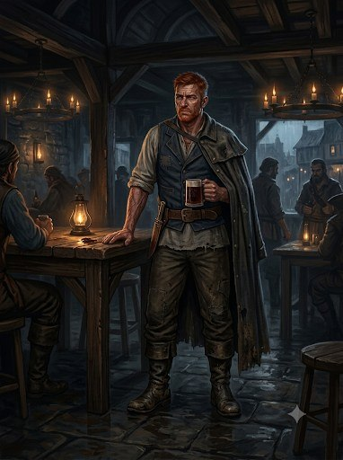

## Моряк — Корин «Кайрэн» Марроне (d6=2)

::: figure [Портрет Корина Марроне;width:90%;height:auto]

:::

### Идентификация

- **Имя:** Корин Марроне; настоящее имя — Кайрэн (скрывает, назвался Корином).
- **Прозвище:** «Ржавый».
- **Роль:** Моряк; main_npc; **может быть жертвой убийства** (`can_be_murder_victim = true`).
- **Раса:** полуэльф.
- **Мировоззрение:** Хаотично-нейтральное (CN).
- **Возраст:** ~40 лет.

### Описание

Крупное, широкоплечее сложение с грубыми чертами; руки — как канаты, покрыты татуировками. Загорелое, обветренное лицо
с недельной щетиной; волосы тёмные, сальные, стянуты в хвост; глаза маленькие, глубоко посаженные, бегающие; на правой
щеке — старый шрам от сабли.

Потёртая морская куртка, тельняшка, кожаные штаны, тяжёлые сапоги; на шее — амулет из акульих зубов; пальцы унизаны
перстнями (некоторые — явно краденые). Запах: ром, соль, табак.

**Приметы:** говорит громко, с морским акцентом, пересыпает речь ругательствами; когда нервничает — крутит перстень на
левой руке; избегает смотреть в глаза Трактирщику; ночью выходит во двор, проверяет, не следит ли кто.

### Речь

Грубый, морской; ругательства и мат как связки. Темп рваный, с паузами и повторами; часто обрывает себя. Голос громкий,
напористый; в friendly — глухой, хриплый шёпот. Лексика: «трюм», «казна», «дьявол», «по реке». Синтаксис: короткие
рубленые фразы, вопросы вместо ответов. Клички: «Слушай сюда», «Ты меня понял?». Жесты: крутит перстень, не смотрит в
глаза.

- **hostile:** агрессивно врёт, повышает голос, перебивает, обрывает.
- **unfriendly:** бурчит, отводит взгляд, отвечает нехотя, цедит.
- **indifferent:** говорит тише, злее, но по делу; крутит перстень.
- **friendly:** глухо, обрывисто, почти шёпотом; впервые смотрит в глаза.

### Предыстория

Корин — бывший матрос корабля «Чёрная Сирена» (La Sirena Nera) под командованием Капитана (`capitan`). Он
**дезертировал с корабля, украв судовую казну** (`event_002`). На том же корабле служили судовый врач Элио Вентури
(будущий Доктор) и Капитан — они были его сослуживцами (`sirena_nera_crew`, `event_001`).

Несколько лет назад Корин узнал Гаэтано Вельди, с которым в прошлом был связан контрабандой, и предложил вести общие
дела. Гаэтано отказался — тогда Корин изнасиловал и убил его жену (Изабеллу) и пригрозил так же поступить с дочерью
(Официанткой), если Гаэтано не согласится. Товары идут по реке Адивиан.

### Профессия

Раньше — матрос на «Чёрной Сирене» (дезертир). Сейчас — тайный деловой партнёр Трактирщика по контрабанде: привозит ему
запрещённые товары — «Погибель Дьявола» (Devil's Bane), пеш (Pesh), лист-живодёр (Flayleaf), грязь (Grit), инструменты
культа Дагона. Днём его видят на складе «как работника» (`smuggler_storage`, `event_005`).

### Скрывает

- **[small]** Контрабандный промысел: привозит Трактирщику конкретные запрещённые товары (Devil's Bane, Pesh, Flayleaf,
  Grit). Известно Трактирщику (`known_by: tavern_keeper`).
- **[big]** Дезертировал с «Чёрной Сирены», украв судовую казну. Знает Капитан (`known_by: capitan`).
- **[big]** Изнасиловал и убил жену Трактирщика (Изабеллу). Угрожал Официантке, чтобы Трактирщик согласился вести общие
  дела (`known_by: tavern_keeper, sailor, dead_wife`).

### Чего боится

- **Капитан «Чёрной Сирены»** — его бывший командир, знает о дезертирстве и краже судовой казны.
- **Совет Воров** — фактическая власть города; Корин и Трактирщик торгуют сами, минуя Совет, и не вносят в общак.
- **Доттари** — городская стража может раскрыть контрабанду или дезертирство.

### Отношения

- **Гаэтано Вельди (Трактирщик, d6=1)** — кровная вражда и одновременно деловой партнёр по контрабанде (despised /
  associated). Корин угрожал ему через дочь после отказа.
- **Элио Вентури (Доктор, d6=4)** — бывший сослуживец по «Чёрной Сирене» (acquainted). Корин не знает, знает ли Доктор о
  его краже казны, и подозревает, что Доктор мог прийти по его душу.
- **Капитан** (`capitan`) — бывший командир с того же корабля (acquainted).
- **Джакомо Раньери (Детектив, d6=5)** — может раскрыть дезертирство и кражу (avoided).

### Ключевое знание

- **Знает точно:** Капитан — его бывший командир с «Чёрной Сирены»; он украл судовую казну; служил на корабле вместе с
  Доктором и Капитаном; он изнасиловал и убил жену Трактирщика; Трактирщик в прошлом тоже занимался контрабандой и
  завязал после встречи с женой; Трактирщик отказался вести общие дела; он убил жену Трактирщика и угрожал его дочери;
  Официантка — дочь Трактирщика; привозит Трактирщику запрещённые товары.
- **Знает частично:** Капитан знает о его дезертирстве и краже; Трактирщик как-то связан с его прошлым (контрабанда);
  река Адивиан и порт — его стихия (контрабанда идёт по реке → в море).
- **Подозревает:** Доктор мог прийти в таверну по его душу; Доктор может знать о его дезертирстве и краже; Официантка
  может знать о его угрозах в отношении её отца.
- **Не знает:** о культе в таверне; о серийных убийствах; о Детективе; о любовной связи Официантки и Доктора; о том,
  что Официантка узнала от призрака об убийстве матери; о молитве Официантки Дагону и потопе; что Трактирщик знает о его
  прошлом.

### Ложные убеждения

- **Никто не знает о его дезертирстве и краже** (на деле Капитан знает; confidence: medium).
- **Трактирщик не знает о его прошлом** (кроме контрабанды; confidence: low).
- **Официантка не знает о его угрозах в отношении её отца** (возможно, знает — узнала от призрака Жены; confidence: low).

### Повседневное расписание

- **Ночь** — в комнате гостя (`sailor_room`): спит; тайно хранит улики/личное.
- **Утро** — во дворе (`tavern_yard`): проходит по двору (следы, грязь, вода).
- **День** — на складе (`smuggler_storage`): помогает «как работник», фактически ведёт контрабанду.
- **Вечер** — на складе: привозит запрещённые товары Трактирщику.
- **Полночь** — во дворе: следит за таверной, опасаясь, что Доктор выдал его прошлое.

### Скрытое

- Тайник Моряка (`sailor_hiding`).
- Нож Моряка (`sailor_knife`).
- Поддельное письмо (`fake_letter`).
- Морская карта (`nautical_chart`).

### [PF2e stat-block]

| Параметр          | Значение                                                                                                    |
|-------------------|-------------------------------------------------------------------------------------------------------------|
| **Уровень**       | 9                                                                                                           |
| **Мировоззрение** | CN                                                                                                          |
| **Раса**          | Полуэльф                                                                                                    |
| **Класс**         | Боец (Fighter) / Вор (Rogue)                                                                                |
| **Роль**          | Solo boss / dirty fighter                                                                                   |
| **Восприятие**    | +18 (moderate); ночное зрение                                                                               |
| **Языки**         | Общий, Эльфийский, Варисийский                                                                              |
| **Навыки**        | Атлетика +20, Акробатика +17, Запугивание +17, Скрытность +17, Морячество +19, Воровство +17                |
| **Сила**          | +5                                                                                                          |
| **Ловкость**      | +4                                                                                                          |
| **Телосложение**  | +4                                                                                                          |
| **Интеллект**     | +2                                                                                                          |
| **Мудрость**      | +3                                                                                                          |
| **Харизма**       | +2                                                                                                          |
| **AC**            | 28                                                                                                          |
| **HP**            | 170                                                                                                         |
| **Скорость**      | 25 футов                                                                                                    |
| **Спасброски**    | Стойкость +20 (extreme), Реакция +18 (extreme), Воля +14 (moderate)                                         |
| **Ближний бой**   | Боевой нож +2 (Greater Striking): +21 (extreme), 3d4+8 колющий, +2d6 скрытый удар                           |
| **Дальний бой**   | Метательный нож: +19 (extreme), 2d4+6 колющий                                                               |

**Способности:**

- **Скрытый удар (Sneak Attack) 2d6:** дополнительный точный урон по «Застигнутой врасплох» цели.
- **Грязный приём (1 действие):** подсечка/удар по слабому месту; цель получает состояние и уязвимость.
- **Двойной разрез (2 действия):** две атаки боевым ножом с уменьшенным штрафом.
- **Внезапный рывок (2 действия):** сближение и атака; цель может стать «Застигнутой врасплох».
- **Морские ноги:** устойчив на скользкой/качающейся поверхности, не теряет равновесие.
- **Не уйти (реакция):** атакует убегающего противника в пределах досягаемости.
- **Жестокий финал (1 действие, 1/раунд):** добивающий удар по раненой цели с дополнительным уроном.
