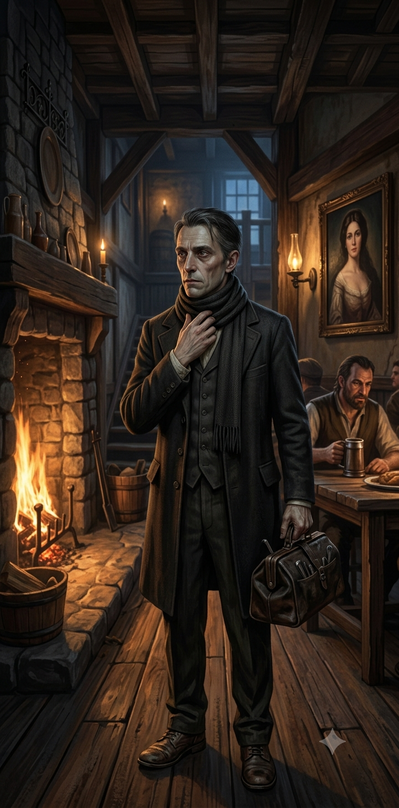

## Врач — Элио Вентури (d6=4)

::: figure [Портрет Элио Вентури;width:90%;height:auto]

:::

### Идентификация

- **Имя:** Элио Вентури.
- **Прозвище:** «Доктор Вентури».
- **Роль:** Врач (патологоанатом); main_npc; **может быть жертвой убийства** (`can_be_murder_victim = true`); тайно —
  последователь культа Дагона.
- **Раса:** человек.
- **Мировоззрение:** Законопослушно-злое (LE).
- **Возраст:** ~45 лет.

### Описание

Узкое, бледное лицо с острыми скулами; волосы тёмные, с проседью, зачёсаны назад; глаза серо-голубые, внимательные,
чуть лихорадочные; под глазами — тёмные круги. Худощавое, жилистое сложение, длинные пальцы.

Носит тёмный сюртук, белую рубашку, жилет; на поясе — сумка с медицинскими инструментами; на пальцах — следы от
химикатов; обувь добротная, но потёртая. Запах: спирт, травы и... благовония (след культа).

**Приметы:** когда нервничает — поправляет воротник; смотрит на Официантку с плохо скрываемой нежностью; избегает Моряка,
но иногда бросает на него странные взгляды; ночью уходит в `cult_lair` на собрание культа.

### Речь

Сухой, хладнокровный, медицинский; чуть лихорадочный. Темп ровный, с точными паузами; как диктовка. Голос равномерный,
приглушённый; в friendly — обрывисто. Лексика: «вскрытие», «симптомы», «яда», «журнал». Синтаксис: точные фразы, замирает
на имени. Клички: «Не спрашивай, кто», «Я не знаю точно». Жесты: поправляет воротник, смотрит на Официантку.

- **hostile:** холодно врёт, резкое, отводит взгляд.
- **unfriendly:** ровно, сухо, нехотя, как диктовка.
- **indifferent:** тише, злее, замирает; поправляет воротник.
- **friendly:** обрывисто, почти шёпотом; впервые смотрит в глаза.

### Предыстория

Элио — бывший судовой врач корабля «Чёрная Сирена» (La Sirena Nera), где служил вместе с Капитаном (`capitan`) и Моряком
(`sirena_nera_crew`, `event_001`). Давно списан с корабля на берег, в текущем экипаже не состоял. О краже казны Моряком
не знает. Сейчас работает врачом-патологоанатомом в Морге, ведёт вскрытия.

### Профессия

Врач-патологоанатом в Морге (`morgue`), работает вместе с Ассистентом Доктора (`doctor_assistant`). Забрал отчёты о
вскрытиях (`autopsy_reports`) поработать дома — снял комнату в таверне «Слёзы устрицы» (`doctor_room`, `event_024`).
Тайно — последователь культа Дагона (не последний жрец: может провести обратный ритуал, `flood_mechanic.path_3`, но не
знает деталей заклинания Официантки).

### Скрывает

- **[small]** Состоит в тайном культе Дагона — культе Официантки. Известно Официантке (`known_by: waitress`).
- **[big]** Влюблён в Официантку. Известно Официантке и Трактирщику (`known_by: waitress, tavern_keeper`).

### Отношения

- **Виттория Вельди (Официантка, d6=3)** — любовь / сексуальная связь (devoted); она — его верховная жрица, он — её
  последователь.
- **Гаэтано Вельди (Трактирщик, d6=1)** — вражда из-за отношений с Официанткой: Трактирщик против связи дочери с Врачом
  (avoided). Трактирщик подозревает, что Элио, связанный с правосудием, сдаст его властям — **ложное подозрение**: Элио о
  контрабанде не знает и не контрабандист.
- **Корин Марроне (Моряк, d6=2)** — бывший сослуживец по «Чёрной Сирене» (acquainted). Элио не знает о краже казны;
  защищал Официантку от приставаний Моряка (мотив для убийства Моряка).
- **Капитан** (`capitan`) — бывший командир, сослуживец по «Чёрной Сирене». Может раскрыть дезертирство Моряка.
- **Джакомо Раньери (Детектив, d6=5)** — знакомы по работе (морг/вскрытия). Элио знает, что Детектив расследует серию
  убийств; знает, что Детектив видел отчёты о вскрытиях. Может раскрыть культ.
- **Ассистент Доктора (Тобиа Бандини)** (`doctor_assistant`) — его подчинённый, оба работают в Морге.
- **Лучиано Аврелиан (Художник, d6=6)** — потенциальный религиозный враг (avoided). Подозревает, что Художник охотится
  на культистов Дагона; может стать целью его охоты.

### Ключевое знание

- **Знает точно:** он состоит в культе Дагона; Официантка — верховная жрица; Официантка — его любовница; Трактирщик
  против их отношений; Капитан «Чёрной Сирены» — его бывший командир; Моряк приставал к Официантке (угрожал ей) — Элио
  защищал её; Детектив расследует серию жестоких убийств (наём Сарии Рокцин, `event_023`), они знакомы по работе; отчёты
  о вскрытиях в его комнате, и Детектив их видел; Ассистент — его подчинённый.
- **Знает частично:** Моряк служил с ним на «Чёрной Сирене»; Ассистент виделся с Официанткой.
- **Подозревает:** Художник может быть врагом культа (расправитель над участниками Дня Гнева).
- **Не знает:** о дезертирстве и краже казны Моряка; о серийных убийствах в городе; о контрабанде Трактирщика и Моряка.

### Ложное убеждение

- **Никто не знает о его участии в культе Дагона (кроме Официантки)** (на деле Художник может раскрыть его как
  культиста Дагона, если докопается до его принадлежности к культу; confidence: low).

### Повседневное расписание

- **Ночь** — в своей комнате (`doctor_room`): спит.
- **Утро** — 05:00 просыпается; 05:15 завтракает; 06:00 помогает подготовиться к утренней молитве Дагону; 06:30
  участвует в ритуале поклонения Дагону в святилище (`cult_lair`); 07:00 отбывает из «Слёз устрицы» в Весткроун
  на пароме; 08:30 прибывает в Морг.
- **День** — в морге (`morgue`): принимает и осматривает тела (серия убийств), оформляет отчёты о вскрытии
  (`autopsy_reports`); 15:30 получает записку, отправляется в таверну «Слёзы устрицы» на пароме; 16:30 прибытие;
  17:00 обсуждает с Официанткой желание Моряка залечь на дно.
- **Вечер** — 17:30–18:45 в своей комнате оформляет отчёты о вскрытии (18:30 общается с Детективом); 19:00 спускается
  в зал; 19:15 слушает флирт Официантки с Художником (`event_027`); 19:30 конфликт с Трактирщиком (`event_028`);
  19:45 поднимается в свою комнату; 20:00–20:30 ужинает с Официанткой в своей комнате; 21:00 общается с Детективом
  (отчёты ещё не готовы).
- **Полночь** — в святилище (`cult_lair`): 21:30–22:30 оформляет отчёты; 23:00–23:30 готовится к ритуалу;
  24:00 участвует в собрании культа (`event_007`).

### Скрытое

- Записка Врача (`doctor_note`).
- Медицинский журнал Врача (`doctor_journal`).
- Тайник Врача (`doctor_hiding`).
- Ритуальный кинжал Врача (`doctor_dagger`).
- Речевые особенности культистов Дагона (водная одержимость) (`cult_speech`).

### Лошадь

Лошадь Доктора стоит в конюшне во дворе таверны (`tavern_yard`). Приехал из Морга; потоп отрезал отъезд — лошадь
остаётся в конюшне.

### Организации

- **Культ Дагона** — последователь, активен.
- **Морг** (`morgue`) — врач-патологоанатом (ведёт вскрытия), активен.
- **Экипаж «Чёрной Сирены»** (`sirena_nera_crew`) — бывший судовой врач, покинул.

### [PF2e stat-block]

| Параметр          | Значение                                                                                                          |
|-------------------|-------------------------------------------------------------------------------------------------------------------|
| **Уровень**       | 6                                                                                                                 |
| **Мировоззрение** | LE                                                                                                                |
| **Раса**          | Человек                                                                                                           |
| **Класс**         | Алхимик (Alchemist) / Жрец (Cleric, Dagon)                                                                        |
| **Роль**          | Support caster / debuffer                                                                                         |
| **Восприятие**    | +14 (moderate)                                                                                                    |
| **Языки**         | Общий, Акло, Варисийский                                                                                          |
| **Навыки**        | Медицина +17, Религия +14, Ремесло (алхимия) +14, Обман +12, Скрытность +12, Знание Дагона +14                    |
| **Сила**          | +0                                                                                                                |
| **Ловкость**      | +2                                                                                                                |
| **Телосложение**  | +2                                                                                                                |
| **Интеллект**     | +4                                                                                                                |
| **Мудрость**      | +3                                                                                                                |
| **Харизма**       | +2                                                                                                                |
| **AC**            | 23                                                                                                                |
| **HP**            | 85                                                                                                                |
| **Скорость**      | 25 футов                                                                                                          |
| **Спасброски**    | Стойкость +12 (moderate), Реакция +14 (high), Воля +14 (high)                                                     |
| **Ближний бой**   | Скальпель +1 (Striking): +14 (high), 2d4+2 колющий, +2d6 скрытый удар                                             |
| **Дальний бой**   | Метательная склянка: +14 (high), 2d6 кислоты/огня (20 футов)                                                      |
| **СЛ заклинаний** | 22                                                                                                                |

**Способности:**

- **Патологоанатом (Pathologist):** +2 к Медицине при вскрытии.
- **Подделка отчётов (Forged Reports):** Обман против Восприятия следователя, СЛ 20.
- **Алхимические бомбы:** 2d6 урона в радиусе 5 футов.
- **Анестезирующий яд (1 действие):** +2d6 яда, Стойкость СЛ 22 — «Замедлен 1».
- **Волна тошноты (2 действия):** 15-футовая эманация, 4d6 яда (Стойкость СЛ 22 — половина) — «Тошнота 1».
- **Экстренная помощь (1 действие, 2/день):** восстанавливает 3d8+6 HP.
- **Скрытый удар (Sneak Attack) 2d6:** дополнительный точный урон по «Застигнутой врасплох» цели.
