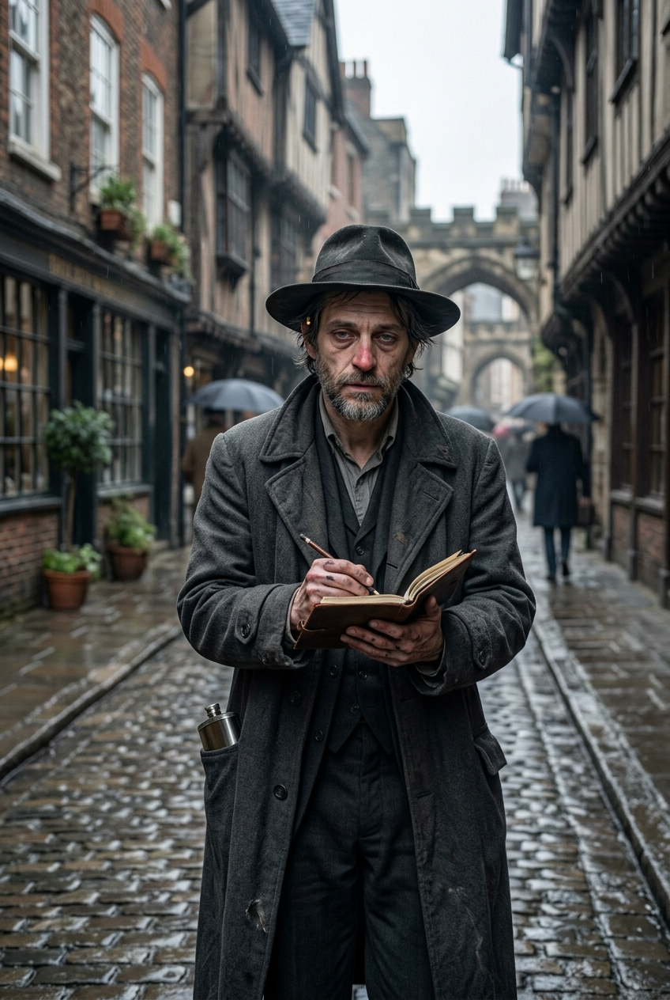

## Детектив — Джакомо Раньери (d6=5)

::: figure [Портрет Джакомо Раньери;width:90%;height:auto]

:::

### Идентификация

- **Имя:** Джакомо Раньери.
- **Прозвище:** «Джек».
- **Роль:** Детектив; main_npc; **может быть жертвой убийства** (`can_be_murder_victim = true`).
- **Раса:** человек.
- **Мировоззрение:** Законопослушно-нейтральное (LN).
- **Возраст:** ~50 лет.

### Описание

Грузный, чуть сутулый мужчина лет пятидесяти. Усталое лицо с мешками под глазами; щетина, седые виски; нос —
красноватый. Глаза — цепкие, внимательные, но чуть мутные (постоянно пьян).

Мятый тёмный плащ, тёмный костюм, шляпа с широкими полями, глубоко надвинутая на лоб. На поясе — блокнот и карандаш; в
кармане — фляжка (постоянно). Обувь — стоптанная, но крепкая.

Постоянно что-то записывает в блокнот; когда пьёт — становится подозрительным и агрессивным; ночью бормочет что-то во
сне.
Запах: алкоголь, табак.

### Речь

Усталый, пьяный, ворчливый — детектив в запое. Темп спотыкающийся, с паузами; иногда резко, иногда обрывисто. Голос
хриплый, хмурый; в friendly — почти шёпот, записывает. Лексика: «морг», «вскрытие», «дело», «отчёт». Синтаксис: короткие
фразы, записывает на ходу. Клички: «Запиши», «Не спрашивай, о чём». Жесты: записывает в блокнот, достаёт фляжку.

- **hostile:** резко врёт, хрипло, отмахивается, пьёт.
- **unfriendly:** устало, нехотя, мотает головой.
- **indifferent:** тише, хмурее, записывает; прищуривается.
- **friendly:** почти шёпотом, обрывисто; впервые смотрит в глаза.

### Расследование

- **Наниматель:** Дуротас Сария Рокцин (Common Dottari) — `event_011` / `event_023`: Сария нанимает Детектива для
  расследования серии жестоких убийств в городе.
- **Дело:** серия смертей в городе.
- **Причина прибытия в таверну:** после получения задания у Сарии (поиск маньяка — серия убийств, жестокое
  расчленение тел) Детектив едет в Морг. Ассистент Доктора (`doctor_assistant`) говорит, что Доктор забрал отчёты о
  вскрытии и поработает с ними дома — снял комнату в Таверне. Начинается дождь. Детектив арендует комнату в Таверне,
  чтобы переждать дождь → попадает в таверну (`event_023` → `event_024` → `event_029`).

### Как отыгрывать: поведение, маски

- **Внешний слой:** усталый, пьяный, ворчливый; хрипло, отмахивается; пьёт и записывает.
- **В напряжении / friendly:** почти шёпотом, обрывисто; впервые смотрит в глаза; достаёт фляжку.

### Отношения

- **Дуротас Сария Рокцин (Common Dottari)** — наниматель; платит из своего кармана.
- **Доктор Элио Вентури (d6=4)** — знакомы по работе (морг / вскрытия); Детектив видел отчёты о вскрытиях, которые
  забрал Доктор из Морга.
- **Ассистент Доктора (Тобиа Бандини)** — знакомы по работе (Морг); иногда пересекаются по делу.
- **Художник (Лучиано Аврелиан, d6=6)** — расследует серию убийств; **avoided** (Детектив пока не знает, что Художник —
  маньяк).
- **Моряк Корин Марроне** — расспрашивал Детектива; конфликт по контрабанде.

### Ключевое знание

- **Знает точно:** его наняла Дуротас Сария Рокцин для расследования серии смертей; видел отчёты о вскрытиях
  (autopsy_reports), которые забрал Доктор из Морга (они в комнате Доктора); Доктор — его коллега / знакомый по работе
  (морг / вскрытия); знаком с Ассистентом Доктора.
- **Подозревает:** если обнаружит доказательства контрабанды — столкнётся с ней (связь по money; контрабанда
  Трактирщика / Моряка).
- **Не знает:** о культе в таверне; о контрабанде Трактирщика и Моряка; о Художнике как о серийном убийце (пока не
  расследует).
- **Секрет (small):** его наняла Дуротас Сария Рокцин для расследования серии смертей в городе.

### Повседневный расписание

- **Утро** — 07:00 просыпается в своём доме в Весткроуне; 08:00 приходит в казармы обычных доттари; 09:00 общается
  с Дуротасом Сарией Рокцин; 09:30–11:30 идёт к местам убийств, осматривает (§C1/§D1/§E1).
- **День** — 12:00–14:30 осматривает места убийств (§C1/§D1/§E1); 15:00 общается с игроками (§C2); 15:30 идёт в Морг;
  16:00 в морге ищет Доктора и отчёты о вскрытии; 16:30 обедает у себя дома.
- **Вечер** — 17:00 отправляется в таверну «Слёзы устрицы» по суше; 17:30 пересекает Адивианский мост; 18:00 прибытие;
  18:30 общается с Доктором (просит отчёты); 18:45 в зале у камина, приветствует партию (`event_026`); 19:00 предлагает
  остаться из-за ливня; 19:15 арендует комнату (`event_029`); 19:30–19:45 ужинает; 20:00 общается с постояльцами;
  21:00 общается с Доктором (ждёт отчёты); 21:30 готовится ко сну.
- **Ночь** — в комнате гостя (`detective_room`): спит (следы пьянства, `detective_drunk`).
- **Полночь** — в комнате: спит; записывает наблюдения в записную книжку (см. `event_011` / `event_012`; наниматель —
  Сария).

### Лошадь

- Лошадь Детектива стоит в конюшне во дворе таверны (tavern_yard). Приехал в город на лошади для расследования; потоп
  отрезал отъезд — лошадь остаётся в конюшне (мокрая).

### Скрытое

- **Следы пьянства Детектива** (evidence: `detective_drunk`).
- **Разбитая бутылка** (evidence: `broken_bottle`).

### [PF2e stat-block]

| Параметр          | Значение                                                                                                                           |
|-------------------|------------------------------------------------------------------------------------------------------------------------------------|
| **Уровень**       | 9                                                                                                                                  |
| **Мировоззрение** | LN                                                                                                                                 |
| **Раса**          | Человек                                                                                                                            |
| **Класс**         | Следователь (Investigator)                                                                                                         |
| **Роль**          | Solo boss / ranged controller                                                                                                      |
| **Восприятие**    | +18 (moderate)                                                                                                                     |
| **Языки**         | Общий, Варисийский                                                                                                                 |
| **Навыки**        | Восприятие +18, Общество +17, Знание (местное) +19, Проницательность +18, Медицина +17, Скрытность +17, Запугивание +17, Обман +15 |
| **Сила**          | +2                                                                                                                                 |
| **Ловкость**      | +4                                                                                                                                 |
| **Телосложение**  | +3                                                                                                                                 |
| **Интеллект**     | +5                                                                                                                                 |
| **Мудрость**      | +4                                                                                                                                 |
| **Харизма**       | +2                                                                                                                                 |
| **AC**            | 27                                                                                                                                 |
| **HP**            | 150                                                                                                                                |
| **Скорость**      | 25 футов                                                                                                                           |
| **Спасброски**    | Стойкость +16, Реакция +18, Воля +20                                                                                               |
| **Ближний бой**   | Дубинка +2 (Greater Striking) +19 (extreme), 3d6+4 дробящий, нелетальный, +2d6 скрытый удар                                        |
| **Дальний бой**   | Дуэльный пистолет +2 (Greater Striking) +19, 3d6+4 колющий (дистанция 60 футов, перезарядка 1)                                     |

**Способности:**

- **Разработать стратегию (Devise a Stratagem) (1 действие):** бросок d20, использовать в следующей атаке.
- **Стратегический удар:** +2d6 точного урона по цели с разработанной стратегией.
- **Подсказка (Clue In) (1 действие):** +1 к следующей проверке Восприятия / Проницательности союзника.
- **Удар пистолетом (1 действие):** цель «Врасплох».
- **Чутьё детектива (реакция):** +2 к AC против этой атаки.
- **Быстрый выстрел (2 действия):** 2 атаки с -2, цель «Замедлена 1».
