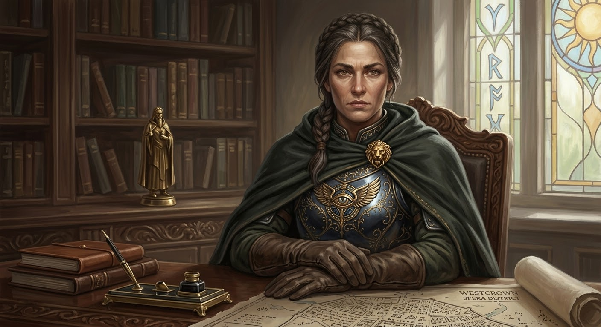

## Дуротас — Сария Рокцин (Saria Roccin)

::: figure [Портрет Сарии Рокцин;width:90%;height:auto]

:::

### Идентификация

- **Имя:** Сария Рокцин (Saria Roccin).
- **Прозвище:** «Дуротас» (никто не зовёт её по имени — только по званию).
- **Роль:** Дуротас (ду́ротас) — «ранговый стражник», командир одного из четырёх подразделений доттари Весткроуна;
  **канонический наниматель партии** в сцене C3 (Дуксотар — формальный подписант, но не наниматель).
- **Должность:** командир **Common dottari** («обычные доттари») — патрулирование улиц и охрана городских ворот района
  Спе́ра (Parego Spera).
- **Раса:** человек (челиец).
- **Мировоззрение:** Хаотично-доброе (CG).

### Описание

Крепкая, воинская женщина около сорока лет, с суровым, решительным лицом. Держится прямо и по-воински, но в напряжении
скрывает усталость и страх. Глаза — цепкие, внимательные; в friendly — впервые смотрит в глаза и впервые слышно металл
в голосе.

Официальная форма доттари — но аккуратная, по-воински; на нагруднике — знак Глаза Ародена (Aroden's Eye). На поясе —
меч и служебные бумаги (ордера). Обувь — крепкая, военная.

Запах: мыло, сталь, немного вина.

**Чувство юмора / маскарад.** На дне рождения некоего Морграма Великолепного явилась в костюме пирата-мужчины и
подарила **зелье защиты от хаоса** (potion of protection from chaos) — показательная деталь характера: ирония,
склонность к маскараду (хаотично-добрая, дарит защиту от хаоса).

### Речь

Честный, военный, суровый — но с проблесками иронии. Темп рваный, с паузами; в friendly — тише, без вока. Голос чёткий,
военный; в friendly — глухо, впервые слышно металл. Лексика: «патруль», «зона», «штраф», «бумага», «орден», «система».
Синтаксис: короткие рубленые фразы, вопросы вместо ответов. Клички: «Я даю бумагу, а не отряд», «Я не могу», «Система».
Жесты: держит служебные бумаги, смотрит поверх головы в темноту, отворачивается, когда говорит о семье.

- **hostile:** резко, сухо, без вока; давит, но не кричит.
- **unfriendly:** нехотя, сухо; не смотрит в глаза.
- **indifferent:** тише, суше; записывает.
- **friendly:** почти шёпотом, обрывисто; впервые смотрит в глаза; впервые слышно металл.
- **helpful:** тише; впервые признаётся, что терпит систему.

### Должность и лор

- **Крупнейший корпус.** Сария командует **самым крупным корпусом войск среди всех гражданских лидеров Весткроуна** —
  это не просто доттари, а именно «обычные доттари» (Common dottari), несущие основную нагрузку по поддержанию порядка
  в городе.
- **Скрытое презрение к Адским Рыцарям.** Она **тайно презирает Адских Рыцарей** (Hellknights) и сотрудничает с ними
  **крайне неохотно**, «скрепя сердце» (begrudgingly). В Весткроуне, где Орден Дыбы — официальная сила, такое
  отношение делает её потенциальным союзником для тех, кто хочет действовать **в обход** Адских Рыцарей.
- **«Самая честная и компетентная».** По данным одного из источников, она — **наиболее честный и компетентный** из
  четырёх дуротасов. Это контрастирует с общим фоном коррумпированных и разобщённых доттари.
- **Знает пределы своей власти.** Она **осознаёт границы своих полномочий** и **не будет**:
    - расследовать дела **Теневых тварей (Shadows)** — вероятно, из-за политических ограничений;
    - арестовывать **дворян**, если только их преступление не настолько вопиюще, что может **скомпрометировать их же
      круг**.
      Это создаёт портрет **честного стражника, вынужденного лавировать в системе**, где арест знати невозможен без
      политических последствий.

### Подозрительная активность (из слухов, «Rumor Mill» для Council of Thieves)

- **Находится под расследованием Адских Рыцарей** (under investigation by the Hellknights).
- **Знает, к какому клерику Асмодея (Asmodeus) обратиться**, если нужно **договориться о штрафе** (penalty fee).
- **Потеряла членов семьи от рук Адских Рыцарей** в прошлом (has lost family to the Hellknights).

Эти три слуха создают **глубину**: у неё есть **личная причина** ненавидеть Адских Рыцарей (семья), она **под
подозрением** (что делает её уязвимой), и она **знает, как обходить систему** (связь с клериком Асмодея для
«договорённостей»).

### Что это значит для приключения (сцена C3: наниматель партии)

| Аспект                          | Что даёт лор                                                                                                                                                                                                                             |
|---------------------------------|------------------------------------------------------------------------------------------------------------------------------------------------------------------------------------------------------------------------------------------|
| **Мотивация нанять партию**     | Она не может действовать официально: Адские Рыцари следят за ней (подозревают), дворян арестовывать не может, а серия убийств затрагивает маргиналов (воров, культистов) — формально «не её юрисдикция», но **она хочет это остановить** |
| **Конфликт с Адскими Рыцарями** | Если партия обнаружит культ Дагона, Сария **не сдаст** его Ордену Дыбы (из презрения / личной вражды), но и **не поможет** официально — даст «бумагу», но не людей                                                                       |
| **Личная уязвимость**           | Она **под расследованием** — если партия «засветит» её связь, у неё будут проблемы. Это создаёт **взаимную уязвимость** (она нужна партии, партия нужна ей)                                                                              |
| **Моральная сложность**         | Она **честная**, но **не может** быть честной до конца. **Знает**, кто такой Дуксотар (пьяница-племянник мэра), но **терпит** его, потому что **система**                                                                                |
| **Ресурсы**                     | У неё **крупнейший корпус** — но она **не может** бросить его на таверну без **ордера** и **политической воли**. Она даёт **бумагу**, а не **отряд**                                                                                     |

### Отношения

- **Адские Рыцари (Hellknights)** — тайно презирает; сотрудничает скрепя сердце (begrudgingly); потеряла семью от
  их рук; **под их расследованием** (взаимная уязвимость).
- **Дуксотар (Илтус Мартис)** — терпит, потому что **система**; знает, что он пьяница-племянник лорд-мэра.
- **Клерик Асмодея (Asmodeus)** — знает, к какому обратиться, чтобы «договориться о штрафе» (penalty fee) — способ
  обходить систему.
- **Совет Воров (council_of_thieves)** — потенциальный союзник для тех, кто хочет действовать в обход Адских Рыцарей.
- **Четыре дуротаса** — она — наиболее честный и компетентный из четырёх; делят город на зоны.

### Ключевое знание

- **Знает точно:** она — командир Common dottari (крупнейший корпус среди гражданских лидеров); наиболее честный и
  компетентный из четырёх дуротасов; знает пределы своей власти (не расследует дела Shadows, не арестовывает дворян);
  терпит Дуксотара, потому что система; знает о культе/контрабанде лишь косвенно.
- **Подозревает:** если раскроет культ Дагона — не сдаст его Ордену Дыбы, но и не поможет официально (даст бумагу, не
  отряд).
- **Не знает:** о культе в таверне; о контрабанде Трактирщика и Моряка; о Художнике как о серийном убийце.
- **Секрет (big):** тайно презирает Адских Рыцарей; под их расследованием; знает, к какому клерику Асмодея
  обратиться для «договорённости» о штрафе; потеряла семью от рук Адских Рыцарей.

### Как отыгрывать: поведение, маски

- **Внешний слой (для большинства сцен):** честный, военный, суровый; суровое лицо, но с проблесками иронии. Держит
  служебные бумаги, смотрит поверх головы в темноту.
- **В напряжении / friendly:** почти шёпотом, обрывисто; впервые смотрит в глаза; впервые слышно металл; отворачивается,
  когда говорит о семье.

### [PF2e stat-block]

| Параметр          | Значение                                                                                                |
|-------------------|---------------------------------------------------------------------------------------------------------|
| **Уровень**       | 6                                                                                                       |
| **Мировоззрение** | CG (Chaotic Good / Хаотично-добрый)                                                                     |
| **Раса**          | Человек (челиец)                                                                                        |
| **Класс**         | Воин (Fighter)                                                                                          |
| **Роль**          | Дуротас / melee striker                                                                                 |
| **Восприятие**    | +14                                                                                                     |
| **Языки**         | Общий, Варисийский                                                                                      |
| **Навыки**        | Атлетика +14, Запугивание +12, Общество +11, Проницательность +13, Знание (местное) +12, Восприятие +14 |
| **Сила**          | +4                                                                                                      |
| **Ловкость**      | +2                                                                                                      |
| **Телосложение**  | +3                                                                                                      |
| **Интеллект**     | +1                                                                                                      |
| **Мудрость**      | +2                                                                                                      |
| **Харизма**       | +2                                                                                                      |
| **Предметы**      | Меч, копьё, служебные бумаги (ордера), +1 кольчуга, символ Глаза Ародена                                |
| **AC**            | 24                                                                                                      |
| **HP**            | 95                                                                                                      |
| **Скорость**      | 25 футов                                                                                                |
| **Спасброски**    | Стойкость +13, Реакция +11, Воля +12                                                                    |
| **Ближний бой**   | Меч +14 `[+10/+5]` (1d8+6 рубящий)                                                                      |
| **Дальний бой**   | Копьё +13 `[+9/+4]` (1d6+4 колющий; метательное 20 футов)                                               |

**Способности:**

- **Приказ (Command)** `[one-action]` — союзники в пределах 30 футов получают +1 к следующей атаке.
- **Связи (Connections)** `[one-action]` (1/день) — знает, к какому клерику Асмодея обратиться, чтобы «договориться
  о штрафе» (penalty fee).
- **Пределы власти (Limits of Authority)** `[one-action]` — не может арестовать дворянина, пока его преступление не
  скомпрометировало его же круг; не расследует дела Теневых тварей (Shadows).
- **Храбрость (Bravery)** — +2 к спасброскам против страха.
- **Аура командования (Aura of Command)** `[one-action]` (aura, emotion) 15 футов — союзники в ауре получают +1
  статусный бонус к спасброскам против страха.
