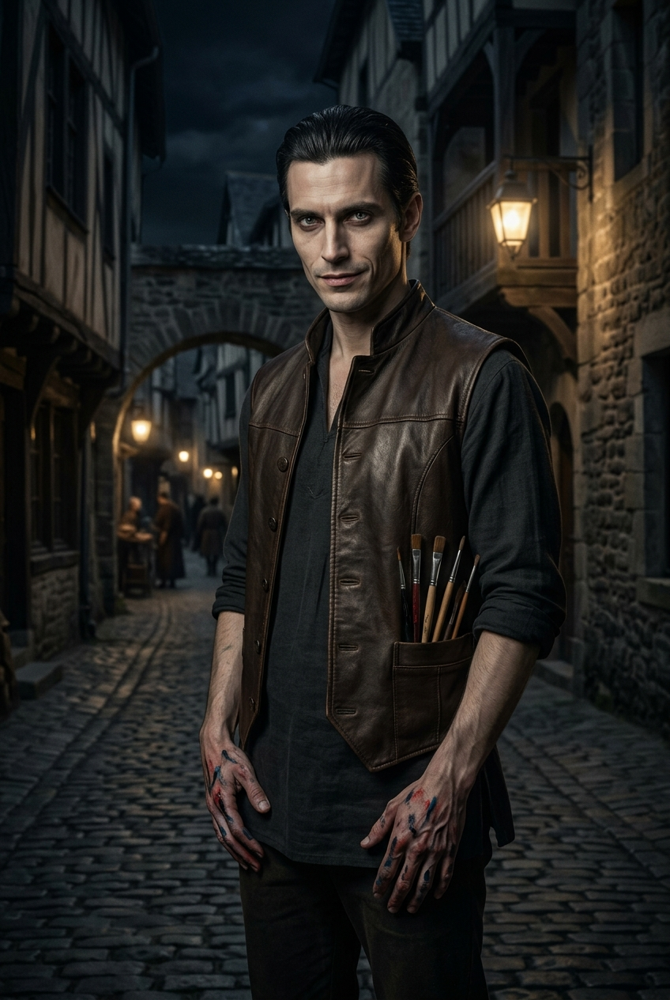
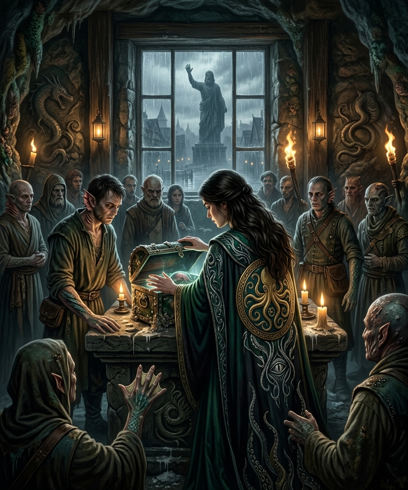

## Художник — Лучиано Аврелиан (d6=6)

::: figure [Портрет Лучиано Аврелиан;width:90%;height:auto]

:::

### Идентификация

- **Имя:** Лучиано Аврелиан.
- **Прозвище:** «Маэстро».
- **Раса:** аасимар.
- **Мировоззрение:** Хаотично-добрый (CG) — на бумаге.
- **Дата рождения**: 15 Кутона (декабря) 4675 AR (15 Kuthona, 4675 AR), 35 лет (кажется моложе из-за происхождения).
- **Знак Зодиака (Голарион)**: Ведомый (The Follower).
- **Восходящий знак (Асцендент)**: Дочь (The Daughter).
- **Покровительствующая стихия**: Ночная тьма и Зимний хлад.

### Описание

Красивый, почти аристократический мужчина, который держится как художник перед полотном.
На толпу он смотрит так, будто перед ним не живые люди, а пейзаж или натюрморт.

Он не врёт прямо — умалчивает, или уходит от ответа, меняя тему.
Его улыбка не доходит до глаз, а в моменты «пустой маски» лицо на секунду теряет эмоции.

#### Внешний вид и черты лица

Высокий, стройный — чуть выше среднего; кошачья грация, длинные руки и пальцы. Красивое, почти аристократическое лицо;
тёмные волосы, аккуратно зачёсанные назад. Серые глаза с безумной искрой; улыбка — обаятельная, но не доходит до глаз.
Стоит ему подумать, что на него никто не смотрит, как лицо мгновенно теряет эмоции и превращается в пустую маску. Черты
лица — необычные: чуть более острые скулы и лоб, чем у обычного человека.

#### Одежда и детали

Простая, но качественная тёмная рубаха, кожаный жилет, тёмные штаны.
На длинных пальцах рук и манжетах рукавов — старые следы краски, которые так и не удалось отмыть.
В кармане жилета — кисти и тюбики с краской; в длинных пальцах — **Серебряный штифт** (редкий и дорогой инструмент для
рисования по грунтованной бумаге — признак мастерства или достатка).
Обувь — мягкая, бесшумная.

#### Поведение и шлейф восприятия

Держится слишком прямо и дерзко легко для обычного горожанина. Движется бесшумно, легче, чем человек. В тени становится
чуть прозрачнее/невесомее, но в ярком свете — обычный.
Запах: масляная краска, льняное масло, резкие травы и еле уловимый, противоестественный холод.
Говорит мягко, чуть звеняще, с металлическим оттенком; в напряжении — металл слышнее.
Жесты — слишком плавные, слишком правильные, будто он контролирует каждое движение, чтобы не выдать себя.

#### Речь

Обаятельный, вкрадчивый, но пустой; чуть звенящий, с металлическим оттенком. Темп — плавный, с паузами; в friendly —
обрывисто, как маска падает. Громкость — мягкий, мелодичный; в friendly — глухо, впервые слышно металл. Лексика:
«картины», «реликвия», «орден», «культ». Синтаксис: плавные фразы, обаятельные формулировки. Пауза — его главный
инструмент. Клички: «Не спрашивай, зачем», «Я не считаю себя злодеем». Жесты: улыбается не доходя до глаз, держит кисти.

### Предыстория

- **4692 AR** — **Четвёртый крестовый поход** (Мендев против Мировой Язвы, 4692–4707 AR): **Хоррамзадех, Король Бури,
  атакует Кенабрес** и повреждает Страж-камень. Храм Ордена Вечной Розы (поклоняются Шелин) в Мендеве попадает под
  удар демонических сил и разграбляется. Лучиано, молодой послушник, выживает. Реликвия храма (реликварий с
  мумифицированным черепом святого) исчезает в хаосе войны.

- **4692–4707 AR** — Лучиано присоединяется к войскам Мендева. Воюет против демонов и культистов, ищет следы реликвий
  своего ордена. К концу Четвёртого похода — опытный воин и разведчик, но его психика **изъедена** постоянным
  контактом с демонами и Бездной. Чувство прекрасного искажается: он начинает видеть «красоту» в страдании и смерти.
  Начинается зависимость от Лист-живодёра (Flayleaf) — как попытка заглушить ПТСР и усилить видения Шелин.

- **4707–4710 AR** — Поход заканчивается «выморенным» перемирием. Лучиано отправляют в изгнание из ордена, покуда он не
  найдет и не вернет утерянные реликвии. Он продолжает поиски по всему Голариону, двигаясь по следам контрабандистов и
  перекупщиков.

- **23 Рова 4710 AR (День Гнева, осеннее равноденствие)** — В пригороде Весткроуна, в таверне Слёзы устрицы, **Виттория
  Вельди** в **День Гнева** разбирает вещи матери в логове культистов и находит **запертый ларец**. Она открывает его в
  первый раз и **реликвия проявляет себя** (видение Шелин). Где-то, в Мендеве, Лучиано получает **видение Шелин**:
  ларец, праздник, лица. Он понимает: реликвия где-то в Весткроуне.

- **Зима 4710–4711 AR** — Лучиано добирается до Челии. Закупаясь Листом живодёром на **Теневом рынке** он случайно
  знакомится с **Гаэтано Вельди**, который поставляет Лист в Весткроуне. Лучиано не раскрывает, что именно он ищет
  в городе — но договаривается с Гаэтано на долгосрочную аренду мансарды в «Слёзах устрицы», а так-же регулярные
  поставки Листа

- **Зима 4711 AR** Для заработка торгует своими картинами в Тривардуме и иногда пишет портреты знати за значительные
  суммы, чем зарабатывает уважение и возможность входить в высший свет Весткроуна.
- **Зима 4711 AR** - Лучиано подкупает лейтенантов доттари, несущих караул на въездах в город (мосты и доки), и получает
  от них информацию о всех, входящих в город.
- **Весна 4711 AR** — Каждое утро сидит на **Мосту Клинкокрыла**. Это основной сухопутный путь в город. Он ищет людей,
  которых видел в видении с праздника; если кто-то совпадает — тайно отслеживает, пытает и убивает.

#### Видение (что именно увидел Лучиано)

::: image [Видение Лучиано;width:100%;height:auto]

:::

В своем видении Лучиано видел, как молодая женщина с длинными, темными волосами, в одежде с Глазом осьминога на фоне
золотого диска (узнаваемый символ Дагона) стоит к нему спиной. Она наклоняется и открывает ларец с реликвией,
поставленный на алтарь в центре святилища культа.
Вокруг - стоит два десятка человек. У некоторых из них - мутациями (жабры, перепонки между пальцами, чешуя). Большая
часть - так-же в одежде культистов.
Его взгляд переходит на окно, через которое видно гигантскую статую Ародена, высотой 90 футов, возносящуюся над городом.
Самый узнаваемый символ Весткроуна - Города Девяти Звёзд.

#### Искажение души Луциано (падение): три уровня воздействия

Не нужно делать так, чтобы Бездна **буквально** превратила его в убийцу. Гораздо интереснее — трещины в мировоззрении,
которые он сам научился оправдывать.

- **Военное:** годами он видел демонов, культистов, разрушения и последствия их действий.
- **Магическое:** контакт с демоническими силами и осквернёнными местами мог влиять на его восприятие, сны и видения.
- **Личное:** он постепенно начал считать жестокость допустимым способом восстановить красоту и порядок.

Лист-живодёр помогает ему заглушать кошмары и усиливать мистические переживания, но не является их причинами. Шелин
действительно время от времени посылает ему свои видения.

#### Предохранитель на охоте

Художник не убивает увиденных *без разбора*: он **пытается установить, кто из них участвовал в ритуале**, но его
критерии **испорчены паранойей, видениями и собственными убеждениями**. Например:

- присутствие при открытии ларца → значит причастность к осквернению;
- попытка скрыть семейную тайну → доказывает соучастие;
- связь с культом (даже косвенная) → делает человека допустимой жертвой.

### Профессия

- Вольный художник — официально, Лучиано — художник. Он делает зарисовки, гуляя по городу, и вокруг, а потом - тщательно
  прорисовывает в своей мастерской на мансарде таверны. Так-же иногда берет заказы на изготовление портретов знатных лиц
  города.
- Агент Ордена Вечной Розы — Лучиано находится в странствиях, ища и возвращая реликвии, украденные из храма его ордена.

Творчество для Луциано — это:

- Инструмент, дающий ему средства к существованию. Он старается не афишировать своё
  авторство, продавая картины с зарисовками через посредников в Тривардуме. Иногда он пишет портреты знати — это
  способ получить полезные знакомства в нужных кругах и получить больше сведений о реликвии, а не открытая
  деятельность. Это поддерживает его скрытный образ жизни.
- Форма поклонения Шелин. Т.к. Лучиано - паладин Шелин, он поклоняется своему божеству в такой форме - творя и создавая
  что-то новое.

#### Скрывает

- **[big]** Серия убийств — его «пытки» участников **Дня Гнева 23 Рова (сентября) 4710 AR** (около семи месяцев назад в
  «Слёзах устрицы»), значительная часть из которых — культисты Дагона, часть — контрабандисты, воры, проститутки и
  маргиналы (не «охота на культистов» — это его ложное убеждение). Раскрыл имена наркотиками, допросами и пытками.
- **[big]** Покровитель — **Шелин** (богиня искусства/красоты, NG), но путь — **падение/извращение**: верит, что убивая
  «уродливых» негодяев, создаёт идеальную красоту (их смерть) и увековечивает её на холсте; получает извращённое
  удовольствие, но **не считает себя злодеем**.
- **[big]** Миссия — вернуть украденную **реликвию** (реликварий — мумифицированный череп святого, `reliquary_skull`).
  **Уверен, что реликвию держит один из участников Дня Гнева 23 Рова (сентября) 4710 AR**; не знает, что реликвия всё
  ещё в культовом святилище (`cult_lair`) под алтарём в этой же таверне (украдена из храма ворами по наводке Совета
  Воров, выкуплена культистами Дагона — `event_018`).
- **[big]** Тайно принимает наркотики — топливо безумия/падения (отдельно от контрабанды Моряка/Трактирщика): **Слёзы
  Размира** (творить часами без боли, галлюцинации подсказывают извращённые образы), **Эфир** (усиление божественных
  способностей для расправы, но потеря контроля), **Белладонна** (религиозное самоистязание, кошмарные видения,
  воплощаемые на холсте). Это метафора падения: он пытается силой вернуть утраченную «красоту», но глубже погружается в
  хаос; сам стал жертвой контроля.
- **[small]** Официантка «запала» на него (он необычно красив), но не бросает Доктора.
- **Кто знает (known_by):** никто (все секреты `known_by: []`).

#### Чего хочет

- Вернуть реликвию «туда, где ей место» (в орден / в храм Шелин).
- «Покара́ть» участников Дня Гнева 23 Рова (сентября) 4710 AR, которых считает негодяями и причастными к осквернению
  реликвии.
- Скрыть серию убийств и свою миссию (раскрытие → повесят).

#### Чего боится

- Раскрытия серии убийств / раскрытия миссии ордена (его повесят).
- Не найти реликвию / не раскрыть серию убийств.
- **Детектив (Джакомо)** — расследует его серию убийств; Художник его боится (и мог бы его убить, чтобы скрыть серию).

#### Отношения

- **Гаэтано Вельди (Трактирщик, d6=1)** — деловая связь: Художник покупает у него **Лист-живодёр (Flayleaf)**
  неофициально (через контрабанду) и **подкупает Фальконе**, чтобы тот позволял уточнять информацию о проходящих.
  Художник взял мансарду в **долгосрочную аренду (минимум 6 месяцев) именно ради доступа к Лист-живодёру** — удобное
  место + продают Лист-живодёр. Это **единственная причина его прихода в таверну** (не случайность). Трактирщик знает о
  его зависимости, но **не знает о Художнике как об убийце**. Художник подозревает Трактирщика как «связанного с культом
  Дагона», но знает лишь о контрабанде, а не о культе.
- **Виттория Вельди (Официантка, d6=3)** — подозревает как участницу Дня Гнева 23 Рова (сентября) 4710 AR (вероятно —
  культиста Дагона); на деле она — **верховная жрица культа Дагона** (его ложное убеждение: «просто культистка»).
- **Элио Вентури (Врач, d6=4)** — подозревает как участника Дня Гнева 23 Рова (сентября) 4710 AR (вероятно — члена
  культа Дагона); на деле он — член культа (последователь Официантки).
- **Чезаре Фальконе (лейтенант доттари)** — Художник его подкупает: за плату Фальконе позволяет уточнять информацию о
  проходящих (имена, откуда, куда). **Слабое звено в схеме Художника**: если игроки выведут Фальконе «работает» на
  художника, они выйдут на Художника через таможню.
- **Джакомо Раньери (Детектив, d6=5)** — противопоставление личного (тайного) и официального правосудия; Художник его
  боится.

#### Ключевое знание

- **Знает точно:** он — серийный убийца; он — паладин (тайный агент ордена) из Мендева; официально не имеет права на
  убийства в этой стране (действует тайно, как шпион); миссия — вернуть реликвию; серия убийств — «пытки» участников Дня
  Гнева 23 Рова (сентября) 4710 AR; покровитель Шелин (извращённый путь); арендовал мансарду под ложной личностью
  «вольный художник»; на мансарде развёрнута художественная мастерская (мрачная треш-расчленёнка); выбрал таверну
  намеренно из-за Лист-живодёра; знает о контрабанде Трактирщика и о том, что тот продаёт ему Лист-живодёр.
- **Подозревает:** Официантка может быть связана с культом Дагона (не знает, что она — верховная жрица); Врач может быть
  связан с культом Дагона; Трактирщик может быть связан с культом (знает лишь о контрабанде/Лист-живодёре).
- **Не знает:** о культе в этой таверне (она — главное логово культа Дагона); что реликвия всё ещё в `cult_lair` под
  алтарём; о любовной связи Официантки и Доктора; о предыстории покойной жены как верховной жрицы; о дезертирстве
  Моряка; о Детективе (пока не расследует).

#### Ложные убеждения

- **Официантка — просто официантка** (на деле — верховная жрица культа Дагона).
- **Врач — просто врач в морге** (на деле — член культа, последователь Официантки).
- **Его миссия нравится Шелин и санкционирована ей** (на самом деле - его дела прямо противоречат постулатам Шелин, но
  ей нужна его помощь).
- **таверна Слезы устрицы — просто случайное место, где он может находиться** (на деле — содержит главное логово культа
  Дагона).
- **участники Дня Гнева 23 Рова (сентября) 4710 AR - знают, где находится реликвия его ордена.** (на деле —
  участники, которых он видел - это рядовые культисты, и они не знают, куда Виттория спрятала ларец с реликвией).
- **Участники Дня Гнева 23 Рова (сентября) 4710 AR — в основном культисты Дагона, которых надо покарать** (на деле —
  значительная часть — культисты, но часть — контрабандисты, воры, проститутки и маргиналы, не все).
- **Серия убийств в городе — это его охота на культистов Дагона** (на деле — «пытки» участников Дня Гнева 23 Рова
  (сентября) 4710 AR, чтобы узнать, кто держит реликвию; «охота на культистов» — лишь его ложное убеждение, confidence:
  high).

#### Организации

- **Орден Вечной Розы:** паладин (тайный агент ордена), покровитель Шелин (извращённый путь). Отправлен
  из Мендева для «чистки» участников Дня Гнева 23 Рова (сентября) 4710 AR и возвращения реликвии. Официально не имеет
  права на убийства в этой стране; на деле — серийный убийца.

### Реликвия: путь от храма до ларца Вельди

- ~4691 AR - Семейство Вельди переезжает в Весткроун и приобретают таверну Слезы устрицы.
- ~4699 AR - Изабелла Вельди приобретает реликвию Ордена Вечной Розы у контрабандистов;
- 23 Рова 4710 AR (День Гнева) - Виттория Вельди находит реликвию (мумифицированный череп) в запертом ларце и открывает
  его первый раз; реликвия проявляется в видении Шелин.

### Как отыгрывать: поведение, речь, маски

- **Внешний слой (для большинства сцен):**
    - Обаятельный, вкрадчивый, красивый. Держится как художник перед полотном. На толпу смотрит как на пейзаж или
      натюрморт.
    - Не врёт прямо — умалчивает, уходит от ответа, меняет тему.
    - Улыбка не доходит до глаз. В моменты «пустой маски» лицо на секунду теряет эмоции.
    - Говорит мягко, чуть звеняще, с металлическим оттенком. Темп плавный, с паузами. Пауза — его главный инструмент.
    - Жесты слишком плавные, слишком правильные — будто он контролирует каждое движение, чтобы не выдать себя.
    - Движется бесшумно, легче, чем человек. В тени становится чуть прозрачнее/невесомее.
    - Запах: масляная краска, льняное масло, резкие травы и еле уловимый противоестественный холод.

- **В напряжении / когда маска падает**:
    - Голос становится глуше, металл слышнее.
    - Речь обрывистая.
    - Лицо превращается в пустую маску.

### 6. Лучиано Аврелиан — Художник (NPC 9)

#### [PF2e stat-block]

| Параметр          | Значение                                                                                                                           |
|-------------------|------------------------------------------------------------------------------------------------------------------------------------|
| **Уровень**       | 9                                                                                                                                  |
| **Мировоззрение** | CG (падший паладин; извращённый путь Шелин)                                                                                        |
| **Раса**          | Аасимар (аасимар: +1 к CHA, +1 к языку Небесный при наличии фита)                                                                  |
| **Класс**         | Чемпион (Champion, Shelyn; павший)                                                                                                 |
| **Роль**          | Solo boss / melee striker                                                                                                          |
| **Восприятие**    | +15; ночное зрение                                                                                                                 |
| **Языки**         | Общий, Небесный, Акло, Варисийский                                                                                                 |
| **Навыки**        | Акробатика +16, Атлетика +17, Запугивание +17, Обман +17, Религия +13, Ремесло (живопись) +12, Скрытность +16, Знание (демоны) +12 |
| **Сила**          | +4                                                                                                                                 |
| **Ловкость**      | +3                                                                                                                                 |
| **Телосложение**  | +2                                                                                                                                 |
| **Интеллект**     | +1                                                                                                                                 |
| **Мудрость**      | +2                                                                                                                                 |
| **Харизма**       | +4                                                                                                                                 |
| **AC**            | 27                                                                                                                                 |
| **HP**            | 155                                                                                                                                |
| **Скорость**      | 30 футов                                                                                                                           |
| **Спасброски**    | Стойкость +17, Реакция +16, Воля +17                                                                                               |
| **Ближний бой**   | Глефа «Шёпот Душ» +18 (досягаемость 10 футов, двуручное), 2d8+4 рубящий                                                            |
| **Дальний бой**   | Метательный нож +16 (метательное 20 футов), 1d4+4 колющий                                                                          |
| **Предметы**      | +1 глефа со страйкинг-руной «Шёпот Душ», метательные ножи (3), +1 кольчужная рубаха, символ Шелин                                  |

**Способности:**

- **Скрытый удар (Sneak Attack):** 1d6; когда вы попадаете по существу, которое «Застигнута врасплох», вы наносите
  дополнительный 1d6 точного урона.
- **Божественная кара (Divine Smite):** (божественный, дух) когда вы используете «Освобождающий шаг» и цель реакции
  совершает Удар по спровоцировавшему врагу, при попадании враг получает 4 продолжительного урона духом.
- **Аура освобождения:** (аура, божественный) 15 футов; союзники в ауре получают +1 бонус статуса к спасброскам против
  эффектов, налагающих состояния «Захвачен», «Обездвижен», «Замедлен» или «Парализован».
- **Освобождающий шаг (Liberating Step):** (реакция) враг наносит урон вашему союзнику в пределах 15 футов; союзник
  получает сопротивление 11 всем видам урона от спровоцировавшей атаки.
- **Сокрушительный удар (1 действие):** Атака; при попадании цель «Застигнута врасплох» до конца следующего хода
  Художника.
- **Художественная казнь (2 действия, 1/раунд):** Атака; при попадании +2d6 урона, цель проходит спасбросок Стойкости СЛ
  27, иначе «Замедлен 1» (Slow 1) на 1 раунд.
- **Ужасающее присутствие (Frightful Presence) (1 действие):** (аура, эмоция, страх, ментальный) 30 футов; спасбросок
  Воли СЛ 27, иначе «Испуган 2» (Frightened 2).
- **Оружие-реликвия «Шёпот Душ» (Glaive of Soul Whisper):** +1 глефа со страйкинг-руной; при критическом попадании по
  существу, которое поклоняется демонам или имеет черту «культист», цель проходит спасбросок Воли СЛ 25, иначе «Испуган
  2» (Frightened 2).
