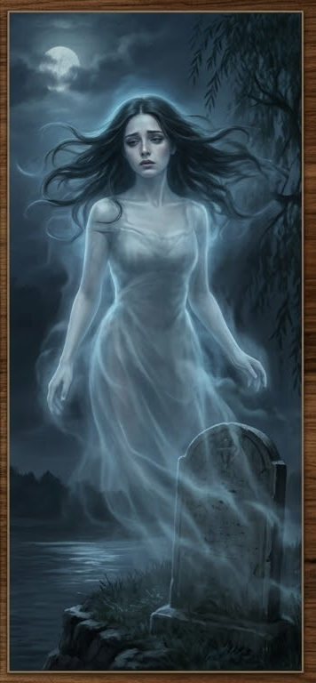

## Мёртвая жена — Изабелла Вельди (призрак)

::: figure [Портрет Изабеллы Вельди;width:90%;height:auto]

:::

### Идентификация

- **Имя:** Изабелла Вельди.
- **Прозвище:** «Госпожа Изабелла».
- **Роль:** Мёртвая жена Трактирщика; мать Официантки; **призрак**, обитает у Могилы жены (`wife_grave`); `status =
  ghost`; **не может быть жертвой убийства** (`can_be_murder_victim = false`).
- **Раса:** человек.
- **Мировоззрение:** Нейтрально-доброе (NG).
- **Возраст:** ~39 лет (на момент смерти).

### Описание

Бледное, почти прозрачное лицо; глаза тёмные, глубокие, с печалью; взгляд мягкий, но пронзительный; иногда, когда она
говорит, её голос звучит как эхо. Стройное, лёгкое сложение.

Одета в белое платье, которое носила при жизни; волосы распущены; ноги не касаются земли — она парит в воздухе. Запах:
холод, цветы (запах с могилы).

**Приметы:** появляется у портрета в зале (`tavern_hall`), у могилы (`wife_grave`) и у входа в `cult_lair`; может
проходить сквозь стены; говорит только с Официанткой (и с теми, кого сочтёт достойным).

### Предыстория и смерть

Изабелла — жена Гаэтано Вельди и мать Виттории. Она была **верховной жрицей культа Дагона** (демон, Chaos; запрещённая
ересь в Челии) и при жизни обучила дочь ритуалам культа; инициацию Виттория провела уже после смерти матери
(`event_019`).

Изабеллу **изнасиловал и убил Моряк** (Корин Марроне) — он сделал это, не зная, что она жрица культа, считая, что убивает
просто жену «коллеги» (`event_004`). Убийство — свершившийся задолго до начала истории факт:
`death.killed_by = sailor`, `cause = murder`, `status = dead`.

За пару недель до игровых событий призрак Изабеллы приходит к дочери (Виттории) в её комнату на рассвете и рассказывает
об убийстве и угрозах Моряка (`event_015`), подталкивая Витторию к мести.

### Реликвия как якорь (для мастера)

Призрак Изабеллы **не** стал мстительным духом. Пока реликвия культа — ковчег с мумифицированным черепом святого
Маврикия — лежит в логове (`cult_lair`) под алтарём и не упокоена (не возвращена Ордену Вечной Розы и не уничтожена),
её «огонь» держит Изабеллу: это не даёт ей превратиться в мстительного духа, способного убить всех вокруг, кроме
дочери. Реликвия служит якором — пока она в логове, приговор Изабеллы заперт, и та лишь шепчет («пусть не мстит.
пусть уходит»). Но если реликвию выкрадут, уничтожат или уведут от места — приговор может сорваться с цепей, и тогда
защита от мести исчезнет.

### Отношения

- **Гаэтано Вельди (Трактирщик, d6=1)** — муж (жена/муж). В память о ней Гаэтано держит её портрет на видном месте в
  зале.
- **Виттория Вельди (Официантка, d6=3)** — дочь (мать/дочь). Обучила её ритуалам культа при жизни; общается с ней как
  призрак.
- **Корин Марроне (Моряк, d6=2)** — убийца (hatred). Она знает, что он убил её; Моряк, напротив, не знал, что она —
  жрица культа.

### Ключевое знание

- **Знает точно:** она была женой Трактирщика; Моряк изнасиловал и убил её (`event_004`); её дочь — Официантка; Моряк
  угрожал её дочери, если Трактирщик не согласится вести общие дела (`event_015`); она — призрак, обитающий у Могилы жены
  (`wife_grave`); она была верховной жрицей культа Дагона до гибели (`event_019`); она обучила дочь ритуалам культа
  (`event_019`).
- **Знает частично:** Моряк убил её, не зная, что она — жрица культа (он считал, что убивает просто жену «коллеги»;
  `event_004`).

### Скрывает

- **[big]** Убита Моряком (изнасилована и убита). Призрак рассказал об этом Официантке (`event_015`). Известно
  Трактирщику, Моряку, самой Изабелле и Официантке (`known_by: tavern_keeper, sailor, dead_wife, waitress`).

### Повседневное расписание

- **Ночь** — у Могилы жены (`wife_grave`): обитает у могилы; один из входов к убежищу культа (`cult_lair`).
- **Утро** — в комнате Официантки (`waitress_room`): приходит к дочери на рассвете (раннее утро, до того как Официантка
  уходит молиться) и рассказывает ей об убийстве (`event_015`).
- **День** — в зале (`tavern_hall`): обитает рядом с портретом жены на видном месте.
- **Вечер** — в зале: обитает рядом с портретом жены.
- **Полночь** — у святилища (`cult_lair`): присутствует у входа к логову культа (через `wife_grave`; связь с подвалом).

### Скрытое

- Призрак Жены (`wife_ghost`).
- Показания призрака (`ghost_testimony`).
- Завещание dead_wife (`wife_will`).

### Организации

- **Таверна** — погибшая жена владельца (призрак), статус: мертва.
- **Культ Дагона** — бывшая верховная жрица (унаследовала культ; служба передаётся по женской линии), статус: мертва. Обучила дочь; теперь призрак, обитает у
  входа к логову культа через Могилу жены (`wife_grave`).

### [PF2e stat-block]

| Параметр          | Значение                                                             |
|-------------------|----------------------------------------------------------------------|
| **Уровень**       | 5                                                                    |
| **Мировоззрение** | NG                                                                   |
| **Раса**          | Человек                                                              |
| **Класс**         | Призрак (Ghost)                                                      |
| **Роль**          | Ghost                                                                |
| **Восприятие**    | +12                                                                  |
| **Языки**         | Общий, Варисийский                                                   |
| **Навыки**        | Религия +12, Проницательность +12, Запугивание +10                   |
| **AC**            | 21                                                                   |
| **HP**            | 60                                                                   |
| **Скорость**      | 25 футов (полёт 25 футов)                                            |
| **Спасброски**    | Стойкость +10, Реакция +12, Воля +15                                 |
| **Ближний бой**   | Призрачное касание +12 (2d6 негативный, 1d6 холода)                  |

**Способности:**

- **Ужасающий вид (Frightful Moan):** Воля СЛ 22 — «Испуган 2».
- **Дар пророчества (Prophetic Gift):** не может лгать.
- **Привязка (Bound):** не может покинуть таверну.
- **Невидимость.**
- **Прохождение сквозь стены.**
