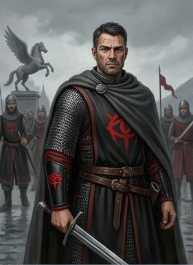
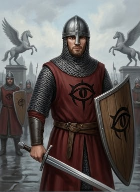
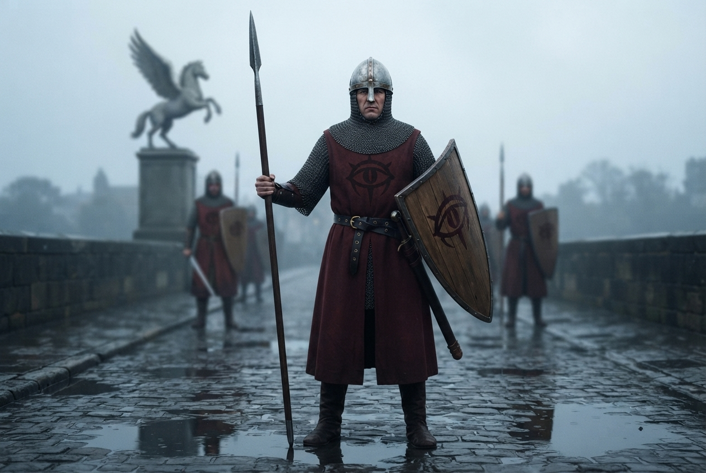
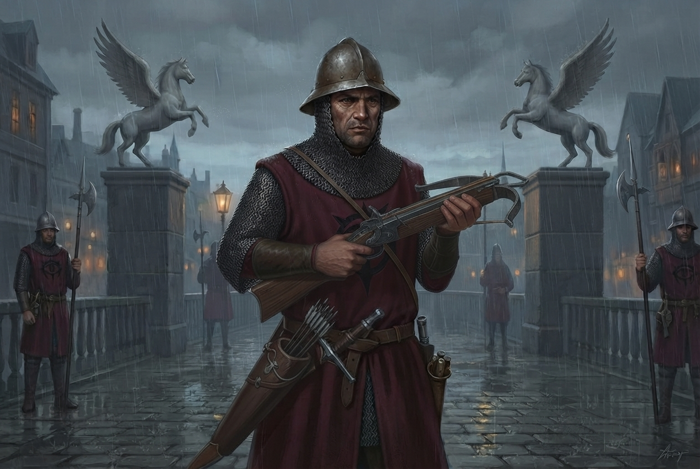
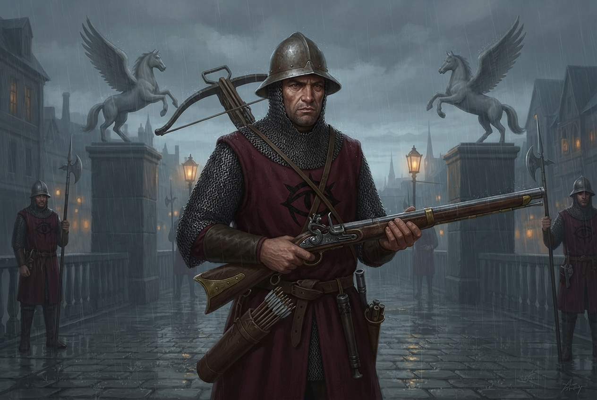
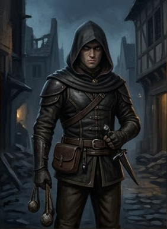
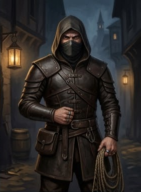
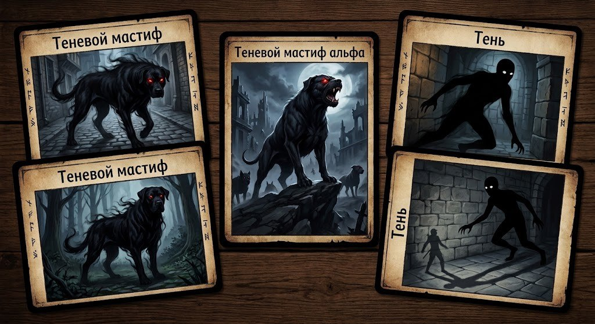

# Бестиарий

## Подсказки для GM

**Обозначения:**

- `[one-action]` — 1 действие,
- `[two-actions]` — 2 действия,
- `[reaction]` — реакция,
- `[free-action]` — свободное действие.
- `[+X/+Y]` — штраф за множественную атаку.

**Трейты:**

Вот соответствия для всех трейтов взятые из неофициального, но наиболее авторитетного русского перевода правил
Pathfinder 2e (проект [pf2e-ru-translation](https://pf2e-ru-translation.readthedocs.io/)).

| Английский трейт  | Русский перевод          | Примечание                                                                            |
|:------------------|:-------------------------|:--------------------------------------------------------------------------------------|
| **Deadly d10**    | **Смертельное d10**      | При критическом попадании добавляет куб урона указанного размера.                     |
| **Propulsive**    | **Тяговое**              | Добавляет половину (или полный, если он отрицательный) модификатор Силы к урону.      |
| **Volley 30 ft.** | **Залповое 30 футов**    | Штраф -2 к атакам по целям в пределах указанной дистанции.                            |
| **Versatile P**   | **Универсальное К**      | К — колющий урон. Оружие может наносить этот тип урона вместо основного.              |
| **Agile**         | **Быстрое**              | Штраф за множественную атаку для этого оружия снижен.                                 |
| **Finesse**       | **Точное**               | Позволяет использовать Ловкость вместо Силы для бросков атаки.                        |
| **Thrown 10 ft.** | **Метательное 10 футов** | Оружие можно метнуть, совершив дистанционную атаку.                                   |
| **Nonlethal**     | **Несмертельное**        | Атаки лишают сознания, а не убивают. Можно совершить смертельную атаку со штрафом -2. |

## Доттари

Доттари (Dottari) — это городская стража Челии, в частности Весткроуна, бывшей столицы империи. Они выполняют функции
полиции, охраны порядка и таможенного контроля. В Весткроуне доттари подчиняются дуксотару Илтусу Мартису, «верховному
стражу», который отвечает только перед мэром.

Все доттари носят «Глаз Ародена» — символ города. Он изображается чёрным на красном фоне на щите или табарде. Офицеры
носят знак наоборот (красный на чёрном) на левой руке. Чем выше расположен знак на рукаве, тем выше ранг офицера.

***Отряды:***

Обычно, доттари патрулируют отрядами по семь человек: шесть солдат и один лейтенант.
Вот как можно распределить роли:

| Роль      | Количество | Дополнительно              |
|-----------|------------|----------------------------|
| Лейтенант | 1          | Есть всегда                |
| Копейщик  | 3–4        | В патруле на улицах города |
| Мечник    | 3–4        | На охране ворот и мостов   |
| Стрелок   | 2–3        | Есть всегда                |

- В составе обычной группы, патрулирующей улицы: 1 лейтенант, 4 копейщика и 2 стрелка.
- В составе поста (охрана мостов, ворот или причалов): 1 лейтенант, 2 копейщика, 2 мечника и 2 стрелка.
- В составе группы, патрулирующей Парего Регикона (Parego Regicona): 1 лейтенант, 4 мечника и 2 стрелка

Состав может незначительно варьироваться в зависимости от ситуации.

***Тактика:***

- Копейщики или мечники выстраиваются в линию, поднимают щиты и держат проход.
- Арбалетчики стоят за ними и ведут огонь по дальним целям.
- Лейтенант, оставаясь позади, координирует, использует Ауру командования и при необходимости стреляет из лука.

Доттари — это городская стража, а не отряд головорезов. Их основная задача — задержать, обезвредить и доставить
нарушителей на суд для проведения законного следствия и вынесения приговора.

Механически: в ближнем бою для добивания (когда очевидно, что после успешного удара HP персонажа опустится до 0) доттари
стараются использовать дубинки и нанести несмертельный урон. Если персонаж игрока опускается до 0 HP от такой атаки — он
без сознания и стабилен, а не умирает. После боя его приводят в чувство, обыскивают и отправляют под арест.

### Лейтенант доттари

#### [PF2e stat-block]

**5 LE Средний Гуманоид (Человек)**  
*Контролёр / офицер (Controller / Officer)*

| Параметр          | Значение                                                                                                                                                                         |
|-------------------|----------------------------------------------------------------------------------------------------------------------------------------------------------------------------------|
| **Уровень**       | 5                                                                                                                                                                                |
| **Мировоззрение** | LE (Lawful Evil / Законно-злой)                                                                                                                                                  |
| **Размер**        | Средний                                                                                                                                                                          |
| **Тип**           | Гуманоид (Человек)                                                                                                                                                               |
| **Роль**          | Контролёр / офицер (Controller / Officer)                                                                                                                                        |
| **Восприятие**    | +12; ветеран патруля (см. способности)                                                                                                                                           |
| **Языки**         | Общий, Варисийский                                                                                                                                                               |
| **Навыки**        | Атлетика +13, Дипломатия +9, Запугивание +11, Знание (право) +10, Знание (местное) +8, Общество +8                                                                               |
| **Сила**          | +4                                                                                                                                                                               |
| **Ловкость**      | +0                                                                                                                                                                               |
| **Телосложение**  | +2                                                                                                                                                                               |
| **Интеллект**     | +0                                                                                                                                                                               |
| **Мудрость**      | +3                                                                                                                                                                               |
| **Харизма**       | +3                                                                                                                                                                               |
| **Предметы**      | +1 длинный меч, композитный длинный лук (20 стрел), кинжал, **+1 хауберк** (средняя броня), стальной щит с эмблемой «Глаз Ародена» (Твёрдость 5, HP 20, BT 10), тёмно-серый плащ |
| **AC**            | 22 (24 с поднятым щитом)                                                                                                                                                         |
| **HP**            | 80                                                                                                                                                                               |
| **Скорость**      | **25 футов**                                                                                                                                                                     |
| **Спасброски**    | Стойкость +12, Реакция +10, Воля +13                                                                                                                                             |
| **Ближний бой**   | +1 длинный меч +16 `[+11/+6]` (1d8+9 рубящий; магический, универсальный К)                                                                                                       |
| **Ближний бой**   | Кинжал +15 `[+11/+7]` (1d4+4 колющий; Быстрое (Agile), Точное (Finesse), Метательное (Thrown) 10 футов, Универсальное (Versatile)S)                                              |
| **Дальний бой**   | Композитный длинный лук +12 [+6/+1] (1d8+5 колющий; Смертельное (Deadly) d10, Тяговое (Propulsive), Залповое (Volley) 30 футов, дистанция 100 футов)                             |

**Способности:**

- **Аура командования (Aura of Command)** (aura, emotion, mental) 30 футов. Лейтенант укрепляет подчинённых стражников,
  давая им **+1 статусный бонус** к броскам атаки и **+2 статусный бонус** к спасброскам Воли.
- **Храбрость (Bravery)** — при успехе на спасбросок Воли против эффекта страха лейтенант получает **критический
  успех**. Кроме того, при получении состояния **испуган (frightened)** его значение снижается на 1.
- **Защита союзника щитом (Shield Warden)** — когда щит лейтенанта поднят, он может использовать **Щитовой блок (Shield
  Block)** `[reaction]` при атаке по **соседнему союзнику**. В этом случае урон поглощает щит, а не союзник.
- **Атака по возможности (Attack of Opportunity)** `[reaction]` — **Триггер:** существо в пределах досягаемости
  использует действие с трейтом `move` или `manipulate`, либо покидает клетку в пределах досягаемости. **Эффект:**
  лейтенант
  совершает одну атаку ближнего боя по спровоцировавшему существу. Эта атака не учитывает штраф за множественную атаку.
- **Блок щитом (Shield Block)** `[reaction]` — **Триггер:** лейтенант получает урон от атаки, пока его щит поднят.
  **Эффект:** щит поглощает урон (Твёрдость 5).
- **Щитовой натиск (Shielded Advance)** `[one-action]` — **Требование:** щит лейтенанта поднят. **Эффект:** лейтенант
  совершает **Перемещение (Stride)** и **Толчок (Shove)** в любом порядке. Штраф за множественную атаку не увеличивается
  от этого действия.
- **Приказ (Command)** `[one-action]` — Лейтенант может отдать приказ любому союзнику; тот получает +1 к следующей
  атаке.
- **Ветеран патруля (Patrol Veteran)** — лейтенант получает **+2 обстоятельственный бонус** к Восприятию против скрытых
  существ и **+2 обстоятельственный бонус** к спасброскам против страха. Он **видел** теневых тварей и **не боится** их
  так, как боятся новички.
- **Владение оружием (Weapon Mastery)** — лейтенант получает **+2 к урону** при атаке длинным мечом (уже включено в
  профиль атаки).

#### Для GM

Игро-механически — это аналог пониженного до 5-го уровня Капитана городской стражи (Captain of the Guard) из
официального
Бестиария.

### Мечник доттари

#### [PF2e stat-block]

**2 LE Средний Гуманоид (Человек)**  
*Солдат (Soldier)*

| Параметр          | Значение                                                                          |
|-------------------|-----------------------------------------------------------------------------------|
| **Уровень**       | 2                                                                                 |
| **Мировоззрение** | LE (Lawful Evil / Законно-злой)                                                   |
| **Размер**        | Средний                                                                           |
| **Тип**           | Гуманоид (Человек)                                                                |
| **Роль**          | Солдат (Soldier)                                                                  |
| **Восприятие**    | +9                                                                                |
| **Языки**         | Общий                                                                             |
| **Навыки**        | Атлетика +9, Запугивание +7, Знание (право) +5                                    |
| **Сила**          | +3                                                                                |
| **Ловкость**      | +2                                                                                |
| **Телосложение**  | +2                                                                                |
| **Интеллект**     | +0                                                                                |
| **Мудрость**      | +2                                                                                |
| **Харизма**       | −1                                                                                |
| **Предметы**      | Длинный меч, стальной щит, дубинка,  кольчужная рубаха, свисток                   |
| **AC**            | 18 (**20 с поднятым щитом**)                                                      |
| **HP**            | 30                                                                                |
| **Скорость**      | 25 футов                                                                          |
| **Спасброски**    | Стойкость +9, Реакция +7, Воля +7                                                 |
| **Ближний бой**   | Длинный меч +9 `[+4/−1]` (1d8+3 рубящий; универсальный К)                         |
| **Ближний бой**   | Дубинка +9 `[+5/+1]` (1d6+3 дробящий; Быстрое (Agile), Несмертельное (Nonlethal)) |

**Способности:**

- **Атака по возможности (Attack of Opportunity)** `[reaction]` — **Триггер:** существо в пределах досягаемости
  использует
  действие с трейтом `move` или `manipulate`, либо покидает клетку в пределах досягаемости. **Эффект:** страж совершает
  одну атаку ближнего боя по спровоцировавшему существу. Эта атака не учитывает штраф за множественную атаку и
  происходит до завершения спровоцировавшего действия.
- **Блок щитом (Shield Block)** `[reaction]` — **Триггер:** стражник получает урон от атаки, пока его щит поднят.
  **Эффект:** щит поглощает урон (Твёрдость 5).
- **Поднять тревогу (Raise the Alarm!)** `[free-action]` — **Триггер:** страж замечает драку или крупное нарушение
  порядка. **Эффект:** через 1 раунд срабатывает тревога. Подкрепление прибывает примерно через 5 раундов, обычно
  патруль из 1 лейтенанта и 6 стражников, а у важных объектов — 2-3 группы.

#### Для GM

Игро-механически — это адаптация «Элитного стража» (Elite Guard, уровень 2) из официального Бестиария.

### Копейщик доттари

#### [PF2e stat-block]

**2 LE Средний Гуманоид (Человек)**  
*Солдат (Soldier)*

| Параметр          | Значение                                                          |
|-------------------|-------------------------------------------------------------------|
| **Уровень**       | 2                                                                 |
| **Мировоззрение** | LE (Lawful Evil / Законно-злой)                                   |
| **Размер**        | Средний                                                           |
| **Тип**           | Гуманоид (Человек)                                                |
| **Размер**        | Средний                                                           |
| **Роль**          | Солдат (Soldier)                                                  |
| **Восприятие**    | +9                                                                |
| **Навыки**        | Атлетика +9, Запугивание +7, Знание (право) +5                    |
| **Сила**          | +3                                                                |
| **Ловкость**      | +2                                                                |
| **Телосложение**  | +2                                                                |
| **Интеллект**     | +0                                                                |
| **Мудрость**      | +2                                                                |
| **Харизма**       | −1                                                                |
| **Предметы**      | Копьё, стальной щит, дубинка, кольчужная рубаха, свисток          |
| **AC**            | 18 (**20 с поднятым щитом**)                                      |
| **HP**            | 30                                                                |
| **Скорость**      | 25 футов                                                          |
| **Спасброски**    | Стойкость +9, Реакция +7, Воля +7                                 |
| **Ближний бой**   | Копьё +9 `[+4/−1]` (1d6+3 колющий; **метательное 20 футов**)      |
| **Ближний бой**   | Дубинка +9 `[+5/+1]` (1d6+3 дробящий; **быстрое, несмертельное**) |

**Способности:**

- **Атака по возможности (Attack of Opportunity)** `[reaction]` — **Триггер:** существо в пределах досягаемости
  использует
  действие с трейтом `move` или `manipulate`, либо покидает клетку в пределах досягаемости. **Эффект:** страж совершает
  одну атаку ближнего боя по спровоцировавшему существу. Эта атака не учитывает штраф за множественную атаку и
  происходит до завершения спровоцировавшего действия.
- **Блок щитом (Shield Block)** `[reaction]` — **Триггер:** стражник получает урон от атаки, пока его щит поднят.
  **Эффект:** щит поглощает урон (Твёрдость 5).
- **Поднять тревогу (Raise the Alarm!)** `[free-action]` — **Триггер:** страж замечает драку или крупное нарушение
  порядка. **Эффект:** через 1 раунд срабатывает тревога. Подкрепление прибывает примерно через 5 раундов, обычно
  патруль из 1 лейтенанта и 6 стражников, а у важных объектов — 2-3 группы.

#### Для GM

Игро-механически — это адаптация «Элитного стража» (Elite Guard, уровень 2) из официального Бестиария.
Заменен длинный меч на копье и добавлен щит.

### Стрелок доттари

#### [PF2e stat-block]

**2 LE Средний Гуманоид (Человек)**  
*Солдат (Soldier)*

| Параметр          | Значение                                                                      |
|:------------------|:------------------------------------------------------------------------------|
| **Уровень**       | 2                                                                             |
| **Мировоззрение** | LE (Lawful Evil / Законно-злой)                                               |
| **Размер**        | Средний                                                                       |
| **Тип**           | Гуманоид (Человек)                                                            |
| **Роль**          | Солдат (Soldier)                                                              |
| **Восприятие**    | +9                                                                            |
| **Навыки**        | Атлетика +9, Запугивание +7, Знание (право) +5                                |
| **Сила**          | +3                                                                            |
| **Ловкость**      | +2                                                                            |
| **Телосложение**  | +2                                                                            |
| **Интеллект**     | +0                                                                            |
| **Мудрость**      | +2                                                                            |
| **Харизма**       | −1                                                                            |
| **Предметы**      | Длинный меч, тяжёлый арбалет (10 болтов), дубинка, кольчужная рубаха, свисток |
| **AC**            | 18                                                                            |
| **HP**            | 30                                                                            |
| **Скорость**      | 25 футов                                                                      |
| **Спасброски**    | Стойкость +9, Реакция +7, Воля +7                                             |
| **Ближний бой**   | Длинный меч +9 `[+4/−1]` (1d8+3 рубящий; **универсальное К**)                 | 
| **Ближний бой**   | Дубинка +9 `[+5/+1]` (1d6+3 дробящий; **быстрое, несмертельное**)             |
| **Дальний бой**   | Тяжёлый арбалет +8 `[+3/−2]` (1d10; дистанция 120 футов, **перезарядка 1**)   |

**Способности:**

- **Атака по возможности (Attack of Opportunity)** `[reaction]` — **Триггер:** существо в пределах досягаемости
  использует действие с трейтом `move` или `manipulate`, либо покидает клетку в пределах досягаемости. **Эффект:** страж
  совершает одну атаку ближнего боя по спровоцировавшему существу. Эта атака не учитывает штраф за множественную атаку и
  происходит до завершения спровоцировавшего действия.
- **Поднять тревогу (Raise the Alarm!)** `[free-action]` — **Триггер:** страж замечает драку или крупное нарушение
  порядка. **Эффект:** через 1 раунд срабатывает тревога. Подкрепление прибывает примерно через 5 раундов, обычно
  патруль из 1 лейтенанта и 6 стражников, а у важных объектов — 2-3 группы.

#### Для GM

Игро-механически — это адаптация «Элитного стража» (Elite Guard, уровень 2) из официального Бестиария.
Выдан тяжелый арбалет.

### Стрелок доттари (2)

#### [PF2e stat-block]

**2 LE Средний Гуманоид (Человек)**  
*Солдат (Soldier)*

| Параметр          | Значение                                                                      |
|:------------------|:------------------------------------------------------------------------------|
| **Уровень**       | 2                                                                             |
| **Мировоззрение** | LE (Lawful Evil / Законно-злой)                                               |
| **Размер**        | Средний                                                                       |
| **Тип**           | Гуманоид (Человек)                                                            |
| **Роль**          | Солдат (Soldier)                                                              |
| **Восприятие**    | +9                                                                            |
| **Навыки**        | Атлетика +9, Запугивание +7, Знание (право) +5                                |
| **Сила**          | +3                                                                            |
| **Ловкость**      | +2                                                                            |
| **Телосложение**  | +2                                                                            |
| **Интеллект**     | +0                                                                            |
| **Мудрость**      | +2                                                                            |
| **Харизма**       | −1                                                                            |
| **Предметы**      | Длинный меч, тяжёлый арбалет (10 болтов), дубинка, кольчужная рубаха, свисток |
| **AC**            | 18                                                                            |
| **HP**            | 30                                                                            |
| **Скорость**      | 25 футов                                                                      |
| **Спасброски**    | Стойкость +9, Реакция +7, Воля +7                                             |
| **Ближний бой**   | Длинный меч +9 `[+4/−1]` (1d8+3 рубящий; **универсальное К**)                 |
| **Ближний бой**   | Дубинка +9 `[+5/+1]` (1d6+3 дробящий; **быстрое, несмертельное**)             |
| **Дальний бой**   | Тяжёлый арбалет +8 `[+3/−2]` (1d10; дистанция 120 футов, **перезарядка 1**)   |

**Способности:**

- **Атака по возможности (Attack of Opportunity)** `[reaction]` — **Триггер:** существо в пределах досягаемости
  использует действие с трейтом `move` или `manipulate`, либо покидает клетку в пределах досягаемости. **Эффект:** страж
  совершает одну атаку ближнего боя по спровоцировавшему существу. Эта атака не учитывает штраф за множественную атаку и
  происходит до завершения спровоцировавшего действия.
- **Поднять тревогу (Raise the Alarm!)** `[free-action]` — **Триггер:** страж замечает драку или крупное нарушение
  порядка. **Эффект:** через 1 раунд срабатывает тревога. Подкрепление прибывает примерно через 5 раундов, обычно
  патруль из 1 лейтенанта и 6 стражников, а у важных объектов — 2-3 группы.

#### Для GM

Игро-механически — это адаптация «Элитного стража» (Elite Guard, уровень 2) из официального Бестиария.
Выдан тяжелый арбалет.

## Адские рыцари

**Адские рыцари (Hellknights)** — общее название **семи основных религиозных рыцарских орденов** Челии; каждый орден —
самостоятельная организация со своим кодексом. В регионе Весткроуна действует **Орден Дыбы (Order of the Rack)**. В
Челии нет государственной инквизиции — её роль выполняет Орден Дыбы. Это «тёмные рыцари», но **не** дьяволопоклонники:
они служат порядку и «правосудию», охотясь на демонических культистов (в том числе на культ Дагона) и на «вредоносные»
знания. База Ордена — **Цитадель Ривад** (в дне пути к западу от Весткроуна). В городе его рыцари расквартированы в
**Тараник-Хаус (Taranik House)** в районе Рего Скрипа: не менее 15 рыцарей, состав ротируется каждые две недели, а
командует гарнизоном **паралихтор Гонвиль Шард (Gonville Shard)**. Рыцари патрулируют **Адивианский мост** (2 сторожевые
башни, по 20 рыцарей в каждой).

Доспех Ордена Дыбы: тёмный металл с дизайном «обнажённой мускулатуры» на груди и плечах, гладкий безликий шлем с узкой
смотровой щелью, багровый «свежеванный» плащ с неровными краями, стилизованные шипы; символ Ордена — **колесо с шипами (
spiked wheel)** на нагруднике. Оружие — длинный меч или кнут.

***Ранги Ордена (от высшего к низшему):***

| № | Ранг (Rank)                    | Соответствие                              |
|---|--------------------------------|-------------------------------------------|
| 1 | **Ликтор (Lictor)**            | генерал; глава Ордена                     |
| 2 | **Паралихтор (Paralictor)**    | майор; командует гарнизоном или крепостью |
| 3 | **Маралихтор (Maralictor)**    | лейтенант                                 |
| 4 | **Сигифер (Signifer)**         | кастер Ордена                             |
| 5 | **Адский рыцарь (Hellknight)** | рядовой полноправный рыцарь               |
| 6 | **Армигер (Armiger)**          | оруженосец, ученик                        |

***Отряды:***

Обычный дозор Адских рыцарей — **трое оруженосцев**. Оруженосцы — ученики Ордена; они ещё не заслужили права носить
полный доспех, а потому их «латы» — вываренная кожа с кольчужными вставками, работающая как **кольчужная рубаха**. Между
оруженосцами сильно **соперничество**: их группы нарочно малы, и они неохотно зовут на помощь другие группы. Это даёт
партии преимущество — вряд ли ей придётся столкнуться более чем с тремя оруженосцами разом.

| Состав          | Количество                     | Дополнительно                        |
|-----------------|--------------------------------|--------------------------------------|
| Дозор (патруль) | 3 оруженосца                   | Соревнуются; не зовут подмогу        |
| Конвой (эскорт) | 1 лейтенант + 6–10 оруженосцев | Повозка, верховые; см. «Конвой» ниже |

***Тактика:***

- Оруженосцы **не объединяются** для сосредоточенного удара по одной цели — из-за соперничества. Если один из них роняет
  противника, он тратит раунд на бахвальство, если рядом нет других врагов.
- При снижении до 10 HP и ниже оруженосец выпивает **зелье лечения** (1 действие).
- Оруженосцы **не сдаются в плен**, но при **4 HP и ниже** могут **паниковать и бежать** (см. «Мораль»).
- В 25% случаев дозор занят **спором** о том, куда идти, и получает **−4 к проверкам Восприятия**, чтобы заметить подход
  партии.

***Конвой (зарисовка для групповой работы):***

Более крупный отряд — **конвой** — сопровождает повозку или важную персону. Обычно это **10 оруженосцев и их лейтенант (
сигифер)**:

- **4 оруженосца** — верхами на боевых конях;
- **6 оруженосцев** — на повозке: один наверху у тяжёлого арбалета, по двое с каждого борта (держатся за подножки) и
  один впереди, рядом с лейтенантом, правит повозкой.

Оруженосцы ездят верхом **без подготовки** (проверки Верховой езды без владения), но кони **не паникуют в бою**, что
позволяет преследовать бегущих; чтобы добить противника на земле, всадники спешиваются.

***Поведение конвоя:***

- **Высокомерие.** Завидев противника, конвой останавливается; насмешки и радостные выкрики выдают самоуверенность.
  Верховые рвутся вперёд, оставляя на охране повозки половину отряда.
- **Повозка как укрытие.** Оруженосцы на повозке используют её как укрытие и стреляют из арбалетов по дальним целям.
- **Отход.** Если дела плохи, конвой разворачивает тяжёлую повозку (уходит **до 1 минуты**) и отступает к Цитадели
  Ривад.
- **Мораль.** Оруженосец, опустившийся ниже **4 HP**, паникует и бежит на запад, к **Цитадели Ривад**, но не сдаётся;
  лейтенант слишком горд, чтобы сдаться, и бьётся до конца.

***Бюджет встречи.*** Полный конвой (**лейтенант ур. 5 + 10 оруженосцев ур. 2**) для партии 4×5 уровня —
**экстремальная**
встреча (≈190 XP) и почти гарантированное поражение в открытом бою. Для сбалансированной игры сократите число
оруженосцев (3–6) или используйте конвой как **засаду/сцену бегства**, а не как честный бой.

### Оруженосец Адских рыцарей

#### [PF2e stat-block]

**2 LN Средний Гуманоид (Человек)**  
*Солдат (Soldier)*

| Параметр          | Значение                                                                                                   |
|-------------------|------------------------------------------------------------------------------------------------------------|
| **Уровень**       | 2                                                                                                          |
| **Мировоззрение** | LN (Lawful Neutral / Законно-нейтральный)                                                                  |
| **Размер**        | Средний                                                                                                    |
| **Тип**           | Гуманоид (Человек)                                                                                         |
| **Роль**          | Солдат (Soldier)                                                                                           |
| **Восприятие**    | +7                                                                                                         |
| **Языки**         | Общий                                                                                                      |
| **Навыки**        | Атлетика +8, Запугивание +6, Знание (право) +4                                                             |
| **Сила**          | +3                                                                                                         |
| **Ловкость**      | +1                                                                                                         |
| **Телосложение**  | +2                                                                                                         |
| **Интеллект**     | +0                                                                                                         |
| **Мудрость**      | +1                                                                                                         |
| **Харизма**       | −1                                                                                                         |
| **Предметы**      | Длинный меч, лёгкий арбалет (20 болтов), кольчужная рубаха, 2 зелья лечения, знак Ордена (колесо с шипами) |
| **AC**            | 17                                                                                                         |
| **HP**            | 28                                                                                                         |
| **Скорость**      | 25 футов                                                                                                   |
| **Спасброски**    | Стойкость +9, Реакция +6, Воля +6                                                                          |
| **Ближний бой**   | Длинный меч +9 `[+4/−1]` (1d8+3 рубящий; универсальный К)                                                  |
| **Дальний бой**   | Лёгкий арбалет +7 `[+2/−3]` (1d8 колющий; перезарядка 1, дистанция 120 футов)                              |

**Способности:**

- **Атака по возможности (Attack of Opportunity)** `[reaction]` — **Триггер:** существо в пределах досягаемости
  использует действие с трейтом `move` или `manipulate`, либо покидает клетку в пределах досягаемости. **Эффект:**
  оруженосец совершает одну атаку ближнего боя по спровоцировавшему существу. Эта атака не учитывает штраф за
  множественную атаку и происходит до завершения спровоцировавшего действия.
- **Мощный удар (Power Attack)** `[two-actions]` — оруженосец совершает одну атаку ближнего боя; при попадании он
  наносит **один дополнительный кубик урона оружия**.
- **Соперничество (Competitive)** — оруженосец **не получает выгоды от окружения (flanking)** и **не сосредотачивает
  атаки** с союзниками по одной цели. Если его атака оставляет противника с 0 HP, он тратит следующее действие на
  бахвальство, если рядом нет других врагов.
- **Не сдаются в плен (No Surrender)** — оруженосец **не сдаётся в плен**, но при **4 HP и ниже** может **паниковать и
  бежать**.
- **Зелье лечения (Healing Draught)** `[one-action]` — **Требование:** у оруженосца есть зелье лечения. **Эффект:**
  оруженосец выпивает зелье и восстанавливает **1d8 HP**. Зелье расходуется.

#### Для GM

Сконвертировано из PF1-блока **Hellknight Patrol** (Оруженосец, CR 1/3) и приведено к **уровню 2** по таблице Building
Creatures — вровень с доттари (лёгкое превышение силы врасплох: без щита). Командир дозора/конвоя — **лейтенант (
сигифер)**
уровня 5, см. следующий блок; тогда дозор станет «3 оруженосца + 1 лейтенант».

### Рядовой Адский рыцарь

#### [PF2e stat-block]

**4 LN Средний Гуманоид (Человек)**  
*Солдат (Soldier)*

| Параметр          | Значение                                                                                                                                                          |
|-------------------|-------------------------------------------------------------------------------------------------------------------------------------------------------------------|
| **Уровень**       | 4                                                                                                                                                                 |
| **Мировоззрение** | LN (Lawful Neutral / Законно-нейтральный)                                                                                                                         |
| **Размер**        | Средний                                                                                                                                                           |
| **Тип**           | Гуманоид (Человек)                                                                                                                                                |
| **Роль**          | Солдат (Soldier)                                                                                                                                                  |
| **Восприятие**    | +11                                                                                                                                                               |
| **Языки**         | Общий, Инфернальный (Infernal)                                                                                                                                    |
| **Навыки**        | Атлетика +12, Запугивание +11, Знание (право) +9, Знание (планы) +9                                                                                               |
| **Сила**          | +4                                                                                                                                                                |
| **Ловкость**      | +1                                                                                                                                                                |
| **Телосложение**  | +3                                                                                                                                                                |
| **Интеллект**     | +0                                                                                                                                                                |
| **Мудрость**      | +2                                                                                                                                                                |
| **Харизма**       | +2                                                                                                                                                                |
| **Предметы**      | Доспех Адского рыцаря (Hellknight Plate), мастерский двуручный меч, мастерский композитный длинный лук (20 стрел), 2 зелья лечения, знак Ордена (колесо с шипами) |
| **AC**            | 22                                                                                                                                                                |
| **HP**            | 70 (high по таблице Building Creatures, 4 ур.)                                                                                                                    |
| **Скорость**      | 20 футов (в доспехе игнорирует штраф −5 футов)                                                                                                                    |
| **Спасброски**    | Стойкость +13, Реакция +8, Воля +10; **+1** статус против страха                                                                                                  |
| **Ближний бой**   | Двуручный меч +14 `[+9/+4]` (1d12+6 рубящий)                                                                                                                      |
| **Дальний бой**   | Композитный длинный лук +10 `[+5/+0]` (1d8+4 колющий; смертельное d10, тяговое, залповое 30 футов)                                                                |

**Способности:**

- **Атака по возможности (Attack of Opportunity)** `[reaction]` — как у оруженосца: атака ближнего боя без штрафа за
  множественную атаку по спровоцировавшему существу.
- **Мощный удар (Power Attack)** `[two-actions]` — одна атака ближнего боя; при попадании +один кубик урона оружия.
- **Кара хаоса (Smite Chaos)** `[one-action]` (1/день) — до конца следующего хода атаки рыцаря наносят **+2 урона** по
  хаотичным существам.
- **Различение лжи (Discern Lies)** (1/день) — рыцарь получает **+4** к Восприятию против попыток Солгать в его
  присутствии.
- **Закованы в адском огне (Forged in Hellfire)** `[reaction]` — когда рыцарь получает урон огнём, он может снизить его
  на **5**.
- **Сила воли (Force of Will)** — рыцарь получает **+2** к спасброскам против эффектов, навязанных демонами и хаосом.
- **Не сдаются в плен (No Surrender)** — рыцарь **не сдаётся в плен**, но может **отступить** при **HP ниже 10**.

#### Для GM

Сконвертировано из PF1-блока **Hellknight** (рядовой Адский рыцарь Ордена, CR 4) и приведено к **уровню 4** по таблице
Building Creatures. Это полноправный рыцарь — выше оруженосца (ур. 2), но ниже офицера-сигифера (ур. 5). В отличие от
оруженосцев, рыцари **действуют сообща**: охватывают цели (flanking) и не соперничают между собой. Тактика: применяют
**Кару хаоса** против хаотичных противников; при **HP ниже 20** выпивают **зелье лечения**; при **HP ниже 10** могут
отступить.

### Лейтенант Адских рыцарей (сигифер)

#### [PF2e stat-block]

**5 LE Средний Гуманоид (Человек)**  
*Кастер / офицер (Spellcaster / Officer)*

| Параметр              | Значение                                                                                                                                          |
|-----------------------|---------------------------------------------------------------------------------------------------------------------------------------------------|
| **Уровень**           | 5                                                                                                                                                 |
| **Мировоззрение**     | LE (Lawful Evil / Законно-злой)                                                                                                                   |
| **Размер**            | Средний                                                                                                                                           |
| **Тип**               | Гуманоид (Человек)                                                                                                                                |
| **Роль**              | Кастер / офицер (Spellcaster / Officer)                                                                                                           |
| **Восприятие**        | +12                                                                                                                                               |
| **Языки**             | Общий, Инфернальный (Infernal)                                                                                                                    |
| **Навыки**            | Религия +13 (expert, WIS+4), Медицина +11, Знание (планы) +10, Знание (право) +10, Запугивание +9, Дипломатия +7                                  |
| **Сила**              | +3                                                                                                                                                |
| **Ловкость**          | +0                                                                                                                                                |
| **Телосложение**      | +3                                                                                                                                                |
| **Интеллект**         | +1                                                                                                                                                |
| **Мудрость**          | +4                                                                                                                                                |
| **Харизма**           | +0                                                                                                                                                |
| **Предметы**          | Полный доспех Ордена, тяжёлый молот, тяжёлый арбалет (на повозке), деревянный священный символ Асмодея, ключ от тюремной повозки, 2 зелья лечения |
| **AC**                | 22                                                                                                                                                |
| **HP**                | 75 (moderate по таблице Building Creatures, 5 ур.)                                                                                                |
| **Скорость**          | 20 футов                                                                                                                                          |
| **Спасброски**        | Стойкость +12, Реакция +8, Воля +13                                                                                                               |
| **Ближний бой**       | Тяжёлый молот +14 `[+9/+4]` (1d8+5 дробящий)                                                                                                      |
| **Дальний бой**       | Тяжёлый арбалет (на повозке) +11 `[+6/+1]` (2d6 колющий; перезарядка 2, дистанция 120 футов)                                                      |
| **СЛ заклинаний**     | 23 (10 + 5 + expert+4 + WIS+4 = 23, extreme по таблице)                                                                                           |
| **Атака заклинанием** | +13                                                                                                                                               |

**Способности:**

- **Огненный луч (Fire Ray)** `[two-actions]` (фокус, огонь) — атака заклинанием по цели в пределах 60 футов; при
  попадании **3d6 огнём**.
- **Прикосновение закона (Touch of Law)** `[one-action]` (фокус) — союзник в пределах касания игнорирует один штраф
  состояния до конца своего следующего хода.
- **Тёмный канал (Harm, divine font)** — 3 раза в день выпускает **Harm** (негативная энергия) касанием или в радиусе
  30 футов; спасбросок Стойкости **СЛ 23** — половина.
- **Приказ (Command)** `[one-action]` — отдаёт приказ союзнику в пределах 30 футов; тот получает **+1** к следующей
  атаке.
- **Гордость (Too Proud to Surrender)** — лейтенант не сдаётся и сражается до конца.

**Заклинания (Cleric of Asmodeus, divine prepared):**

- **Фокусные:** Огненный луч, Прикосновение закона.
- **1-й круг (4 слота):** Command, Fear, Heal, Burning Hands.
- **2-й круг (3 слота):** Burning Hands (2-й), Silence, Calm Emotions.
- **3-й круг (2 слота):** Blindness, Slow.

#### Для GM

Сконвертировано из PF1-блока **Shanwen** (жрец Асмодея 1, CR 1/2) и приведено к **уровню 5** — вровень с лейтенантом
доттари. В оригинале это «спонсор» группы оруженосцев; здесь — **офицер-сигифер** Ордена Дыбы, командующий конвоем или
дозором. Полный конвой (см. «Адские рыцари» → «Конвой») — **лейтенант + 10 оруженосцев**. Это **авторское
расширение**: в каноне Шанвен — лишь жрец Асмодея 1 ур. (CR 1/2), сопровождавший карету с Араэлем; здесь он развёрнут в
офицера-сигифера 5 ур.

## Матросы «Чёрной Сирены»

«Чёрная Сирена» — парусник с чёрными парусами и белой сиреной на каждом из них, стоящий в порту Весткроуна. Его
экипаж — закалённые в штормах моряки и абордажники, которые задевают игроков не ради убийства, а ради «проверки».
Это «кабацкая» драка: без обнажения стального оружия, на импровизированном оружии (кружки, стулья, бутылки,
сковорода). **Бюджет XP: 120 XP (Severe, партия 4×5 уровня).**

***Отряд:***

- Абордажник-матрос — 2
- Запевала-корабельный кок — 1
- Портовый Боцман — 1

***Тактика:***

- Раунд 1: Запевала включает «Ритм кабацкой песни», Боцман отдаёт «Приказ» и делает «Толчок».
- Раунд 2: Абордажники активно используют окружение, «Захват в драке» и «Бросок в драке».

***Особенность:*** «кабацкая» драка — без стального оружия. Задача — **обезоружить** и привести к Капитану, а не
убить. Если побеждают моряки — игроков ведут силой; если побеждают игроки (более половины моряков с 0 HP / без
сознания) — Капитан сам останавливает сражение.

***Действия порта (выберите подходящее)*** — Мастер сам решает, когда что использовать:

| Эффект           | Когда использовать                                                |
|------------------|-------------------------------------------------------------------|
| Скользкие доски  | Если бой идёт у воды; Акробатика СЛ 18, иначе «Сбит с ног».       |
| Бутылочный дождь | Если в драке участвует толпа; Реакция СЛ 18, иначе 1d6 дробящего. |
| Толпа            | Если бой затянулся; Стойкость СЛ 18, иначе «Замедлен 1».          |

### Абордажник-матрос

#### [PF2e stat-block]

**3 CN Средний Гуманоид (Человек)**  
*Абордажник-матрос (Siren Deckhand) / бугай-ближник (Barroom Brawler)*

| Параметр          | Значение                                                                                  |
|-------------------|-------------------------------------------------------------------------------------------|
| **Уровень**       | 3                                                                                         |
| **Мировоззрение** | CN (Chaotic Neutral / Хаотично-нейтральный)                                               |
| **Размер**        | Средний                                                                                   |
| **Тип**           | Гуманоид (Человек)                                                                        |
| **Роль**          | Бугай-ближник (Barroom Brawler)                                                           |
| **Восприятие**    | +7                                                                                        |
| **Языки**         | Общий                                                                                     |
| **AC**            | 18                                                                                        |
| **HP**            | 35                                                                                        |
| **Скорость**      | 25 футов                                                                                  |
| **Спасброски**    | Стойкость +8, Реакция +7, Воля +6                                                         |
| **Ближний бой**   | Импровизированное оружие +9 `[+5/+1]` (1d6+3 дробящий; Несмертельное (Nonlethal), Стычка) |

**Способности:**

- **Драчун (Barroom Brawler)** — не получает -2 за импровизированное оружие.
- **Захват в драке (Brawling Grapple)** `[one-action]` — проверка Атлетики против Стойкости; при успехе цель
  «Захвачен».
- **Бросок в драке (Barroom Slam)** `[one-action]` — 1d8+3 дробящий + «Сбит с ног».

#### Для GM

«Это всё? Я думал, вы крепче.» Стальное оружие не обнажается — только импровизированное: кружки, бутылки, стулья,
сковорода. Если партия обнажает сталь, моряки не отступают, но бой становится смертельным: «Эй! Без стали! Мы не
убийцы!».

### Портовый Боцман

#### [PF2e stat-block]

**4 N Средний Гуманоид (Человек)**  
*Портовый Боцман (Siren's Boatswain) / командир (Officer)*

| Параметр          | Значение                                                                                             |
|-------------------|------------------------------------------------------------------------------------------------------|
| **Уровень**       | 4                                                                                                    |
| **Мировоззрение** | N (Neutral / Нейтральный)                                                                            |
| **Размер**        | Средний                                                                                              |
| **Тип**           | Гуманоид (Человек)                                                                                   |
| **Роль**          | Командир (Officer)                                                                                   |
| **Восприятие**    | +10                                                                                                  |
| **Языки**         | Общий                                                                                                |
| **AC**            | 20                                                                                                   |
| **HP**            | 68                                                                                                   |
| **Скорость**      | 25 футов                                                                                             |
| **Спасброски**    | Стойкость +12, Реакция +9, Воля +10                                                                  |
| **Ближний бой**   | Тяжёлый корабельный нагель +12 `[+8/+3]` (2d6+6 дробящий; Несмертельное (Nonlethal), Обезоруживание) |

**Способности:**

- **Приказ «Чёрной Сирены» (Siren's Command)** `[one-action]` — союзники в пределах 30 футов получают +1 к
  броскам атаки и к Атлетике.
- **Толчок и сбивание (Bull Rush & Tackling)** `[two-actions]` — +2 к Толчку/Сбиванию; 2d6+4 + «Захвачен».

#### Для GM

«Держи линию! Не дай им окружить!» Боцман командует «Приказом „Чёрной Сирены“» и держит линию абордажников.

### Запевала-корабельный кок

#### [PF2e stat-block]

**2 N Средний Гуманоид (Человек)**  
*Запевала-корабельный кок (Shanty Cook) / поддержка (Supporter)*

| Параметр          | Значение                                                                                                      |
|-------------------|---------------------------------------------------------------------------------------------------------------|
| **Уровень**       | 2                                                                                                             |
| **Мировоззрение** | N (Neutral / Нейтральный)                                                                                     |
| **Размер**        | Средний                                                                                                       |
| **Тип**           | Гуманоид (Человек)                                                                                            |
| **Роль**          | Поддержка (Supporter)                                                                                         |
| **Восприятие**    | +7                                                                                                            |
| **Языки**         | Общий                                                                                                         |
| **AC**            | 17                                                                                                            |
| **HP**            | 34                                                                                                            |
| **Скорость**      | 25 футов                                                                                                      |
| **Спасброски**    | Стойкость +8, Реакция +7, Воля +9                                                                             |
| **Ближний бой**   | Тяжёлая чугунная сковорода +8 `[+4/+1]` (1d6+3 дробящий; Несмертельное (Nonlethal), Смертельное (Deadly) d10) |

**Способности:**

- **Ритм кабацкой песни (Shanty Rhythms)** `[one-action]` — союзники получают +1 к спасброскам против страха и
  «Оглушён»; противники в пределах 30 футов проходят спасбросок **Воли СЛ 18**, иначе — состояние «Очарован 1 (charmed
  1)».

#### Для GM

«Эй, парни! Песню! „Сирена, сирена, веди нас домой!“» Запевала поддерживает «Ритмом кабацкой песни» с первого
раунда.

## Воры Совета

Воры Совета — карманники и «загонщики» Совета Воров, фактической скрытой власти города. В сцене «Налёт воров
Совета» (Сумеречный рынок) они выходят из теней, чтобы окружить партию, выбить оружие или оглушить и увести к
**Вассиндио Дровендж** в Совет Воров. **Бюджет XP: 120 XP (Severe, партия 4×5 уровня).**

***Отряд:***

- Уличный карманник — 2
- Заводила Совета — 1

***Тактика:***

- Заводила Совета — командир: он не вступает в бой первым, бросает **Сеть** и применяет **Вынужденный удар**.
- Карманники поддерживают **Скрытым ударом** и **Диверсией и кражей**.

- **Раунд 1:** Карманники кидают Болы под ноги самым юрким персонажам (сбивая с ног), а Заводила бросает Сеть на
  ключевого воина или чародея.
- **Раунд 2:** Карманники заходят в клещи, чтобы включить «Скрытый удар». Заводила применяет «Вынужденный удар» и
  «Оглушающий удар», чтобы выключить из боя самых опасных игроков.

***Итоги:*** при успехе игроки побеждают, и воры могут выдать зацепку про Совет/контрабанду (Совет +1 к
отношению; золото). При провале игроки захвачены и отведены в Совет Воров (Совет +1; вернут украденные вещи). В
ходе боя игроки могут заметить на одном из воров **знак/печать Совета Воров**.

### Уличный карманник

#### [PF2e stat-block]

**5 NE Средний Гуманоид (Человек)**  
*Уличный карманник (Street Cutpurse) / вор-ближник (Rogue striker)*

| Параметр          | Значение                                                                                           |
|-------------------|----------------------------------------------------------------------------------------------------|
| **Уровень**       | 5                                                                                                  |
| **Мировоззрение** | NE (Neutral Evil / Нейтрально-злой)                                                                |
| **Размер**        | Средний                                                                                            |
| **Тип**           | Гуманоид (Человек)                                                                                 |
| **Роль**          | Вор-ближник (Rogue striker)                                                                        |
| **Восприятие**    | +9; слабое освещение (low-light vision)                                                            |
| **Языки**         | Общий, Воровской жаргон (Thieves' Cant)                                                            |
| **Навыки**        | Акробатика +10, Атлетика +8, Обман +7, Скрытность +10, Воровство +11                               |
| **Сила**          | +1                                                                                                 |
| **Ловкость**      | +4                                                                                                 |
| **Телосложение**  | +2                                                                                                 |
| **Интеллект**     | +0                                                                                                 |
| **Мудрость**      | +1                                                                                                 |
| **Харизма**       | +2                                                                                                 |
| **Предметы**      | Дубинка-блэкджек, кожаная броня, воровские инструменты, болы (2)                                   |
| **AC**            | 19                                                                                                 |
| **HP**            | 55                                                                                                 |
| **Скорость**      | 30 футов                                                                                           |
| **Спасброски**    | Стойкость +9, Реакция +13, Воля +10                                                                |
| **Ближний бой**   | Дубинка-блэкджек +11 `[+6/+2]` (1d6+4 дробящий; Быстрое (Agile), Несмертельное (Nonlethal))        |
| **Дальний бой**   | Болы +11 `[+6/+2]` (1d4+2 дробящий; Несмертельное (Nonlethal), Сбивает с ног, Шаг (Step) 10 футов) |

**Способности:**

- **Скрытый удар (Sneak Attack) 1d6** `[one-action]` — дополнительный 1d6 урона оружием по цели в состоянии
  «Застигнута врасплох (flat-footed)».
- **Ловкий уклон (Nimble Dodge)** `[reaction]` — **Триггер:** по карманнику атакуют ближней или дальней атакой, и он
  видит нападающего. **Эффект:** +2 к КБ против триггерной атаки.
- **Диверсия и кража (Create a Diversion & Steal)** `[one-action]` — проверка Обмана против Воли цели, чтобы сделать
  её «Застигнута врасплох (flat-footed)», после чего свободный удар или кража (проверка Воровства против
  Восприятия цели) — срыв кошель или предмета с пояса.

#### Для GM

Карманник не вступает в бой первым; он заходит в клещи и «Скрытым ударом» выключает цели в состоянии «Застигнута
врасплох».

### Заводила Совета

#### [PF2e stat-block]

**5 LE Средний Гуманоид (Человек)**  
*Заводила Совета (Council Ruffian) / командир (Officer)*

| Параметр          | Значение                                                                                                                                       |
|-------------------|------------------------------------------------------------------------------------------------------------------------------------------------|
| **Уровень**       | 5                                                                                                                                              |
| **Мировоззрение** | LE (Lawful Evil / Законно-злой)                                                                                                                |
| **Размер**        | Средний                                                                                                                                        |
| **Тип**           | Гуманоид (Человек)                                                                                                                             |
| **Роль**          | Командир (Officer)                                                                                                                             |
| **Восприятие**    | +12                                                                                                                                            |
| **Языки**         | Общий, Воровской жаргон (Thieves' Cant)                                                                                                        |
| **Навыки**        | Акробатика +11, Атлетика +13, Запугивание +12, Скрытность +11, Общество +9                                                                     |
| **Сила**          | +4                                                                                                                                             |
| **Ловкость**      | +2                                                                                                                                             |
| **Телосложение**  | +3                                                                                                                                             |
| **Интеллект**     | +0                                                                                                                                             |
| **Мудрость**      | +1                                                                                                                                             |
| **Харизма**       | +3                                                                                                                                             |
| **Предметы**      | Тяжёлая дубина, дубинка-блэкджек, сеть, кожаная броня с гвоздями                                                                               |
| **AC**            | 22                                                                                                                                             |
| **HP**            | 75                                                                                                                                             |
| **Скорость**      | 25 футов                                                                                                                                       |
| **Спасброски**    | Стойкость +14, Реакция +11, Воля +10                                                                                                           |
| **Ближний бой**   | Тяжёлая дубина +13 `[+9/+4]` (2d8+4 дробящий; Несмертельное (Nonlethal) без штрафа)                                                            |
| **Ближний бой**   | Дубинка-блэкджек +13 `[+9/+4]` (2d6+4 дробящий; Быстрое (Agile), Несмертельное (Nonlethal))                                                    |
| **Дальний бой**   | Сеть +11 `[+7/+2]` (Несмертельное (Nonlethal), Обезоруживание, Сбивает с ног, Шаг (Step) 10 футов; при попадании цель «Оплетён (entangled 1)») |

**Способности:**

- **Вынужденный удар (Coercive Strike)** `[one-action]` — атака дубинкой-блэкджеком; при попадании свободная
  проверка Запугивания против Воли цели: при успехе цель «Испуган 1 (frightened 1)» («Испуган 2» при
  критическом успехе).
- **Оглушающий удар (Knockout Blow)** `[two-actions]` — **Требование:** противник в состоянии «Застигнута врасплох
  (flat-footed)» или «Испуган (frightened)». **Эффект:** мощный удар Несмертельное (Nonlethal); при попадании
  2d8+10 дробящего и спасбросок **Стойкости СЛ 22** — при провале «Оглушён 1 (stunned 1)» (при критическом
  провале — «Без сознания» на 1 минуту).

#### Для GM

Заводила Совета — командир: он не вступает в бой первым, бросает **Сеть** и применяет **Вынужденный удар**, чтобы
выключить из боя самых опасных игроков.

## Теневые твари

Теневые твари (Тень из Нижних Теней) — осколки проклятия Илнерика, движимые голодом и злобой. Они охотятся
стаей: **Теневой мастиф** окружают и сбивают с ног, **Тень** атакуют сквозь плоть, высасывая жизнь. Появляются
в сцене «Ночь в городе» (F3). В свете их можно разглядеть и поразить магическим оружием; в темноте и тусклом
свете Теневой мастиф использует **Теневое слияние** и становится невидимым.

***Отряд:***

- Теневой мастиф — 4
- Теневой мастиф (Альфа) — 1
- Тень — 4–6

***Тактика:***

- Раунд 1: Альфа и два мастифа используют **Ужасающий вой**; тени применяют **Скольжение в тенях** и **Украсть тень**,
  ослабляя партию.
- Раунд 2: мастифы используют **Теневое слияние** (невидимость) и атакуют из-за угла; **Стайная тактика**
  даёт +1 к атакам.
- Альфа ведёт стаю; убийство Альфы рассеивает стаю или заставляет её отступить.

***Особенность:*** это погоня, а не тупик. Теневые мастифы гонят партию к таверне «Слёзы устрицы», а тени
отрезают пути отступления. Если партия бежит, твари преследуют, но не догоняют.

### Теневой мастиф

#### [PF2e stat-block]

| Параметр          | Значение                                                                                 |
|-------------------|------------------------------------------------------------------------------------------|
| **Уровень**       | 4                                                                                        |
| **Мировоззрение** | NE                                                                                       |
| **Размер**        | Средний                                                                                  |
| **Тип**           | Зверь (Тень)                                                                             |
| **Восприятие**    | +11; темновидение, нюх (неточный) 10 футов                                               |
| **Языки**         | Инфернальный (не говорит)                                                                |
| **Навыки**        | Акробатика +10, Атлетика +12, Скрытность +12 (+15 в тусклом свете/темноте), Выживание +9 |
| **Сила**          | +4                                                                                       |
| **Ловкость**      | +3                                                                                       |
| **Телосложение**  | +3                                                                                       |
| **Интеллект**     | −3                                                                                       |
| **Мудрость**      | +2                                                                                       |
| **Харизма**       | −1                                                                                       |
| **AC**            | 20                                                                                       |
| **HP**            | 60                                                                                       |
| **Скорость**      | 40 футов                                                                                 |
| **Спасброски**    | Стойкость +11, Реакция +10, Воля +8                                                      |
| **Ближний бой**   | Пасть +13 `[+8/+3]` (5 футов), 2d6+5 колющий                                             |

**Способности:**

- **Теневое слияние (Shadow Blend)** `[one-action]` (иллюзия, тень) — **Требование:** мастиф в тусклом свете или
  темноте. **Эффект:** мастиф становится **невидимым** до конца своего следующего хода или до атаки. Даже существа
  с темновидением не могут видеть его, если не используют магический свет.
- **Ужасающий вой (Terrifying Howl)** `[two-actions]` (аура, эмоция, страх, ментальный, звуковой) — все живые
  существа в пределах **20 футов**, слышащие вой, проходят **Воля СЛ 19**; при провале — **испуган 2** (при
  критическом провале — **испуган 3** и **бежит 1**). Существо, прошедшее спасбросок, получает иммунитет на 24 часа.
- **Стайная тактика (Pack Tactics)** — если рядом с целью есть хотя бы один союзник-мастиф, атаки мастифа
  получают **+1 обстоятельственный бонус** к броскам атаки.
- **Уязвимость к свету (Light Vulnerability)** — если мастиф находится в области **яркого магического света**
  (например, от заклинания *свет*), он получает **−2 статусный штраф** к КБ и спасброскам и **не может**
  использовать **Теневое слияние**.

#### Для GM

Адаптация Shadow Mastiff из PF1e (CR 5) под партию 4×5-го уровня. В PF1e это Medium outsider; здесь — Зверь (Тень)
или Некротический/Зверь, если подчеркнуть связь с Теневым Планом.

#### Описать

Это не собака. Это **силуэт собаки**, вырезанный из темноты. Мех — не мех, а **чернота, которая пьёт свет**. Глаза —
две **багровые точки**, которые не отражают свет, а **излучают его** изнутри. Когда мастиф движется, его очертания
**дрожат и расплываются**, как тень на ветру. Он **не рычит** — он **воет**, и этот вой **не звучит как вой
зверя**. Это звук, который **отражается от стен**, **искажается**, **возвращается** — и ты **не понимаешь**,
откуда он **на самом деле**.

> Промт для изображения: Dark fantasy illustration, a shadow mastiff — a massive black canine creature made of
> living darkness, its fur is not fur but shadowstuff that drinks light, two glowing crimson eyes that emit light
> rather than reflect it, its outline wavers and blurs like a heat mirage, muscular build with spiked tail,
> standing in a narrow cobblestone alley at dusk, dim lighting, fog, gothic horror atmosphere, Pathfinder 2e
> style, highly detailed, dramatic shadows, no bright colors except the red eyes, 4k, concept art

### Теневой мастиф (Альфа)

#### [PF2e stat-block]

| Параметр          | Значение                                                                                                   |
|-------------------|------------------------------------------------------------------------------------------------------------|
| **Уровень**       | 6                                                                                                          |
| **Мировоззрение** | NE                                                                                                         |
| **Размер**        | Средний                                                                                                    |
| **Тип**           | Зверь (Тень)                                                                                               |
| **Восприятие**    | +14; темновидение, нюх (неточный) 30 футов                                                                 |
| **Языки**         | Инфернальный (не говорит)                                                                                  |
| **Навыки**        | Акробатика +12, Атлетика +15, Запугивание +11, Скрытность +14 (+17 в тусклом свете/темноте), Выживание +12 |
| **Сила**          | +6                                                                                                         |
| **Ловкость**      | +4                                                                                                         |
| **Телосложение**  | +4                                                                                                         |
| **Интеллект**     | −1                                                                                                         |
| **Мудрость**      | +3                                                                                                         |
| **Харизма**       | +1                                                                                                         |
| **AC**            | 23                                                                                                         |
| **HP**            | 95                                                                                                         |
| **Скорость**      | 40 футов                                                                                                   |
| **Спасброски**    | Стойкость +15, Реакция +14, Воля +11                                                                       |
| **Ближний бой**   | Пасть +17 `[+12/+7]` (10 футов), 3d6+8 колющий                                                             |

**Способности:**

- **Теневое слияние (Shadow Blend)** `[one-action]` (иллюзия, тень) — как у Теневого мастифа, но невидимость
  длится до конца **следующего хода Альфы** (а не до атаки).
- **Ужасающий вой (Terrifying Howl)** `[two-actions]` (аура, эмоция, страх, ментальный, звуковой) — все живые
  существа в пределах **20 футов**, слышащие вой, проходят **Воля СЛ 22**; при провале — **испуган 3** (при
  критическом провале — **испуган 4** и **бежит 1**). Все мастифы в пределах 20 футов получают **+1 к атакам** на 1
  раунд (Альфа ведёт стаю).
- **Альфа-тактика (Alpha Tactics)** — если Альфа рядом с целью, все мастифы получают **+2 к атакам** по этой цели (не
  суммируется со **Стайной тактикой**).
- **Уязвимость к свету (Light Vulnerability)** — как у Теневого мастифа.

#### Для GM

Адаптация Shadow Mastiff Alpha (PF1e). Крупнее и опаснее, ведёт стаю.

#### Описать

Альфа **крупнее** — размером с **пони**. Его тень **плотнее**, **тяжелее**. Когда он **воет**, остальные мастифы
**замолкают** и **смотрят на него**. Он **не просто ведёт стаю** — он **управляет ею**. Его глаза **ярче**, и в
них есть **что-то ещё** — не просто голод, а **понимание**. Он **знает**, что делает. Он **выбирает** жертву.

> Промт для изображения: Dark fantasy illustration, an alpha shadow mastiff — a larger, more menacing version of a
> shadow mastiff, the size of a pony, its body is denser and heavier shadowstuff, glowing crimson eyes with an
> unsettling intelligence behind them, it stands at the front of a pack, other shadow mastiffs in the background,
> dim moonlit alley in a ruined city, gothic horror atmosphere, Pathfinder 2e style, dramatic lighting, fog,
> highly detailed, 4k, concept art

### Тень

#### [PF2e stat-block]

| Параметр          | Значение                                                                                  |
|-------------------|-------------------------------------------------------------------------------------------|
| **Уровень**       | 4                                                                                         |
| **Мировоззрение** | CE                                                                                        |
| **Размер**        | Средний                                                                                   |
| **Тип**           | Нецифровой Неплотный                                                                      |
| **Восприятие**    | +6; темновидение                                                                          |
| **Языки**         | Некри                                                                                     |
| **Навыки**        | Акробатика +6, Скрытность +10                                                             |
| **Сила**          | −5                                                                                        |
| **Ловкость**      | +4                                                                                        |
| **Телосложение**  | +0                                                                                        |
| **Интеллект**     | −2                                                                                        |
| **Мудрость**      | +2                                                                                        |
| **Харизма**       | +3                                                                                        |
| **AC**            | 16                                                                                        |
| **HP**            | 40                                                                                        |
| **Иммунитеты**    | эффекты смерти, болезнь, парализован, яд, точный урон, без сознания                       |
| **Сопротивления** | все 5 (кроме силы, ghost touch или положительного; удвоенное сопротивление немагическому) |
| **Уязвимости**    | свет                                                                                      |
| **Скорость**      | полёт 30 футов (hover)                                                                    |
| **Спасброски**    | Стойкость +4, Реакция +10, Воля +8                                                        |
| **Ближний бой**   | Теневая длань +11 `[+6/+1]` (Точное (Finesse), магическое), 2d6+3 негативный              |

**Способности:**

- **Уязвимость к свету (Light Vulnerability)** — объект, излучающий магический свет (например, от заклинания *свет*),
  считается магическим при использовании для атаки по тени.
- **Скольжение в тенях (Slink in Shadows)** — тень может **Скрыться (Hide)** или закончить **Скрытый удар (Sneak)** в
  тени существа или объекта.
- **Украсть тень (Steal Shadow)** `[one-action]` (divine, necromancy) — **Требование:** тень попала по живой цели
  **Теневой дланью** в предыдущем действии. **Эффект:** тень тянет за тень цели, накладывая **ослаблен 1 (enfeebled
  1)**. Это состояние накапливается с другими **ослаблен** от теней, до максимума **ослаблен 4**. Если **ослаблен**
  достигает **3 или более**, тень цели отделяется от тела (см. Тень-потомок). **Ослаблен** от **Украсть тень**
  уменьшается на 1 каждый час.
- **Тень-потомок (Shadow Spawn)** — когда тень цели вырвана **Украсть тень**, она становится **тень-потомком** под
  контролем тени-создателя. Этот потомок не имеет **Украсть тень** и навсегда получает **неуклюж 2 (clumsy 2)**.
  Если существо, из которого вырвали тень, умирает, потомок становится полноценной автономной тенью. Если существо
  восстанавливается от **ослаблен**, тень возвращается, и потомок исчезает.

#### Для GM

Готовый статблок PF2e (Shadow, Bestiary) — приведён как есть.

#### Описать

Это **не существо**. Это **отсутствие существа**. Тень **не имеет тела** — только **силуэт**, который **движется**
по стенам, **скользит** по полу, **поднимается** по ногам. Её **прикосновение** — не удар. Это **холод**, который
**проникает** под кожу и **тянет** что-то **изнутри**. Ты **чувствуешь**, как твоя **собственная тень** **тянется**
к ней, **отделяется**, **уходит**. И ты **не можешь** её **удержать**.

> Промт для изображения: Dark fantasy illustration, a shadow undead — a two-dimensional silhouette of a humanoid
> figure, pure black, no features except two faint white eyes, it glides along a stone wall and floor, its body is
> incorporeal, it reaches out with a shadowy hand, the shadow of a living person nearby is stretching toward it,
> dimly lit dungeon corridor, gothic horror atmosphere, Pathfinder 2e style, highly detailed, dramatic shadows,
> 4k, concept art

## Важные NPC

### Лучиано Аврелиан

#### [PF2e stat-block]

**9 CG Средний Аасимар (Человек)**
*Чемпион Шелин (паден) / одиночка-ближник (Solo boss / melee striker)*

| Параметр          | Значение                                                                                                                          |
|-------------------|-----------------------------------------------------------------------------------------------------------------------------------|
| **Уровень**       | 9                                                                                                                                 |
| **Мировоззрение** | CG (Chaotic Good / Хаотично-добрый)                                                                                               |
| **Размер**        | Средний                                                                                                                           |
| **Тип**           | Аасимар (Человек)                                                                                                                 |
| **Роль**          | Одиночка-ближник (Solo boss / melee striker)                                                                                      |
| **Восприятие**    | +15; мастер маски (см. способности)                                                                                               |
| **Языки**         | Общий, Небесный, Акло, Варисийский                                                                                                |
| **Навыки**        | Акробатика +16, Атлетика +17, Запугивание +17, Обман +17, Религия +13, Ремесло (живопись) +12, Скрытность +16, Знание (Дагон) +12 |
| **Сила**          | +4                                                                                                                                |
| **Ловкость**      | +3                                                                                                                                |
| **Телосложение**  | +2                                                                                                                                |
| **Интеллект**     | +1                                                                                                                                |
| **Мудрость**      | +2                                                                                                                                |
| **Харизма**       | +4                                                                                                                                |
| **Предметы**      | Глефа «Шёпот Душ» (+1, страйкинг-руна), метательный нож (20), серебряный штифт, альбом с набросками, ларец с Лист-живодёром       |
| **AC**            | 27                                                                                                                                |
| **HP**            | 155                                                                                                                               |
| **Скорость**      | **30 футов**                                                                                                                      |
| **Спасброски**    | Стойкость +17, Реакция +16, Воля +17                                                                                              |
| **Ближний бой**   | Глефа «Шёпот Душ» +18 `[+13/+8]` (2d8+4 рубящий; магический, универсальный К)                                                     |
| **Дальний бой**   | Метательный нож +16 `[+11/+6]` (1d4+4 колющий; Быстрое (Agile), Точное (Finesse), Метательное (Thrown) 10 футов)                  |

**Способности:**

- **Аура освобождения (Liberating Aura)** (aura, божественный) 15 футов. Художник окружён светом Шелин; его союзники
  в пределах 15 футов получают **+1 статусный бонус** к спасброскам против страха.
- **Скрытый удар (Sneak Attack)** `[one-action]` (mental) — **Требование:** цель в состоянии «Застигнута врасплох
  (surprised)». **Эффект:** +1d6 к урону от атаки ближнего боя.
- **Божественная кара (Divine Smite)** `[reaction]` (concentrate) — **Триггер:** Художник совершает «Освобождающий
  шаг». **Эффект:** +4 persistent spirit damage к следующей атаке.
- **Освобождающий шаг (Liberating Step)** `[reaction]` — **Триггер:** существо в пределах досягаемости атакует
  существо рядом с художником. **Эффект:** Художник совершает «Перемещение (Stride)».
- **Сокрушительный удар (Crushing Blow)** `[one-action]` — цель в результате атаки попадает в состояние «Застигнута
  врасплох (flat-footed)».
- **Художественная казнь (Artistic Execution)** `[two-actions]` (concentrate, linguistic, mental) — **Частота:**
  1/раунд. **Требование:** цель в пределах 30 футов. **Эффект:** +2d6 к урону от атаки ближнего боя; проверка
  **Стойкости СЛ 27**, при провале цель «Замедлен 1 (slowed 1)».
- **Ужасающее присутствие (Frightening Presence)** `[one-action]` (emotion, mental) — **Триггер:** Художник
  входит в бой. **Эффект:** все враги в пределах 15 футов проходят спасбросок **Воли СЛ 27**; при провале —
  состояние «Испуган 2 (frightened 2)».
- **Оружие-реликвия «Шёпот Душ» (Soul-Whisper Glaive)** — +1 глефа со страйкинг-руной; при критическом попадании
  цель проходит спасбросок **Воли СЛ 25**, при провале — состояние «Испуган 2 (frightened 2)».

#### Для GM

Игро-механически — это адаптация Чемпиона (Champion) 9-го уровня из официального Бестиария, с извращённым покровителем
Шелин. Как solo boss/ближник, Художник не вступает в бой первым: он предпочитает договариваться, обманывать или
прятаться. Нападает только при провале доверия (candor_level → «Не доверяет») или если его загнали в угол.
